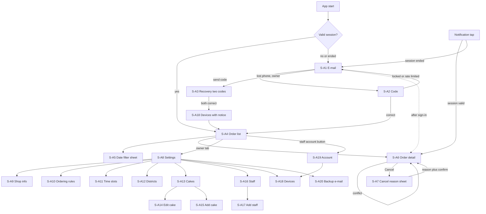

# Admin Orders UI, part 1: Overview, research, flows, screen inventory (sections 2 to 4)

Part of the split UI specification; index: [admin-orders-ui.md](../admin-orders-ui.md). [v1.0 | 2026-10-31]

## 2. Overview

Scope: the Admin app (owner and staff) on iOS and Android. It is a separate app from the Customer app (PRD D-1), built for both platforms at once (D-2), with the same visual language and the tokens and components of [design-system.md](../design-system.md) (v1.5 adds part 7 for the admin). One specification covers both platforms; differences are in part 7 of this document. Phones only (no tablet layout, PRD non-goals). The minimum versions are fixed elsewhere (ADR-0005: iOS 17, Android 8.0); iOS 26 gets Liquid Glass, iOS 17 to 25 and Android 8.0 to 11 use the fallbacks of design-system part 5.

Global rules:

- All text is Vietnamese, referenced by key (`A_*`), text in parts 8 and 9. Money is whole dong with thousand separators (for example 130 000 with a thin non-breaking space, then "đ"). Dates are `dd/MM` (with year when not the current year) and times `HH:mm`, in Vietnam time (UTC+7) whatever the device time zone.
- No payment word, payment status or payment action appears (PRD non-goal). No screen edits an order's content or deletes an order (BR-1).
- Customer data (name, phone, address, note) appears only on S-A4 (name), S-A6 and the notification target. It is never in notification text, never cached after sign-out, and the order list and detail are not shown from a cache when offline (BR-15, AC-22, AC-52).
- Owner-only rights are hidden in the app and refused by the server (FR-5, FR-21). Hiding is convenience; the app also shows a message if the server refuses (`A_ERR_FORBIDDEN`).
- A form saves all fields or nothing (FR-28). Server answers are authoritative: client checks only save a round trip.
- Screen IDs use the prefix `S-A` to stay apart from the Customer app screens (`S-1` to `S-9`). IDs are stable.
- Sample data is fake only (owner "Chu Mau", staff "Nhan Vien A", codes like BT-AAAAAA, e-mail on example.com, phones +84 900 000 0xx).

Roles: Owner sees two tabs (Orders, Settings). Staff see the order area only, with no tab bar; an account button in the order list header opens S-A19 (own devices, sign out) (AC-32, BR-1).

## 3. Research summary

| Claim | Source (URL) | Read on | Confidence |
| ----- | ------------ | ------- | ---------- |
| Standard SwiftUI `TabView` built with Xcode 26 takes the Liquid Glass tab bar automatically; `.tabBarMinimizeBehavior(.onScrollDown)` collapses it while scrolling (not used here: the bar stays visible, two tabs only) | https://www.donnywals.com/exploring-tab-bars-on-ios-26-with-liquid-glass/ ; https://www.createwithswift.com/making-the-tab-bar-collapse-while-scrolling/ | 2026-10-31 | Medium (secondary) |
| iOS 26 toolbars use Liquid Glass; groups are separated with `ToolbarSpacer` | https://www.tothenew.com/blog/?p=74193 | 2026-10-31 | Low (secondary) |
| `glassEffect`, `GlassEffectContainer`, glass for navigation and action layer, not content | See [place-order-ui research](../place-order-ui/01-overview-research-flow.md) section 2 | 2026-10-25 | Medium |
| Material 3 Expressive in Compose: `HorizontalFloatingToolbar` and `VerticalFloatingToolbar` carry `@ExperimentalMaterial3ExpressiveApi`; no official guidance found on replacing `NavigationBar` with a floating toolbar. Decision: stable `NavigationBar` | https://composables.com/jetpack-compose/androidx.compose.material3/material3/components/HorizontalFloatingToolbar.md | 2026-10-31 | Medium |
| One-time code field: iOS e-mail code autofill is inconsistent (10 to 15 s delay) and iOS 26 may paste the whole code into the first of several boxes; so `OtpField` is one hidden text input with six display cells, content type one-time code, and paste fills the cells | https://developer.apple.com/forums/thread/807907 ; https://www.twilio.com/en-us/blog/developers/best-practices/best-practices-for-otp-input-forms-in-ios | 2026-10-31 | Medium |
| Android has no SMS-based retrieval for e-mail codes; the person reads the e-mail and types or pastes the code (SMS Retriever is not applicable) | Search found no source; reasoning from the SMS-only scope of the API | 2026-10-31 | Unverified |
| Photo selection without a storage permission: iOS `PHPicker` (`PhotosPicker`), Android Photo Picker | Apple and Android documentation (not opened in this session) | 2026-10-31 | Unverified |
| Android 13 and later require the runtime permission for notifications; Android 8.0 and later need a notification channel | Android documentation (not opened in this session) | 2026-10-31 | Unverified |

Decisions that follow: native tab bar and native sheets, dialogs, switches, date and time pickers on both platforms; glass only on the navigation and action layer; no custom floating pill (design-system 7.3); pull-to-refresh and list paging are native; the photo picker is used so the app asks for no photo permission.

## 4. User flows

Error branches: network or server errors on any screen show the `StateView` or `InlineMessage` of part 7 (shared patterns) with retry; a refused session (401) from any screen clears local data and goes to S-A1 with `A_SESSION_ENDED`; a refused right (403) shows `A_ERR_FORBIDDEN` and returns to the order list.

## 5. Screen inventory

| ID | Name | Type | Role | Purpose | FRs |
| -- | ---- | ---- | ---- | ------- | --- |
| S-A1 | Sign in: e-mail | Screen | All | Enter e-mail, request code | FR-1, FR-3, FR-6 |
| S-A2 | Sign in: code | Screen | All | Enter 6-digit code, resend, change e-mail | FR-2, FR-3, FR-6 |
| S-A3 | Recovery sign-in | Screen | Owner | Two codes, one per mailbox | FR-43 |
| S-A4 | Order list | Screen (tab 1) | All | List, filters, search, New count, notification hint | FR-8 to FR-13, FR-34, FR-41 |
| S-A5 | Date filter | Sheet | All | Today, tomorrow, one date, range | FR-10 |
| S-A6 | Order detail | Screen | All | Full order, call and Zalo, status actions, history | FR-14 to FR-20 |
| S-A7 | Cancel order | Sheet | All | Choose reason, confirm naming the code | FR-18 |
| S-A8 | Settings | Screen (tab 2) | Owner | Entry to all owner areas, sign out | FR-21, FR-42 |
| S-A9 | Shop information | Screen | Owner | Name, greeting, phone, Zalo | FR-26, FR-28 |
| S-A10 | Ordering rules | Screen | Owner | Daily limit, lead days, minimum cakes | FR-24, FR-40, FR-28 |
| S-A11 | Time slots | Screen with edit sheet | Owner | Add, edit, activate or deactivate | FR-25, FR-28 |
| S-A12 | Districts and fees | Screen with edit sheet | Owner | Add, edit, activate or deactivate | FR-23, FR-28 |
| S-A13 | Cakes | Screen | Owner | List, count n/12, hide state | FR-22, FR-38, FR-39 |
| S-A14 | Edit cake | Screen | Owner | Name, description, price, active, remove | FR-22, FR-39 |
| S-A15 | Add cake | Screen | Owner | Name, description, price, image upload | FR-38 |
| S-A16 | Staff | Screen | Owner | Accounts, count n/30, deactivate or reactivate | FR-27 |
| S-A17 | Add staff | Screen | Owner | Name and e-mail | FR-27 |
| S-A18 | Devices | Screen | All (scope differs) | List and revoke | FR-37, FR-43 |
| S-A19 | Account | Screen | Staff | Own name, e-mail, own devices, sign out | FR-4, FR-37 |
| S-A20 | Backup e-mail | Screen | Owner | Register or change with a confirmation code | FR-42 |

20 screens (S-A5 and S-A7 are sheets; the slot, district and staff-detail edits are sheets inside their parent screens). Four confirmation dialogs (complete order, remove cake, deactivate staff, revoke device) and the daily-limit warning dialog are specified in their parent screens.
