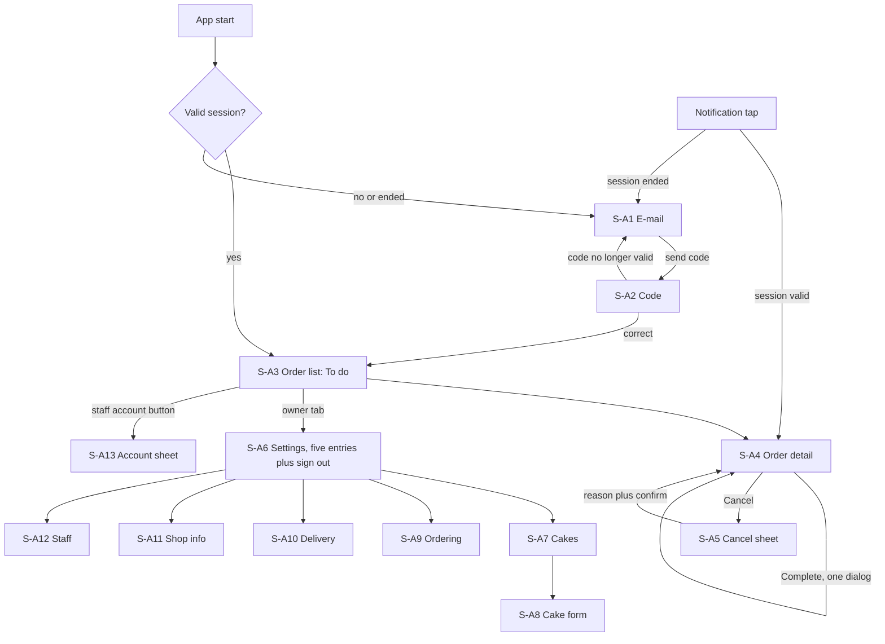
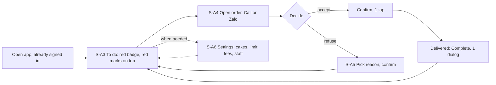
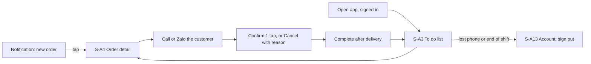

# Admin Orders UI, part 1: Overview, research, flows, screen inventory (sections 2 to 5)

Part of the split UI specification; index: [admin-orders-ui.md](../admin-orders-ui.md). [v1.1 | 2026-10-31]

## 2. Overview

Scope: the Admin app (owner and staff) on iOS and Android. It is a separate app from the Customer app (PRD D-1), built for both platforms at once (D-2), with the same visual language and the tokens and components of [design-system.md](../design-system.md) (part 7 for the admin). One specification covers both platforms; differences are in part 7 of this document. Phones only. Minimum versions are fixed elsewhere (ADR-0005: iOS 17, Android 8.0); iOS 26 gets Liquid Glass, iOS 17 to 25 and Android 8.0 to 11 use the fallbacks of design-system part 5. [v1.1 | 2026-10-31]

Global rules:

- All text is Vietnamese, referenced by key (`A_*`), text in parts 8 and 9. Money is whole dong with thousand separators (130 000 with a thin non-breaking space, then "đ"). Dates are `dd/MM` (with year when not the current year) and times `HH:mm`, in Vietnam time (UTC+7) whatever the device time zone.
- No payment word, status or action appears. No screen edits an order's content or deletes an order (BR-1).
- Customer data appears only on S-A3 (name), S-A4 and the notification target. It is never in notification text, never cached after sign-out, and list and detail are not shown from a cache when offline (BR-7, AC-20, AC-44, AC-45). [v1.1 | 2026-10-31]
- Owner-only rights are hidden in the app and refused by the server (FR-5, FR-20); the app shows `A_ERR_FORBIDDEN` if refused. A form saves all fields or nothing (BR-11).
- Fewer screens, fewer steps (owner directive, PRD G-2): no menu has a second level; Confirm is one tap; each setting area is one screen; no step is added for notifications, filters or recovery. [v1.1 | 2026-10-31]
- Screen IDs use the prefix `S-A`. They were renumbered in v1.1 because screens were merged or removed; the mapping to the v1.0 ids is in section 5.1. Sample data is fake only (owner "Chu Mau", staff "Nhan Vien A", codes BT-AAAAAA, e-mail on example.com, phones +84 900 000 0xx).

Roles: Owner sees two tabs (Orders, Settings). Staff see the order area only, with no tab bar; an account button in the order list header opens S-A13 (sign out buttons) (FR-3, BR-1). [v1.1 | 2026-10-31]

## 3. Research summary

| Claim | Source (URL) | Read on | Confidence |
| ----- | ------------ | ------- | ---------- |
| Standard SwiftUI `TabView` built with Xcode 26 takes the Liquid Glass tab bar automatically; a tab item can carry a badge (`.badge`) | https://www.donnywals.com/exploring-tab-bars-on-ios-26-with-liquid-glass/ | 2026-10-31 | Medium (secondary) |
| iOS 26 toolbars use Liquid Glass; `glassEffect`, `GlassEffectContainer`: glass for navigation and action layer, not content | https://www.tothenew.com/blog/?p=74193 ; [place-order-ui research](../place-order-ui/01-overview-research-flow.md) | 2026-10-31 | Low to medium |
| Material 3 Expressive floating toolbars are `@ExperimentalMaterial3ExpressiveApi`; decision: stable `NavigationBar`, with `Badge` for the count | https://composables.com/jetpack-compose/androidx.compose.material3/material3/components/HorizontalFloatingToolbar.md | 2026-10-31 | Medium |
| One-time code field: iOS e-mail code autofill is inconsistent and iOS 26 may paste the whole code into the first box; so `OtpField` is one hidden input with six display cells | https://developer.apple.com/forums/thread/807907 ; https://www.twilio.com/en-us/blog/developers/best-practices/best-practices-for-otp-input-forms-in-ios | 2026-10-31 | Medium |
| Android has no SMS-based retrieval for e-mail codes; the person types or pastes the code | Reasoning from the SMS-only scope of the API | 2026-10-31 | Unverified |
| Photo selection without a storage permission: iOS `PhotosPicker`, Android Photo Picker | Platform documentation (not opened in this session) | 2026-10-31 | Unverified |
| Android 13 and later need the runtime notification permission; Android 8.0 and later need a notification channel | Platform documentation (not opened in this session) | 2026-10-31 | Unverified |

Decisions that follow: native tab bar, sheets, dialogs, menus, switches and pickers on both platforms; glass only on the navigation and action layer; pull-to-refresh and paging are native; the photo picker needs no permission; the date filter is a native menu plus the native date picker, not a custom sheet. [v1.1 | 2026-10-31]

## 4. User flows

Error branches: network or server errors show the `StateView` or `InlineMessage` of part 7 with retry; a refused session (401) clears local data and goes to S-A1 with `A_SESSION_ENDED`; a refused right (403) shows `A_ERR_FORBIDDEN` and returns to the order list. [v1.1 | 2026-10-31]

### 4.1 How a day works [v1.1 | 2026-10-31]

Owner (phone, morning to evening):

Staff (phone, shift):

## 5. Screen inventory

| ID | Name | Type | Role | Purpose | FRs |
| -- | ---- | ---- | ---- | ------- | --- |
| S-A1 | Sign in: e-mail | Screen | All | Enter e-mail, request code | FR-1, FR-6 |
| S-A2 | Sign in: code | Screen | All | Enter 6-digit code, resend, change e-mail | FR-1, FR-2, FR-6 |
| S-A3 | Order list "To do" | Screen (tab 1) | All | One list, status and date filter, search, red badge and red marks | FR-9 to FR-13 |
| S-A4 | Order detail | Screen | All | Full order, call and Zalo, status actions, last change | FR-14 to FR-19 |
| S-A5 | Cancel order | Sheet | All | Choose one of four reasons, confirm naming the code | FR-18 |
| S-A6 | Settings | Screen (tab 2) | Owner | Five entries, sign out all other phones, sign out | FR-20, FR-2, FR-4 |
| S-A7 | Cakes | Screen | Owner | List, count n/12, hide state | FR-21 |
| S-A8 | Cake form | Screen (add and edit) | Owner | Name, description, price, image (add), hide, remove | FR-21 |
| S-A9 | Ordering | Screen | Owner | Daily limit, days of notice, minimum cakes | FR-22 |
| S-A10 | Delivery | Screen with edit sheets | Owner | Districts and fees, time slots | FR-23 |
| S-A11 | Shop info | Screen | Owner | Name, greeting, phone, Zalo | FR-24 |
| S-A12 | Staff | Screen with add and detail sheets | Owner | Accounts, count n/30, add, switch off or on | FR-5 |
| S-A13 | Account | Sheet | Staff | Name, e-mail, sign out all other phones, sign out | FR-2, FR-4 |

13 entries (S-A5 and S-A13 are sheets; slot, district, staff-add and staff-detail edits are sheets inside their parent). Before: 20. Confirmation dialogs: complete order, remove cake, switch off staff, sign out all other phones, sign out, daily-limit warning. [v1.1 | 2026-10-31]

### 5.1 Mapping to v1.0 ids [v1.1 | 2026-10-31]

| v1.0 | v1.1 | Note |
| ---- | ---- | ---- |
| S-A1, S-A2 | S-A1, S-A2 | Recovery link and lock text removed |
| S-A3 Recovery | removed | PRD P-1 |
| S-A4 | S-A3 | One list, badge, red marks |
| S-A5 Date sheet | removed | Native menu in S-A3 (single date) |
| S-A6, S-A7 | S-A4, S-A5 | History removed, four reasons |
| S-A8 | S-A6 | Five entries |
| S-A9 | S-A11 | |
| S-A10 | S-A9 | |
| S-A11, S-A12 | S-A10 | Slots and districts on one screen |
| S-A13 | S-A7 | |
| S-A14, S-A15 | S-A8 | Add and edit share one form |
| S-A16, S-A17 | S-A12 | Add staff is a sheet |
| S-A18 Devices, S-A20 Backup | removed | PRD P-2, P-1 |
| S-A19 | S-A13 | Now a sheet |
