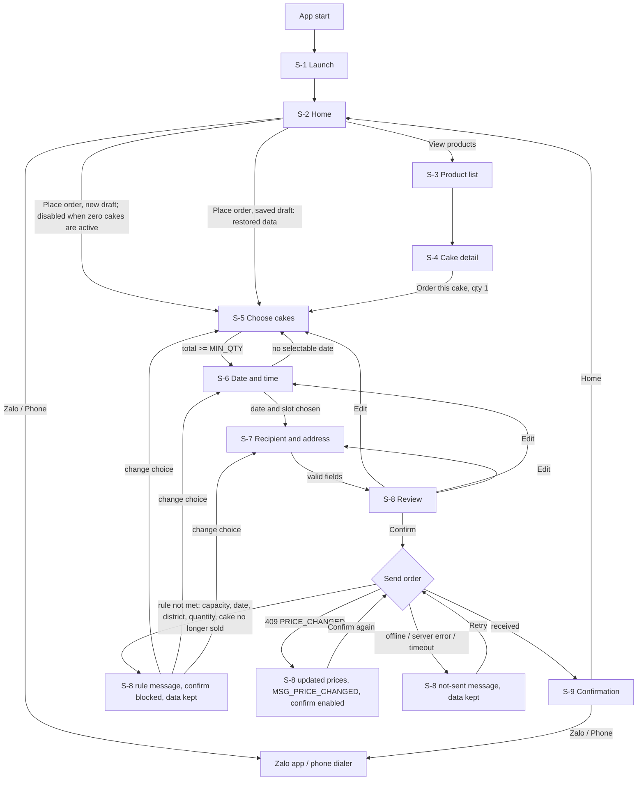

# Place Order: UI Specification

| Field        | Value                                                                 |
| ------------ | --------------------------------------------------------------------- |
| Version      | 1.2                                                                   |
| Last updated | 2026-10-26                                                            |
| Status       | Draft                                                                 |
| Owner        | canvas-ui                                                             |
| Based on     | product/place-order.md v1.4 (Approved) [v1.2 | 2026-10-26]             |
| Related      | design/design-system.md; pipeline/place-order/00-request.md; mockups (reference only, private link in the PRD) |

## 1. Overview

Scope: the Customer app on iOS and Android, from launch to the confirmation screen. The Admin app (staff and owner) is out of scope (PRD non-goals). One specification covers both platforms; differences are in section 6. Visual direction: iOS uses Liquid Glass, Android uses Material 3 Expressive. Component and token names come from `design-system.md`.

Global rules that apply to every screen:

- All text is Vietnamese and referenced by key (FR-14). Text lives in section 8.
- Money is shown as whole dong (BR-5). Format and rules are in the design system (principle 4).
- No payment information, payment method, payment hint or payment word appears anywhere (FR-19, AC-27). Reviewers shall check every key in section 8.
- Launch data (shop name, greeting, contacts, prices, districts, slots) is shown exactly as received. No "sample", "demo" or "test" marker is shown (AC-29).
- Dates and times are shown in Vietnam time (UTC+7), whatever the device time zone (A-1).
- No screen offers tracking, status or cancellation (non-goals).

Placeholders in text: `{n}`, `{min}`, `{max}`, `{days}`, `{amount}`, `{date}`, `{name}`, `{code}`, `{start}`, `{end}`. Values for `{min}` (MIN_QTY), `{days}` (LEAD_DAYS) and `{max}` (MAX_DAYS_AHEAD) come from configuration, never typed into copy.

## 2. Research summary

| Claim | Source (URL) | Read on | Confidence |
| ----- | ------------ | ------- | ---------- |
| iOS 26 Liquid Glass in SwiftUI: `glassEffect(_:in:)` with `GlassEffectContainer` for grouped glass shapes; iOS 26 and later | https://developer.apple.com/documentation/swiftui/glasseffectcontainer.md | 2026-10-25 | High |
| Glass button styles (`.glass`, `.glassProminent`), `.interactive()`, `glassEffectID` morphing; glass belongs on the navigation and action layer, not on content | https://levelup.gitconnected.com/swiftui-liquid-glass-from-basic-to-a-little-advance-cdef4e4c5b90 ; https://medium.com/@veersr9/ios-26-liquid-glass-in-swiftui-a-practical-reference-demo-app-liquidglassreference-69b8d46dc055 | 2026-10-25 | Medium (secondary) |
| Fallback before Liquid Glass: SwiftUI `Material` backgrounds | Apple SwiftUI `Material` documentation | 2026-10-25 | Unverified (not read) |
| Material 3 Expressive in Compose: `ButtonGroup`, `FloatingToolbar`, `FlexibleBottomAppBar`, `LoadingIndicator`, `MaterialExpressiveTheme`, large flexible top app bar; some APIs experimental in 1.4.0 alpha builds | https://proandroiddev.com/material-3-expressive-design-a-new-era-9ea77959a262 ; https://proandroiddev.com/material-3-expressive-design-a-new-era-part-2-6a93483c98b0 | 2026-10-25 | Medium (third-party) |
| Official Material 3 Expressive guidance (stable status, motion scheme) | https://m3.material.io/blog/building-with-m3-expressive | 2026-10-25 | Unverified (page unreadable) |

[v1.1 | 2026-10-25] Fixed by the owner: minimum iOS 17 and Android 8.0 (API 26). Real glass or blur exists only on iOS 26 and later and Android 12 (API 31) and later (ADR-0012, Accepted). Both fallbacks are specified in section 6. Zalo and phone link behaviour: ADR-0015.

Decisions that follow: glass is used for cards and the floating bar only; all long text sits on cards with contrast kept at 4.5:1; every glass surface has the `material.fallback` rendering. The system date pickers are not used for the date step because capacity-based unavailability must be shown per date (unverified that native pickers cannot do this; the custom `DateGrid` is the specified behaviour either way).

## 3. User Flow



Entry points: app start (S-1); S-4 starts the flow with that cake at quantity 1 (FR-4); S-2 starts the flow with no cake chosen, or, [v1.1 | 2026-10-25] when a saved draft exists (kept up to 24 hours, also after the system ended the app; ADR-0011), with the restored draft data, with no prompt. Entry from S-4 always starts a new draft with that cake at quantity 1 and replaces any saved draft. Exit points: S-9 to S-2; leaving the flow from step 1 with the back control returns to the previous screen and discards flow data. Flow data is kept for the whole time the customer moves between steps (FR-15).

Step count after "Place order": 4 steps (cakes, date and time, recipient, review) plus the confirmation, within G-1 (at most 6).

## 4. Screen Inventory

| ID | Name | App | Purpose | FRs covered |
| -- | ---- | --- | ------- | ----------- |
| S-1 | Launch | Customer | Logo-only screen on start | FR-1, FR-14 |
| S-2 | Home | Customer | Shop name, greeting, contact, entry to products and order | FR-2, FR-14, FR-19 |
| S-3 | Product list | Customer | Every active cake (1 to 4) with picture, name, description, price; Error only at zero [v1.2 | 2026-10-26] | FR-3, FR-14 |
| S-4 | Cake detail | Customer | One cake and the button that starts an order | FR-3, FR-4, FR-14 |
| S-5 | Order step 1: Choose cakes | Customer | Quantity per active cake (1 to 4 rows) [v1.2 | 2026-10-26] | FR-5, FR-4, FR-10, FR-14, FR-15 |
| S-6 | Order step 2: Date and time | Customer | Receiving date and time slot | FR-6, FR-7, FR-10, FR-14, FR-15 |
| S-7 | Order step 3: Recipient and address | Customer | Name, phone, address, district, note | FR-8, FR-13, FR-18, FR-14, FR-15 |
| S-8 | Order step 4: Review | Customer | Full order review, privacy sentence, confirm, rule and send errors | FR-9, FR-10, FR-16, FR-17, FR-18, FR-15, FR-14 |
| S-9 | Confirmation | Customer | Order code, received message, contact buttons | FR-11, FR-12, FR-14, FR-19 |

Error and offline states have no screens of their own. They are states of the screens above and use the shared patterns in section 5.10.

## 5. Screen Specs

Common layout (all screens): `AppBackground` behind everything. `TopBar` at the top (S-1 and S-9 have none). Content scrolls vertically in `GlassCard` groups with `space.lg` between groups and `space.screenMargin` side margins. `BottomActionBar` floats above the safe area on S-2, S-4, S-5, S-6, S-7, S-8 and S-9; content has bottom padding equal to the bar height so nothing is hidden. In S-5 to S-8 the `TopBar` shows the back control and the `StepIndicator` sits directly below it.

### 5.1 S-1 Launch

- Purpose: show the brand while the app starts (FR-1).
- Entry/Exit: entry on app start. Exit to S-2 automatically after the start work finishes, shown for at least 1.0 s and at most 2.0 s (proposed values, adjustable). Nothing is tappable.
- Layout: `AppBackground`; `LogoMark` (Large) centred, no text, no button, no loading text.
- Data shown: the logo only (FR-1). [v1.2 | 2026-10-26] The logo is a bundled app asset (iOS asset catalog image set, Android drawable), shown before any network call; the API has no logo field. Until the owner supplies the artwork, a neutral placeholder mark with no text is bundled (section 11). `LogoMark` on S-2 uses the same asset.
- Actions: none.
- States:

| State | Behaviour |
| ----- | --------- |
| Default | Logo centred with a gentle scale-in (`motion.duration.long`). |
| Loading | Same as Default. Any start work happens behind the logo; no spinner is shown. |
| Empty | N/A: the screen shows no data. |
| Error | N/A: start never blocks here; data load failures are shown on S-2 (section 5.2). |
| Disabled | N/A: no controls. |
| Success | N/A: exit to S-2 is the only outcome. |

- Validation: none.
- Accessibility: the logo has the label `LOGO_LABEL`; the screen is announced once.

### 5.2 S-2 Home

- Purpose: entry point (FR-2).
- Entry/Exit: from S-1 and from S-9. Exits to S-3 (View products), S-5 (Place order), the Zalo app or the phone dialer.
- Layout, top to bottom: `LogoMark` (Small) with shop name in `type.title.large`; greeting in `type.body` inside a `GlassCard`; a row of two `ContactButton` (Zalo, Phone; [v1.1 | 2026-10-25] the Zalo button shows a generic chat icon plus the word "Zalo", never the Zalo brand mark, ADR-0015); `BottomActionBar` with `PrimaryButton` "Place order" above `SecondaryButton` "View products".
- Data shown: shop name, short greeting (both from shop data, no marker).
- Actions:

| Action | Result | FR |
| ------ | ------ | -- |
| Tap Zalo | Opens Zalo with the shop contact (AC-3). If it cannot open, `Toast` with `ERR_OPEN_ZALO`. | FR-2 |
| Tap Phone | Opens the dialer with the shop number (AC-3). If it cannot open, `Toast` with `ERR_OPEN_PHONE`. | FR-2 |
| Tap View products | Go to S-3. | FR-2, FR-3 |
| Tap Place order | [v1.1 | 2026-10-25] If a saved draft exists, go to S-5 with the restored data and no prompt. Otherwise go to S-5 with no cake chosen. [v1.2 | 2026-10-26] The button is disabled while the known active-cake count is zero (below), so no flow starts (AC-33). | FR-2, FR-15 |

- States:

| State | Behaviour |
| ----- | --------- |
| Default | All six elements visible. |
| Loading | Only when there is no cache: skeleton for name and greeting (`StateView` Loading); contact and order buttons visible but disabled. |
| Empty | N/A: shop information is required data; a missing value is treated as Error. |
| Error | [v1.1 | 2026-10-25] Shown only when shop information could not be loaded and there is no cache (cache is valid up to 7 days, ADR-0011): `StateView` Error with `HOME_ERR` and `COMMON_RETRY`; all four action buttons disabled. When a cache exists, the cached data is shown at once (Default), refreshed in the background, and a failed refresh is silent. |
| Disabled | Contact buttons are disabled while Loading and Error. The "Place order" and "View products" buttons follow the same rule. |
| No cakes (sub-state of Default) [v1.2 | 2026-10-26] | Shown when the latest product answer has zero active cakes (BR-13, AC-33). Shop name, greeting and contact buttons work as in Default. `PrimaryButton` "Place order" is disabled (dimmed, still announced with its text and state "dimmed"). An `InlineMessage` (Info) `HOME_NO_CAKES` sits directly above the bottom bar content (inside the scroll area, under the greeting card). "View products" stays enabled and opens S-3, which shows its zero-cake Error state. The state ends as soon as a later answer has at least one active cake (refresh on screen appear and on returning to the foreground; no app reinstall, AC-33): the message disappears and the button is enabled. With no product answer yet (first launch, still loading) Place order is enabled; S-5 then handles zero (section 5.5). |
| Success | N/A: no submit on this screen. |

- Validation: none.

### 5.3 S-3 Product list

- Purpose: show every active cake (FR-3, BR-13). [v1.2 | 2026-10-26]
- Entry/Exit: from S-2. Exit to S-4 (tap a card) or back to S-2.
- Layout: `TopBar` (large title `PRODUCTS_TITLE`, back); one `ProductCard` per active cake in a single-column vertical list, in the order the API returns. [v1.2 | 2026-10-26] 1, 2, 3 and 4 cards are all normal and use the same card size and spacing (`space.lg`); the list is simply shorter. There is no placeholder, empty slot, "coming soon" card, gap or reserved space for a hidden cake, and no text saying fewer cakes are shown. The list never needs to scroll for 1 to 3 cards on a typical phone; with 4 cards or large text it scrolls. No bottom bar (ordering starts from the detail view or from S-2, FR-4).
- Data shown per card: picture, name, short description, current price. Exactly the active cakes returned (AC-4, AC-32). [v1.2 | 2026-10-26]
- Actions: tap a card to open S-4 (FR-3, FR-4).
- Wireframes [v1.2 | 2026-10-26]: the structure does not change with rotation (single column, cards fill the width inside `space.screenMargin`; in landscape the cards are wider and the list scrolls), so the wireframes are by card count at compact width, as the design process allows. `[card]` = picture, name, description, price.

```
 1 cake          2 cakes         3 cakes         4 cakes         0 cakes (Error)
+-----------+   +-----------+   +-----------+   +-----------+   +-----------+
| < Sản phẩm|   | < Sản phẩm|   | < Sản phẩm|   | < Sản phẩm|   | < Sản phẩm|
| [card A ] |   | [card A ] |   | [card A ] |   | [card A ] |   |           |
|           |   | [card B ] |   | [card B ] |   | [card B ] |   |   (icon)  |
|  (blank   |   |           |   | [card C ] |   | [card C ] |   | PRODUCTS_ |
|  background)  |  (blank)  |   |           |   | [card D ] |   |   EMPTY   |
|           |   |           |   |  (blank)  |   | (scrolls) |   | [Thử lại] |
+-----------+   +-----------+   +-----------+   +-----------+   +-----------+
```

Landscape: the same single column with wider cards; with 1 or 2 cards the content stays at the top and the rest is background; the Error state is centred. No two-column variant is used, so a count of 3 never leaves an orphan cell.
- States:

| State | Behaviour |
| ----- | --------- |
| Default | One `ProductCard` per active cake (1 to 4). |
| Loading | [v1.1 | 2026-10-25] Only when there is no cache: four skeleton cards (`StateView` Loading). With a cache, cached cards show at once. [v1.2 | 2026-10-26] The skeleton count is a visual placeholder only and disappears when the answer arrives; it never implies four cakes. |
| Empty | [v1.2 | 2026-10-26] Zero active cakes (a successful answer with an empty list): `StateView` Error layout with an icon, `PRODUCTS_EMPTY` (Vietnamese text in section 8) and the action `COMMON_RETRY` (reloads the list; the shop may have made a cake active again, AC-33). No list, no placeholder cards. This is the only count-based Error (BR-13). A cached non-empty list is replaced by the zero answer when a fresh answer says zero. |
| Error | [v1.1 | 2026-10-25] Only when there is no cache: `StateView` Error with `PRODUCTS_ERR` and `COMMON_RETRY` (load failure, different from the zero-cake state). With a cache, a failed refresh is silent. A single failed picture shows a placeholder icon in the image frame (label `PRODUCT_IMG_FAILED`) while the card stays tappable. |
| Disabled | N/A: cards are always tappable once shown. |
| Success | N/A: no submit. |

- Validation: none.

### 5.4 S-4 Cake detail

- Purpose: show one cake and start an order with it (FR-4).
- Entry/Exit: from S-3. Exit to S-5 (order button) or back to S-3.
- Cake no longer available [v1.2 | 2026-10-26]: if the shop hides this cake while S-4 is open, the screen learns it on its background refresh, on returning to the foreground, or when `DETAIL_BTN_ORDER` is tapped (the tap rechecks the active list first). The screen then shows the Gone state below instead of starting an order.
- Layout: `TopBar` (inline title is the cake name, back); large picture (`radius.image`); in a `GlassCard`: name (`type.title.large`), description (`type.body`), price (`type.body.strong`, with `PRICE_EACH`); `BottomActionBar` with `PrimaryButton` `DETAIL_BTN_ORDER`.
- Data shown: picture, name, description, current price. No other attributes (none are in the PRD).
- Actions: tap `DETAIL_BTN_ORDER` opens S-5 with this cake at quantity 1, other cakes at 0 (AC-5).
- States:

| State | Behaviour |
| ----- | --------- |
| Default | As above. |
| Loading | [v1.2 | 2026-10-26] N/A: S-4 is opened only from a card on S-3 (or in the same session), so the cake data is already in hand and shown at once. S-4 is never restored after the system ends the app (ADR-0011 restores only the draft, to S-5; the app then starts at S-1), so there is no restore path to S-4. The earlier skeleton and "after a restore" wording was wrong and is removed (QA DOC-9). |
| Empty | N/A: a detail is reached only from an existing card. |
| Gone [v1.2 | 2026-10-26] | The cake is no longer in the active list. The picture and text stay visible but dimmed; an `InlineMessage` (Info) `DETAIL_GONE` is shown above the card; `BottomActionBar` shows `SecondaryButton` `DETAIL_GONE_ACTION` that returns to S-3 (the refreshed list, which may now have fewer cards or the zero-cake Error state); the order button is not shown. Nothing was added to a draft. |
| Error | Picture failed: placeholder and `PRODUCT_IMG_FAILED`, button still enabled. [v1.2 | 2026-10-26] A failed background refresh is silent (the cake data came from the list); no data-failed Error exists on this screen. |
| Disabled | [v1.2 | 2026-10-26] N/A: the order button is enabled in Default and replaced by the Gone action in Gone. |
| Success | N/A: no submit. |

- Validation: none.

### 5.5 S-5 Order step 1: Choose cakes

- Purpose: choose a quantity for each active cake (FR-5, BR-13). [v1.2 | 2026-10-26]
- Entry/Exit: from S-2 (no cake, or the restored draft with its quantities when a saved draft exists, [v1.1 | 2026-10-25] no prompt), S-4 (new draft, that cake at 1), or from S-6 and S-8 via back or Edit. Exit to S-6, or back to the previous screen.
- Layout: `TopBar` (`FLOW_TITLE`, back); `StepIndicator` ("Step 1 of 4", `STEP_LABEL` and `STEP1`); one `GlassCard` containing one row per active cake (1 to 4 rows, [v1.2 | 2026-10-26] no blank or disabled row for a hidden cake; the card simply gets shorter): thumbnail, name, price (`type.body.strong`), `QuantityStepper`; a summary `GlassCard` with `QTY_TOTAL` and `QTY_SUBTOTAL`; `InlineMessage` (Info) with `QTY_MIN_HINT` when total is below MIN_QTY; `BottomActionBar` with `PrimaryButton` `COMMON_NEXT`.
- Data shown: for each cake name, price, quantity; total number of cakes; cakes subtotal (sum of price x quantity, BR-5).
- Actions:

| Action | Result | FR |
| ------ | ------ | -- |
| Plus / minus on a stepper | Quantity changes by 1; minimum 0, [v1.1 | 2026-10-25] maximum 99 per cake. At 99 the plus button is disabled with no message. Totals update. | FR-5 |
| Tap `COMMON_NEXT` | Go to S-6. Enabled only when total is at least MIN_QTY. | FR-5, FR-10 |
| Back | Return to the previous screen (see section 3). | FR-15 |

- States:

| State | Behaviour |
| ----- | --------- |
| Default | Quantities as chosen; the hint `QTY_MIN_HINT` is visible while the total is below MIN_QTY. |
| Loading | Product names and prices not yet available: skeleton rows, steppers and Next disabled. |
| Empty | Total is 0 (nothing chosen): all steppers at 0, the hint is shown, Next disabled. This is the normal first state from "Place order". [v1.2 | 2026-10-26] Zero active cakes (reached when S-2 had no answer yet or a stale cache): `StateView` Error layout with `PRODUCTS_EMPTY` and `COMMON_RETRY`; no rows, no summary, Next disabled; the draft data is kept. After a retry that finds an active cake the rows appear. |
| Cake removed [v1.2 | 2026-10-26] | A cake in the draft (restored or in progress) is not in the refreshed active list, or S-8 sent the customer back with `ERR_PRODUCT_UNAVAILABLE`: its row is not shown, its quantity is dropped from the totals, an `InlineMessage` (Info) `ORDER_CAKE_REMOVED` (with the cake name) appears above the rows until the customer changes a quantity or leaves the step; quantities of the other cakes and all other flow data (date, slot, recipient) are kept. If the date no longer has room for the smaller total nothing changes, since a smaller order only needs less room; if the total falls below MIN_QTY the normal hint shows. |
| Error | [v1.1 | 2026-10-25] Products could not be loaded and there is no cache: `StateView` Error with `PRODUCTS_ERR` and `COMMON_RETRY`. With a cache, cached prices are shown and a failed refresh is silent (the server price check on confirm is the final guard, ADR-0010). |
| Disabled | Next is disabled while the total is below MIN_QTY (the hint explains why, AC-13); minus is disabled at 0; [v1.1 | 2026-10-25] plus is disabled at 99 for that cake, silently (input-safety bound, ADR-0009; the limit is configuration `max_qty_per_cake`, not shown). |
| Success | N/A: no submit. |

- Validation: rule MIN_QTY (BR-4) with message `ERR_MIN_QTY`, shown as the persistent hint `QTY_MIN_HINT` here and as a blocking message on S-8 (FR-10, AC-13). [v1.1 | 2026-10-25] No business upper limit beyond the remaining amount of the date (BR-4); the stepper stops at 99 per cake as an input bound (ADR-0009), without a message.
- Note: when the customer changes quantities after choosing a date, S-6 re-checks the chosen date (section 5.6).

### 5.6 S-6 Order step 2: Date and time

- Purpose: choose the receiving date and one time slot (FR-6, FR-7).
- Entry/Exit: from S-5, or from S-7 and S-8 via back or Edit. Exit to S-7, or back to S-5.
- Layout: `TopBar`, `StepIndicator` (`STEP2`); `GlassCard` with title `DATE_TITLE`, range hint `DATE_HINT_RANGE`, and `DateGrid`; a legend line `DATE_LEGEND_FULL`; `GlassCard` with title `TIME_TITLE` and a vertical list of `SlotChip`; `InlineMessage` `NEXT_HINT_DATE_TIME` while one of the two is missing; `BottomActionBar` with `PrimaryButton` `COMMON_NEXT`.
- Data shown: months from today's month to the month of today + MAX_DAYS_AHEAD; the fixed list of time slots (`SLOT_LABEL`), identical for every date (AC-10).
- Date availability (display rules from the PRD, no new rules):
  - Available: today + LEAD_DAYS up to today + MAX_DAYS_AHEAD (inclusive) and remaining amount at least the order's total number of cakes (BR-1, BR-2, BR-8; AC-7, AC-8, AC-24).
  - Unavailable and visibly marked: dates before the lead time, after the horizon, and dates without enough remaining amount. Dates in the lead window and past the horizon use the dimmed style; full dates use the dimmed style with a diagonal strike. All unavailable dates are not focusable for selection and carry the spoken reasons `DATE_A11Y_*`.
  - The remaining amount number is not shown to the customer (not in any FR).
  - Choosing a slot never changes which dates are available (AC-10).
- Actions:

| Action | Result | FR |
| ------ | ------ | -- |
| Tap an available date | Date selected (single selection); tapping another replaces it. | FR-6 |
| Previous / next month control | Moves the calendar; disabled at the first and last month. | FR-6 |
| Tap a slot | Slot selected (single selection). | FR-7 |
| Tap `COMMON_NEXT` | Go to S-7. Enabled only when a date and a slot are both chosen. | FR-6, FR-7 |
| Back | Return to S-5, nothing lost. | FR-15 |

- States:

| State | Behaviour |
| ----- | --------- |
| Default | Calendar and slots shown; chosen date and slot highlighted with `color.primaryContainer`. |
| Loading | Availability of dates loading: calendar skeleton, slot list skeleton if slots are not yet available, Next disabled. |
| Empty | No date is selectable for this order size: calendar shown with every date unavailable, plus `InlineMessage` `DATE_EMPTY` and a `SecondaryButton` `DATE_EMPTY_ACTION` that returns to S-5. Next disabled. |
| Error | Availability or slots could not be loaded: `StateView` Error with `DATE_ERR` and `COMMON_RETRY`; Next disabled. |
| Disabled | Next is disabled until both date and slot are chosen (hint `NEXT_HINT_DATE_TIME`); unavailable dates are disabled. |
| Success | N/A: no submit. |

- Validation: a date and a slot are required to proceed (the Next button is disabled and the hint is shown, so no error is raised). If the customer returned to S-5, raised the quantity, and the chosen date no longer has enough room, the date selection is cleared, the slot choice is kept, and `InlineMessage` (Error) `DATE_CLEARED` is shown (supports FR-6, FR-10).

### 5.7 S-7 Order step 3: Recipient and address

- Purpose: collect name, phone, delivery address, district, optional note (FR-8, FR-18).
- Entry/Exit: from S-6, or from S-8 via back or Edit. Exit to S-8, or back to S-6.
- Layout: `TopBar`, `StepIndicator` (`STEP3`); `GlassCard` with `TextField` Text `FIELD_NAME`, `TextField` Phone `FIELD_PHONE`, `TextField` Text (multiline, two lines) `FIELD_ADDRESS`, `PickerField` `FIELD_DISTRICT`; a fee line `DISTRICT_FEE` appears under the picker once a district is chosen; `GlassCard` with `TextField` Multiline `FIELD_NOTE` and counter `NOTE_COUNTER`; `BottomActionBar` with `PrimaryButton` `COMMON_NEXT`.
- Data shown: the entered values; the flat fee of the chosen district (AC-11, no free-delivery wording exists); the list of served districts only, so an unserved district cannot be chosen (AC-11).
- Actions:

| Action | Result | FR |
| ------ | ------ | -- |
| Type in a field | Value kept in flow data. Error under the field clears when the field becomes valid. | FR-8, FR-13 |
| Open district picker | A sheet lists served districts, each row shows name and fee (`DISTRICT_FEE` format); tapping a row selects it and closes the sheet. | FR-8 |
| Type in note | Up to 200 characters. A 201st typed or pasted character is not inserted; `ERR_NOTE_MAX` appears next to the field; pasted text is cut at 200 (AC-26). | FR-18 |
| Tap `COMMON_NEXT` | Validates all required fields at once. If any fails, an error appears next to each failing field, focus moves to the first failing field, and the flow does not advance (AC-12). If all pass, go to S-8. | FR-13 |
| Back | Return to S-6, nothing lost. | FR-15 |

- States:

| State | Behaviour |
| ----- | --------- |
| Default | Empty fields on first visit, filled when revisiting. Next is enabled (errors are shown on tap, so the customer sees what to fix). |
| Loading | District list loading: the picker shows a spinner state and is disabled; other fields are usable. Next is enabled but treats district as missing. |
| Empty | District list is empty: picker shows `DISTRICT_EMPTY`, Next stays disabled. |
| Error | District list failed to load: `InlineMessage` `DISTRICT_ERR` with `COMMON_RETRY` next to the picker. Field errors follow the Validation table. |
| Disabled | Next disabled only when the district list is Empty. |
| Success | N/A: no submit; valid input moves on to S-8. |

- Validation:

| Field | Rule | Message key |
| ----- | ---- | ----------- |
| Name | Required | `ERR_NAME_REQUIRED` |
| Phone | Required | `ERR_PHONE_REQUIRED` |
| Phone | [v1.1 | 2026-10-25] Must be a Vietnamese mobile number (ADR-0009): spaces, dots, hyphens and parentheses are ignored; a leading `+84` or `84` is read as `0`; valid when 10 digits, `0` then `3`, `5`, `7`, `8` or `9`. Landlines and foreign numbers are invalid. | `ERR_PHONE_INVALID` |
| Name | [v1.1 | 2026-10-25] At most 100 characters (input limit, no message) | none |
| Address | [v1.1 | 2026-10-25] At most 250 characters (input limit, no message) | none |
| Address | Required | `ERR_ADDRESS_REQUIRED` |
| District | Required, from the served list | `ERR_DISTRICT_REQUIRED` |
| Note | Optional, at most 200 characters | `ERR_NOTE_MAX` |

Keyboards and input hints: name uses the name keyboard with sentence capitalisation of words; phone uses the numeric phone pad; address uses the default keyboard; autofill hints for name, phone and address are enabled (native). Return key moves to the next field; the note field's return key inserts a new line.

### 5.8 S-8 Order step 4: Review

- Purpose: show the full order before confirmation, state which data is collected and why, and confirm (FR-9, FR-10, FR-11 trigger, FR-16, FR-17).
- Entry/Exit: from S-7. Exit to S-9 on success; Edit controls go to S-5, S-6 or S-7; back goes to S-7.
- Layout: `TopBar`, `StepIndicator` (`STEP4`); `InlineMessage` area at the top for rule and send errors (hidden in Default); `GlassCard` "cakes": section title `REVIEW_SEC_CAKES`, one `SummaryRow` per cake with quantity above 0 (`REVIEW_ITEM` and line price), `COMMON_EDIT` control to S-5; `GlassCard` totals: `SummaryRow` Money `REVIEW_FEE`, `SummaryRow` Total `REVIEW_TOTAL`; `GlassCard` delivery: `REVIEW_DATE`, `REVIEW_TIME` (edit to S-6), `REVIEW_NAME`, `REVIEW_PHONE`, `REVIEW_ADDRESS` (address and district), `REVIEW_NOTE` only when a note was entered (edit to S-7); `NoticeText` `REVIEW_PRIVACY`; `BottomActionBar` with `PrimaryButton` `BTN_CONFIRM`.
- Data shown: only cakes with quantity above 0 (AC-6); line price = price x quantity; delivery fee of the chosen district; total = sum of line prices + fee (BR-5, AC-14); date, time, name, phone, address, note if any. No payment line, method or instruction (AC-27).
- Actions:

| Action | Result | FR |
| ------ | ------ | -- |
| Tap an Edit control | Go to the matching step; data kept (AC-18). | FR-15 |
| Tap `BTN_CONFIRM` | Sends the order. Immediately: button shows loading with `BTN_SENDING`, is disabled, and the whole review is inert, so repeated taps cannot send twice (AC-19). Result in under 10 s (PRD performance target), otherwise treated as a timeout. | FR-11, FR-16 |
| Tap `COMMON_RETRY` in a send-error banner | Sends again as the same attempt; at most one order results (FR-16; mechanism is architect's, Q-T1). | FR-16, FR-17 |

- States:

| State | Behaviour |
| ----- | --------- |
| Default | Review shown, confirm enabled. |
| Loading | Sending: confirm shows a spinner and `BTN_SENDING`, disabled; Edit controls and back are disabled until the result. |
| Empty | N/A: S-5 prevents reaching review with fewer than MIN_QTY cakes; a cleared date leads back to S-6 before review. |
| Error | Two kinds, shown in the top `InlineMessage` (Error), flow data kept in both: (a) Rule not met, confirm blocked until fixed (FR-10): `ERR_MIN_QTY`, `ERR_DATE_CAPACITY` (also the message when another customer took the capacity, AC-9, AC-22), `ERR_DATE_LEAD`, `ERR_DATE_HORIZON`, `ERR_DISTRICT_UNSERVED`, and [v1.1 | 2026-10-25] `ERR_PRODUCT_UNAVAILABLE` ([v1.2 | 2026-10-26] a cake in the order was hidden by the shop, BR-13, AC-34: the order is not sent or stored, all entered data is kept, confirm is blocked; the action `DATE_EMPTY_ACTION` opens S-5, which shows the Cake removed state with the cake name; the customer continues with the remaining cakes or, if the total is below MIN_QTY, adds cakes) and `ERR_SLOT_UNAVAILABLE` (action opens S-6 with `ACTION_CHOOSE_SLOT`); each has an action button that opens the step to fix (S-5, S-6 or S-7, using `DATE_EMPTY_ACTION` for quantity and `ACTION_CHOOSE_DATE`, `ACTION_CHOOSE_DISTRICT`). (b) Not sent: `ERR_OFFLINE`, `ERR_SERVER`, `ERR_TIMEOUT` or [v1.1 | 2026-10-25] `ERR_RATE_LIMITED` with `COMMON_RETRY`; no confirmation screen appears (AC-20). (c) [v1.1 | 2026-10-25] Price changed (server answers 409 `PRICE_CHANGED` with the new prices; ADR-0010, owner decision: the order is rejected and the customer re-reviews): nothing was sent; the cake rows, line prices, fee and total are replaced with the new values at once (changed amounts are highlighted for the session of this screen with `color.warningContainer` behind the value, and spoken in the alert), `InlineMessage` (Info, announced as an alert) shows `MSG_PRICE_CHANGED`, and `BTN_CONFIRM` stays enabled so the customer confirms again at the new total. The message clears when the customer taps Edit or confirms. |
| Disabled | Confirm is disabled while Loading and while a rule error is shown (kind a). After the customer fixes it and returns, confirm is enabled again. Confirm stays enabled after a kind b or kind c message so retry or re-confirm is possible. For `ERR_RATE_LIMITED` the retry button stays enabled (the server may answer again; the customer decides). |
| Success | On received: transition to S-9 (see 5.9). No intermediate success state is shown on S-8. |

- Validation: all ordering rules BR-1 to BR-4 and BR-8 are checked at confirmation time (FR-10); the messages are the keys above. Field validation was done on S-7.

### 5.9 S-9 Confirmation

- Purpose: tell the customer the order is received and give the order code (FR-11, FR-12).
- Entry/Exit: from S-8 only. Exit to S-2. Back gesture and the Android back button also go to S-2; they never return to S-8 (prevents a second send). No other exit.
- Layout: no `TopBar`; `StatusMark`; title `CONF_TITLE` (`type.title.large`); `GlassCard` with label `CONF_CODE_LABEL` and `OrderCodeDisplay`; message `CONF_MESSAGE`; row of two `ContactButton` (Zalo, Phone); `BottomActionBar` with `SecondaryButton` `CONF_BTN_HOME`.
- Data shown: order code (unique per order, AC-16); the received-and-contact message. No tracking, no status, no cancel, no payment information, no order recap (AC-15, AC-25, AC-27).
- Actions:

| Action | Result | FR |
| ------ | ------ | -- |
| Tap Zalo / Phone | Same behaviour as S-2 (AC-17). | FR-12 |
| Tap `CONF_BTN_HOME` | Clears flow data and goes to S-2. | FR-11 |
| Press and hold the code | Native text selection and copy (no extra copy button). | FR-11 |

- States:

| State | Behaviour |
| ----- | --------- |
| Default | As above, `StatusMark` animation played once. |
| Loading | N/A: shown only after the order is received. |
| Empty | N/A: a code always exists on this screen. |
| Error | Only for the contact buttons: `Toast` with `ERR_OPEN_ZALO` or `ERR_OPEN_PHONE`. |
| Disabled | N/A: all controls are always available. |
| Success | This screen is the success state (the animation and success haptic play on entry). |

- Validation: none. Copy shall say "received" and "the shop will contact you", never "accepted" or "guaranteed" (AC-25).

### 5.10 Shared error and offline patterns

| Situation | Where | Behaviour |
| --------- | ----- | --------- |
| Data load fails (shop info, products, availability, districts) | S-2, S-3, S-4, S-5, S-6, S-7 | `StateView` Error or `InlineMessage` with the screen's key and `COMMON_RETRY`. Retry reloads only the failed data; entered flow data stays. [v1.1 | 2026-10-25] On S-2 to S-5 shop data, products and districts come from the cache when one exists (up to 7 days) and the Error state shows only without a cache. Availability (S-6) is never cached: offline there shows `DATE_ERR` with retry (ADR-0011). |
| No connection while loading | Same | Same pattern; the message names the network (`ERR_NETWORK_LOAD`). Nothing is entered into the order that depends on missing data. |
| No connection while sending | S-8 | `ERR_OFFLINE`, entered data kept, retry available (AC-20). |
| Server error or timeout while sending | S-8 | `ERR_SERVER` or `ERR_TIMEOUT`, entered data kept, retry available (FR-17). [v1.1 | 2026-10-25] Too many requests: `ERR_RATE_LIMITED`, same handling. |
| Price changed while sending | S-8 | [v1.1 | 2026-10-25] Updated review plus `MSG_PRICE_CHANGED`, confirm enabled (section 5.8). |
| Product or time slot no longer offered | S-8 | [v1.1 | 2026-10-25] `ERR_PRODUCT_UNAVAILABLE` (fix on S-5) or `ERR_SLOT_UNAVAILABLE` (fix on S-6); catalog is refreshed first. [v1.2 | 2026-10-26] For a hidden cake the data is kept and S-5 names the cake (`ORDER_CAKE_REMOVED`). |
| Zero active cakes | S-2, S-3, S-5 | [v1.2 | 2026-10-26] S-2 disables "Place order" with `HOME_NO_CAKES`; S-3 and S-5 show `PRODUCTS_EMPTY` with `COMMON_RETRY`. Different from a load failure (`PRODUCTS_ERR`). |
| Cake hidden while its detail is open | S-4 | [v1.2 | 2026-10-26] Gone state: `DETAIL_GONE` with `DETAIL_GONE_ACTION` back to S-3. |
| Connection returns | Any | No automatic send. The customer taps retry. A visible load error retries on `COMMON_RETRY` only. |
| App goes to background and returns | S-5 to S-8 | Flow data kept. [v1.1 | 2026-10-25] The draft is also saved on the device and survives the system ending the app, for up to 24 hours without change; it is restored when the customer taps "Place order" on S-2 (no prompt) and deleted after a confirmed order (ADR-0011). |

## 6. Platform Notes

Identical on both platforms unless listed. Technology below follows section 2. [v1.1 | 2026-10-25] Minimum versions (owner decision): iOS 17 and Android 8.0 (API 26). Three rendering levels exist per platform; layout, sizes, copy and behaviour are identical in all of them.

| Level | iOS | Android |
| ----- | --- | ------- |
| Full | iOS 26 and later: Liquid Glass on cards, bars and glass button styles | Android 12 (API 31) and later: Material 3 Expressive with translucent tonal cards (`color.surface.glass`) over natively blurred background blobs |
| Fallback | iOS 17 to 25: material blur. Cards and bars use `material.fallback` (system ultra-thin material over `color.surface.solid`) with the hairline `color.surface.stroke`; buttons use plain filled (`PrimaryButton`) and tonal (`SecondaryButton`) styles in place of glass styles; no morphing between glass shapes | Android 8.0 to 11 (API 26 to 30): opaque cards. Cards and bar use `color.surface.solid` at 94% with no blur, `elevation` shadows kept; background blobs stay as flat soft gradients (no blur) |
| Accessibility override | Reduce Transparency or Increase Contrast on any version: `material.fallback` with higher-contrast stroke | Reduced transparency or high-contrast text on any version: `color.surface.solid` |

The fallback levels keep text contrast of at least 4.5:1 by design (opaque or near-opaque surfaces). No paid or third-party blur library is used (ADR-0012).

| Topic | iOS | Android |
| ----- | --- | ------- |
| UI technology | SwiftUI; Liquid Glass (`glassEffect` inside `GlassEffectContainer`, glass button styles) on iOS 26 and later | Jetpack Compose; Material 3 Expressive (`MaterialExpressiveTheme`, `ButtonGroup`, floating toolbar or flexible bottom app bar, `LoadingIndicator`) |
| Fallback | [v1.1 | 2026-10-25] iOS 17 to 25: `material.fallback` with the same layout; also used when Reduce Transparency is on | Android 8.0 to 11, or reduced transparency: `material.fallback` (opaque card surface) |
| Logo container | Rounded square | Organic blob shape |
| Top bar | Large title collapsing to inline, native back with swipe-back | Large flexible top app bar, system back and predictive back |
| Bottom action bar | Floating glass bar | Floating toolbar / flexible bottom app bar, stays above gesture or button navigation |
| District picker | Sheet with list | Modal bottom sheet with list |
| Steppers | Capsule with two buttons | `ButtonGroup` around a value |
| Loading | Skeleton, system spinner for the confirm button | Skeleton, `LoadingIndicator` for the confirm button |
| Zalo and phone | [v1.1 | 2026-10-25] Zalo opens as a web link `https://zalo.me/<number>` and phone as `tel:` (ADR-0015); the Zalo button uses a generic chat icon (system symbol) plus the word "Zalo" | Same; generic chat icon (Material Symbol) plus the word "Zalo" |
| Haptics and motion | See section 7 | See section 7 |

## 7. Motion & Haptics

Standard tokens and feedback table: `design-system.md` section 4. Specific to this feature:

| Moment | Motion | Haptic |
| ------ | ------ | ------ |
| S-1 to S-2 | Logo cross-fades into the home layout, `motion.duration.long` | None |
| Between order steps | Native push and pop; `StepIndicator` segment fills with `motion.spring.standard` | None |
| Quantity change (S-5) | Value cross-fade; totals count with a short cross-fade | Selection (iOS), segment tick (Android) |
| Date or slot chosen (S-6) | Fill change | Selection / context click |
| Validation failure (S-7) and blocked confirm (S-8) | Message appears; field shakes once | Error notification / reject |
| Confirm tapped (S-8) | Button morphs to its loading form | Light impact / context click |
| Order received (S-9) | `StatusMark` plays with `motion.spring.bouncy`, order code fades in after 150 ms | Success notification / confirm |
| Reduce Motion / remove animations | All of the above become 150 ms cross-fades; blobs stay still | Haptics unchanged |

## 8. Content & Copy

All display text is Vietnamese. Data-source values (shop name, greeting, cake names and descriptions, district names, slot times) come from the shop data and are not listed.

| Key | Vietnamese text | Used on |
| --- | --------------- | ------- |
| `LOGO_LABEL` | Logo cửa hàng | S-1, S-2 (screen reader) |
| `HOME_BTN_ZALO` | Zalo | S-2, S-9 |
| `HOME_BTN_PHONE` | Gọi điện | S-2, S-9 |
| `HOME_BTN_PRODUCTS` | Xem sản phẩm | S-2 |
| `HOME_BTN_ORDER` | Đặt bánh | S-2 |
| `HOME_ERR` | Không tải được thông tin cửa hàng. Vui lòng kiểm tra kết nối mạng và thử lại. | S-2 |
| `ERR_OPEN_ZALO` | Không mở được Zalo. Bạn có thể gọi điện cho cửa hàng. | S-2, S-9 |
| `ERR_OPEN_PHONE` | Không mở được ứng dụng gọi điện. | S-2, S-9 |
| `ERR_NETWORK_LOAD` | Không có kết nối mạng. Vui lòng kiểm tra kết nối và thử lại. | S-3 to S-7 |
| `COMMON_RETRY` | Thử lại | all error states |
| `COMMON_BACK` | Quay lại | back control (screen reader label) |
| `COMMON_NEXT` | Tiếp tục | S-5, S-6, S-7 |
| `COMMON_EDIT` | Sửa | S-8 |
| `COMMON_LOADING` | Đang tải | loading states (screen reader) |
| `PRODUCTS_TITLE` | Sản phẩm | S-3 |
| `PRODUCTS_ERR` | Không tải được thông tin bánh. Vui lòng thử lại. | S-3, S-5 [v1.2 | 2026-10-26] (S-4 removed) |
| `PRODUCTS_EMPTY` | [v1.2 | 2026-10-26] Hiện cửa hàng chưa có bánh để đặt. Vui lòng quay lại sau hoặc liên hệ cửa hàng qua Zalo hoặc điện thoại. | S-3, S-5 |
| `HOME_NO_CAKES` | [v1.2 | 2026-10-26] Hiện cửa hàng chưa có bánh để đặt. Bạn có thể liên hệ cửa hàng qua Zalo hoặc gọi điện. | S-2 |
| `DETAIL_GONE` | [v1.2 | 2026-10-26] Bánh này hiện không còn được bán. | S-4 |
| `DETAIL_GONE_ACTION` | [v1.2 | 2026-10-26] Xem các bánh khác | S-4 |
| `ORDER_CAKE_REMOVED` | [v1.2 | 2026-10-26] {name} hiện không còn được bán và đã được bỏ khỏi đơn. Các bánh khác và thông tin bạn đã nhập vẫn được giữ lại. | S-5 |
| `MONEY_FORMAT` | [v1.2 | 2026-10-26] {amount} ₫ (the amount is already grouped with dots, whole dong; code: Android `money_format` `%1$s ₫`) | every price, subtotal, fee and total |
| `PRODUCT_IMG_FAILED` | Không tải được ảnh | S-3, S-4 |
| `PRICE_EACH` | {amount}/cái | S-3, S-4, S-5 |
| `DETAIL_BTN_ORDER` | Đặt bánh này | S-4 |
| `FLOW_TITLE` | Đặt bánh | S-5 to S-8 |
| `STEP_LABEL` | Bước {n}/4 ([v1.2 | 2026-10-26] the total 4 is part of the string, as in Android `step_label` `Bước %1$d/4`; the step count is fixed by G-1) | S-5 to S-8 |
| `STEP1` | Chọn bánh | S-5 |
| `STEP2` | Ngày và giờ nhận | S-6 |
| `STEP3` | Người nhận và địa chỉ | S-7 |
| `STEP4` | Xem lại đơn hàng | S-8 |
| `QTY_TOTAL` | Tổng số bánh: {n} | S-5 |
| `QTY_SUBTOTAL` | Tiền bánh: {amount} | S-5 |
| `QTY_MIN_HINT` | Đơn hàng cần ít nhất {min} bánh. | S-5 |
| `QTY_INC_A11Y` | Tăng số lượng {name} | S-5 |
| `QTY_DEC_A11Y` | Giảm số lượng {name} | S-5 |
| `QTY_VALUE_A11Y` | {name}, số lượng {n} | S-5 |
| `DATE_TITLE` | Chọn ngày nhận | S-6 |
| `DATE_HINT_RANGE` | Nhận bánh từ {from} đến {to}. | S-6 |
| `DATE_LEGEND_FULL` | Ngày gạch chéo không còn đủ chỗ cho đơn của bạn. | S-6 |
| `DATE_A11Y_SELECTED` | {date}, đã chọn | S-6 |
| `DATE_A11Y_FULL` | {date}, không còn đủ chỗ cho đơn này | S-6 |
| `DATE_A11Y_TOO_SOON` | {date}, chưa thể chọn vì cần đặt trước ít nhất {days} ngày | S-6 |
| `DATE_A11Y_TOO_FAR` | {date}, chưa thể chọn vì chỉ nhận đặt trước tối đa {max} ngày | S-6 |
| `DATE_EMPTY` | Không có ngày nào còn đủ chỗ cho đơn của bạn. Hãy giảm số lượng bánh. | S-6 |
| `DATE_EMPTY_ACTION` | Sửa số lượng | S-6, S-8 |
| `DATE_ERR` | Không tải được lịch nhận bánh. Vui lòng thử lại. | S-6 |
| `DATE_CLEARED` | Ngày bạn chọn không còn đủ chỗ cho đơn của bạn. Vui lòng chọn ngày khác. | S-6 |
| `TIME_TITLE` | Chọn giờ nhận | S-6 |
| `SLOT_LABEL` | {start} – {end} | S-6, S-8 |
| `NEXT_HINT_DATE_TIME` | Chọn ngày và giờ nhận để tiếp tục. | S-6 |
| `FIELD_NAME` | Họ và tên | S-7 |
| `FIELD_PHONE` | Số điện thoại | S-7 |
| `FIELD_ADDRESS` | Địa chỉ giao hàng | S-7 |
| `FIELD_DISTRICT` | Quận/huyện | S-7 |
| `DISTRICT_PLACEHOLDER` | Chọn quận/huyện | S-7 |
| `DISTRICT_FEE` | Phí giao hàng: {amount} | S-7 |
| `DISTRICT_ERR` | Không tải được danh sách khu vực giao hàng. | S-7 |
| `DISTRICT_EMPTY` | Hiện chưa có khu vực giao hàng nào. Vui lòng liên hệ cửa hàng. | S-7 |
| `FIELD_NOTE` | Ghi chú (không bắt buộc) | S-7 |
| `NOTE_COUNTER` | {n}/200 | S-7 |
| `ERR_NAME_REQUIRED` | Vui lòng nhập họ và tên. | S-7 |
| `ERR_PHONE_REQUIRED` | Vui lòng nhập số điện thoại. | S-7 |
| `ERR_PHONE_INVALID` | [v1.1 | 2026-10-25] Vui lòng nhập số điện thoại di động Việt Nam (10 số, ví dụ 09xx xxx xxx). | S-7 |
| `ERR_ADDRESS_REQUIRED` | Vui lòng nhập địa chỉ giao hàng. | S-7 |
| `ERR_DISTRICT_REQUIRED` | Vui lòng chọn quận/huyện. | S-7 |
| `ERR_NOTE_MAX` | Ghi chú tối đa 200 ký tự. | S-7 |
| `REVIEW_SEC_CAKES` | Bánh đã chọn | S-8 |
| `REVIEW_ITEM` | {name} × {n} | S-8 |
| `REVIEW_FEE` | Phí giao hàng | S-8 |
| `REVIEW_TOTAL` | Tổng cộng | S-8 |
| `REVIEW_DATE` | Ngày nhận | S-8 |
| `REVIEW_TIME` | Giờ nhận | S-8 |
| `REVIEW_NAME` | Người nhận | S-8 |
| `REVIEW_PHONE` | Số điện thoại | S-8 |
| `REVIEW_ADDRESS` | Địa chỉ giao hàng | S-8 |
| `REVIEW_NOTE` | Ghi chú | S-8 |
| `REVIEW_PRIVACY` | Chúng tôi chỉ dùng họ tên, số điện thoại và địa chỉ của bạn để giao đơn hàng này và liên hệ với bạn. | S-8 |
| `BTN_CONFIRM` | Xác nhận đơn hàng | S-8 |
| `BTN_SENDING` | Đang gửi đơn | S-8 |
| `ERR_MIN_QTY` | Đơn hàng cần ít nhất {min} bánh. Vui lòng thêm bánh. | S-8 |
| `ERR_DATE_CAPACITY` | Ngày {date} không còn đủ chỗ cho đơn của bạn. Vui lòng chọn ngày khác. | S-8 |
| `ERR_DATE_LEAD` | Ngày nhận phải sau ngày đặt ít nhất {days} ngày. Vui lòng chọn ngày khác. | S-8 |
| `ERR_DATE_HORIZON` | Chỉ nhận đặt trước tối đa {max} ngày. Vui lòng chọn ngày sớm hơn. | S-8 |
| `ERR_DISTRICT_UNSERVED` | Cửa hàng chưa giao đến khu vực này. Vui lòng chọn quận/huyện khác. | S-8 |
| `ACTION_CHOOSE_DATE` | Chọn ngày khác | S-8 |
| `ACTION_CHOOSE_DISTRICT` | Chọn khu vực khác | S-8 |
| `ACTION_CHOOSE_SLOT` | [v1.1 | 2026-10-25] Chọn giờ khác | S-8 |
| `ERR_PRODUCT_UNAVAILABLE` | [v1.1 | 2026-10-25] Có bánh trong đơn hiện không còn được bán. Vui lòng chọn lại bánh. [v1.2 | 2026-10-26] Đơn hàng chưa được gửi. Thông tin của bạn vẫn được giữ lại. | S-8 |
| `ERR_SLOT_UNAVAILABLE` | [v1.1 | 2026-10-25] Khung giờ nhận bánh bạn chọn không còn khả dụng. Vui lòng chọn giờ khác. | S-8 |
| `ERR_RATE_LIMITED` | [v1.1 | 2026-10-25] Đơn hàng chưa được gửi vì có quá nhiều yêu cầu. Thông tin của bạn vẫn được giữ lại. Vui lòng đợi một lát rồi thử lại. | S-8 |
| `ERR_OFFLINE` | Đơn hàng chưa được gửi vì không có kết nối mạng. Thông tin của bạn vẫn được giữ lại. | S-8 |
| `ERR_SERVER` | Đơn hàng chưa được gửi do có lỗi. Thông tin của bạn vẫn được giữ lại. Vui lòng thử lại. | S-8 |
| `ERR_TIMEOUT` | Đơn hàng chưa được gửi vì mất quá nhiều thời gian. Thông tin của bạn vẫn được giữ lại. Vui lòng thử lại. | S-8 |
| `MSG_PRICE_CHANGED` | [v1.1 | 2026-10-25] Giá đã thay đổi nên đơn hàng chưa được gửi. Vui lòng xem lại giá và tổng cộng mới, rồi bấm xác nhận lại. | S-8 |
| `CONF_TITLE` | Đã nhận đơn hàng | S-9 |
| `CONF_CODE_LABEL` | Mã đơn hàng | S-9 |
| `CONF_CODE_A11Y` | Mã đơn hàng {code} | S-9 |
| `CONF_MESSAGE` | Cửa hàng đã nhận được đơn của bạn và sẽ liên hệ với bạn. Khi cần, bạn có thể nhắn Zalo hoặc gọi điện cho cửa hàng và cho biết mã đơn hàng. | S-9 |
| `CONF_BTN_HOME` | Về trang chủ | S-9 |

Copy check: no key contains payment wording (FR-19); `CONF_MESSAGE` says received and contact, not accepted (AC-25). [v1.1 | 2026-10-25] No key is pending; all error codes of api.md section 5 that need display text have a key (`ERR_PRODUCT_UNAVAILABLE`, `ERR_SLOT_UNAVAILABLE`, `ERR_RATE_LIMITED` added; other codes use `ERR_SERVER`). `HOME_BTN_ZALO` stays the plain word "Zalo".

## 9. Accessibility

Defaults from standard 02 apply: touch target at least 44 pt (iOS) and 48 dp (Android); contrast at least 4.5:1; every icon-only control labelled; layout survives the largest text size. Details:

| Topic | Specification |
| ----- | ------------- |
| Labels | Back (`COMMON_BACK`), steppers (`QTY_INC_A11Y`, `QTY_DEC_A11Y`, value `QTY_VALUE_A11Y`), contact buttons (their visible text), month controls (month name spoken), product image (cake name, or `PRODUCT_IMG_FAILED`), order code (`CONF_CODE_A11Y`, read character by character). |
| Calendar | Each day is one element with a spoken date and state (`DATE_A11Y_*`). Unavailable days are announced as unavailable with the reason. The grid is operable with a screen reader and keyboard or switch navigation. |
| Errors | Field errors are announced when they appear and are linked to the field; focus moves to the first invalid field after a failed Next (AC-12). Banners on S-8 are announced as alerts. |
| Dynamic type | Text scales to the largest iOS accessibility size and 200% Android. Rows wrap to two lines, steppers stack the value below the name if the row is too narrow, the calendar cell grows in height; content scrolls; the bottom bar never covers content (content bottom padding follows the bar height). |
| Contrast | Text on glass uses `color.text.primary` on `color.surface.glass`; if the blob behind lowers contrast below 4.5:1 the surface uses `color.surface.solid`. Primary button text `color.onPrimary` on `color.primary` is about 6.4:1 (estimate; to be measured). |
| Not colour alone | Selected and unavailable dates differ by fill, border and strike pattern, and by spoken state. |
| Motion | Reduce Motion and remove-animation settings turn all movement into 150 ms cross-fades. |
| Focus | Visible focus ring `color.focus` for external keyboards and switch control. |
| Language | The screen reader language for all text is Vietnamese. |
| Zero-cake and gone states [v1.2 | 2026-10-26] | `PRODUCTS_EMPTY`, `HOME_NO_CAKES`, `DETAIL_GONE` and `ORDER_CAKE_REMOVED` are announced as they appear (polite for S-2 and S-4, alert for S-5 after S-8 sends the customer back). The disabled "Place order" button is read with its text and the state "dimmed"; the message above it explains why. |

### 9.1 Test identifiers [v1.2 | 2026-10-26]

One list for both platforms: iOS `accessibilityIdentifier` and Android `Modifier.testTag` use the identical string. Android names come from `android/app/src/main/kotlin/app/banh/customer/TestTags.kt`. UI tests select by identifier only, never by visible text. A tag goes on the element that is tapped or asserted (one element per card or button; on iOS combine children of a card so the card is one element). `<id>` is the cake id from the API.

| Identifier | Element | Screen | In Android file |
| ---------- | ------- | ------ | --------------- |
| `launch.logo` | Logo | S-1 | yes |
| `home.shopName` | Shop name text | S-2 | yes |
| `home.greeting` | Greeting text | S-2 | yes |
| `home.zaloButton` | Zalo button | S-2 | yes |
| `home.phoneButton` | Phone button | S-2 | yes |
| `home.productsButton` | View products button | S-2 | yes |
| `home.orderButton` | Place order button (enabled or disabled) | S-2 | yes |
| `home.skeleton` | Loading skeleton | S-2 | yes |
| `home.noCakesNotice` | `HOME_NO_CAKES` message | S-2 | NO, new |
| `products.list` | Scrolling list container | S-3 | yes |
| `products.card.<id>` | One cake card | S-3 | yes (function `productCard`) |
| `products.skeleton.<index>` | Skeleton card, index from 0 | S-3 | yes (function `productCardSkeleton`) |
| `detail.name` | Cake name | S-4 | yes |
| `detail.description` | Description | S-4 | yes |
| `detail.price` | Price | S-4 | yes |
| `detail.orderButton` | Order this cake button | S-4 | yes |
| `detail.imageFailed` | Image failure placeholder | S-3 card and S-4 (`products.card.<id>` keeps its own id; this tag is inside it) | NO, new |
| `detail.goneNotice` | `DETAIL_GONE` message | S-4 | NO, new |
| `detail.goneAction` | `DETAIL_GONE_ACTION` button | S-4 | NO, new |
| `order.step` | Step label of the S-5 stub (and S-5 in the full flow) | S-5 | yes (`ORDER_STUB_STEP`) |
| `order.cakeRemovedNotice` | `ORDER_CAKE_REMOVED` message | S-5 | NO, new (full S-5 only, not in the stub) |
| `state.error` | Error `StateView` of any screen (load failure) | S-2 to S-5 | yes |
| `state.retry` | Retry button inside `state.error` or `state.empty` | any | yes |
| `state.empty` | Zero-cake `StateView` (`PRODUCTS_EMPTY`) | S-3, S-5 | NO, new |

Differences for forge-dev: the Android file lacks `home.noCakesNotice`, `detail.imageFailed`, `detail.goneNotice`, `detail.goneAction`, `order.cakeRemovedNotice` and `state.empty` (add them with the zero-cake work). `state.retry` is shared by the Error and Empty states. The iOS app has no identifiers yet (the only UI test finds the text "Banh App": replace it). Full S-5 to S-9 identifiers will be published with their own stage.

States each UI test must reach (both platforms, with the fake API or fixture):

| Screen | States to reach |
| ------ | --------------- |
| S-1 | Default (`launch.logo` visible, then S-2 appears). |
| S-2 | Default; Loading without cache (`home.skeleton`); Error without cache (`state.error`, `state.retry`, all four buttons disabled); No cakes (`home.noCakesNotice` visible, `home.orderButton` disabled, `home.productsButton` enabled, then back to Default after a cake becomes active). |
| S-3 | Default with 4, 3, 2 and 1 cards (`products.card.<id>` count equals the active cakes, no extra card); Loading (`products.skeleton.0`); Error without cache (`state.error`); zero cakes (`state.empty`, no `products.list` cards, `state.retry` then a cake becomes active and its card appears); image failure (`detail.imageFailed`, card still tappable). |
| S-4 | Default (name, description, price, order button); Gone (`detail.goneNotice`, `detail.goneAction`, no `detail.orderButton`); image failure. |
| S-5 stub | `order.step` visible after tapping `home.orderButton` and after tapping `detail.orderButton`. |

## 10. Traceability

FR to screens. "X" means the screen implements or shows the requirement.

| FR | S-1 | S-2 | S-3 | S-4 | S-5 | S-6 | S-7 | S-8 | S-9 | Notes |
| -- | --- | --- | --- | --- | --- | --- | --- | --- | --- | ----- |
| FR-1 | X | | | | | | | | | Logo only, then S-2 |
| FR-2 | | X | | | | | | | | Name, greeting, Zalo, phone, two buttons |
| FR-3 | | X | X | X | | | | | | Every active cake (1 to 4), picture, name, description, price; zero-cake Error on S-3, disabled order on S-2, Gone on S-4 [v1.2 | 2026-10-26] |
| FR-4 | | | | X | X | | | | | Order button, quantity 1 |
| FR-5 | | | | | X | | | | | Quantity per active cake; removed-cake message [v1.2 | 2026-10-26] |
| FR-6 | | | | | | X | | | | Date choice; unavailable dates not selectable |
| FR-7 | | | | | | X | | | | Fixed slot list |
| FR-8 | | | | | | | X | | | Name, phone, address, district |
| FR-9 | | | | | | | | X | | Review content |
| FR-10 | | | | | X | X | | X | | Blocking messages; hint on S-5; date check on S-6 |
| FR-11 | | | | | | | | X | X | Confirm then code and message |
| FR-12 | | | | | | | | | X | Zalo and phone buttons |
| FR-13 | | | | | | | X | | | Errors next to fields |
| FR-14 | X | X | X | X | X | X | X | X | X | All text Vietnamese, section 8 |
| FR-15 | | | | | X | X | X | X | | Back and Edit keep data |
| FR-16 | | | | | | | | X | | Confirm inert while sending |
| FR-17 | | | | | | | | X | | Not-sent message, data kept |
| FR-18 | | | | | | | X | X | | Note input, counter, shown on review |
| FR-19 | | X | X | X | X | X | X | X | X | Constraint: no payment text anywhere |

Non-FR items covered: privacy sentence before confirmation (PRD section 8, Privacy) on S-8; accessibility and performance (PRD section 8) in sections 5.8 and 9; AC-29 (no visible sample marker) in the global rules. ACs mapped to screens: AC-1 S-1; AC-2, AC-3 S-2; AC-4 S-3; [v1.2 | 2026-10-26] AC-32 S-3, S-5; AC-33 S-2, S-3, S-5; AC-34 S-5, S-8; AC-5 S-4 and S-5; AC-6 S-5, S-8; AC-7, AC-8, AC-10, AC-24 S-6; AC-9, AC-13, AC-22 S-8; AC-11, AC-12, AC-26 S-7; AC-14, AC-18, AC-19, AC-20 S-8; AC-15, AC-16, AC-17, AC-25 S-9; AC-21 all; AC-27 all.

Every FR is traced. No screen element is without an FR; the PRD items BR-1 to BR-12 appear only through the FRs above. AC-28 (cancellation) has no UI. [v1.1 | 2026-10-25] AC-23 (price kept after change) is covered on S-8 by the re-review on `PRICE_CHANGED` (section 5.8).

## 11. Assets

- Mockups: reference only, private link recorded in the PRD header. The text of this document is authoritative.
- Pictures of the cakes: fake placeholder images supplied with launch data; no real customer data in any asset. No exported images are stored in the repository yet.
- Logo [v1.2 | 2026-10-26]: S-1 must show the logo before the catalog loads and the API has no logo field, so the logo is a bundled asset: iOS asset catalog image set `ShopLogo`, Android drawable `shop_logo` (vector or PNG at 1x to 3x), used on S-1 (Large) and S-2 (Small). Shape and masking come from `LogoMark`. The owner supplies the artwork (see open question BQ-1); until then a neutral placeholder mark without text or any word "sample", "demo" or "test" is bundled. Replacing the artwork is an asset swap with no layout change. The shop name stays dynamic text from shop data.
- Icons: native system symbols on iOS and Material Symbols on Android [v1.1 | 2026-10-25] The Zalo button uses a generic chat icon (SF Symbol / Material Symbol) with the word "Zalo"; the Zalo logo is not used (ADR-0015).

## 12. Open Questions / Change log

Business questions: BQ-1 below (artwork only). [v1.1 | 2026-10-25] Copy is final; no key is pending. All technical questions are answered (below).

| ID | Question | Why it matters | Blocking | Class | Status | Answer |
| -- | -------- | -------------- | -------- | ----- | ------ | ------ |
| BQ-1 | [v1.2 | 2026-10-26] Please supply the shop logo artwork (vector or PNG at least 512 px square, transparent background) | The logo is bundled in both apps (section 11); a neutral placeholder is used until it arrives | No | business | Open | Placeholder bundled meanwhile |
| TQ-9 | [v1.2 | 2026-10-26] Does S-2 learn the active-cake count (needed to disable "Place order" at zero) from a catalog request at start-up, and is the refresh on screen appear and foreground return acceptable? | Section 5.2 No cakes state; for atlas-architect and forge-dev | No | technical | Open | Proposed: yes, with ETag revalidation (ADR-0017) |
| TQ-10 | [v1.2 | 2026-10-26] S-5 drops a hidden cake's quantity from the draft: confirm the draft keeps date, slot and recipient data (ADR-0011) | Section 5.5 Cake removed state | No | technical | Open | Proposed as specified |

| ID | Question | Why it matters | Blocking | Class | Status | Answer |
| -- | -------- | -------------- | -------- | ----- | ------ | ------ |
| TQ-1 | Minimum iOS and Android versions (Liquid Glass needs iOS 26; Material 3 Expressive needs a Compose Material3 release that may still be alpha or experimental) | Decides how much fallback rendering is built (same as PRD Q-T3 and design-system DS-Q1) | No | technical | Closed [v1.1 | 2026-10-25] | iOS 17 and Android 8.0 (API 26), owner decision (ADR-0005); fallbacks in section 6 |
| TQ-2 | How are Zalo and the dialer opened (link forms, behaviour when Zalo is not installed), and may the Zalo brand mark be used | AC-3, FR-2, FR-12 | No | technical | Closed [v1.1 | 2026-10-25] | ADR-0015: web link and `tel:`; no brand mark, generic chat icon plus "Zalo" |
| TQ-3 | May shop information and products be cached for offline display on S-2 to S-4, or must they always be loaded fresh | Error state of S-2 and S-3 (config source is Q-T2) | No | technical | Closed [v1.1 | 2026-10-25] | ADR-0011: cache up to 7 days; Error only without cache |
| TQ-4 | If a price changed between the review and the confirmation (BR-5, BR-6), is the order rejected with a re-review, or accepted at the reviewed price | Possible new message `MSG_PRICE_CHANGED` and S-8 behaviour | No | technical | Closed [v1.1 | 2026-10-25] | Owner: rejected, re-review (409 `PRICE_CHANGED`, ADR-0010) |
| TQ-5 | Is there a technical upper bound for one cake's quantity (input safety)? | S-5 stepper behaviour | No | technical | Closed [v1.1 | 2026-10-25] | 99 per cake, silent (ADR-0009) |
| TQ-6 | Phone number validation rules, maximum lengths of name and address, and order code format and length (display width of `OrderCodeDisplay`) | S-7 validation, S-9 layout (same as Q-T6) | No | technical | Closed [v1.1 | 2026-10-25] | ADR-0009: Vietnamese mobile; name 100, address 250; code `BT-` plus 6 characters (9 wide) |
| TQ-7 | Should the in-progress order survive the app being closed by the system | FR-15 scope on process death | No | technical | Closed [v1.1 | 2026-10-25] | ADR-0011: yes, 24 hours, restored without prompt |
| TQ-8 | Is a paid or third-party blur library allowed for Android below the version where native blur exists | Fallback cost (DS-Q2) | No | technical | Closed [v1.1 | 2026-10-25] | ADR-0012: no; opaque cards below Android 12 |

Assumptions: launch screen time 1.0 to 2.0 s; slots appear as a list and dates as a month grid; the district is chosen from a sheet; leaving the flow from step 1 discards flow data without a confirmation dialog (no FR asks for one).

### Change log

| Version | Date | Change |
| ------- | ---- | ------ |
| 1.0 | 2026-10-25 | First version, based on product/place-order.md v1.2. |
| 1.2 | 2026-10-26 | Based on PRD v1.4 (BR-13, AC-32 to AC-34): S-3 shows 1 to 4 cakes with width-based wireframes and a zero-cake Error state (`PRODUCTS_EMPTY`, retry); S-2 No cakes state (`HOME_NO_CAKES`, Place order disabled); S-4 Gone state and Loading corrected (DOC-9: S-4 is never restored); S-5 1 to 4 rows, zero state and Cake removed state; S-8 `ERR_PRODUCT_UNAVAILABLE` keeps data; new keys `PRODUCTS_EMPTY`, `HOME_NO_CAKES`, `DETAIL_GONE`, `DETAIL_GONE_ACTION`, `ORDER_CAKE_REMOVED`, `MONEY_FORMAT`; `STEP_LABEL` note; section 9.1 test identifiers and states; bundled logo asset, BQ-1, TQ-9, TQ-10. |
| 1.1 | 2026-10-25 | Minimum iOS 17 / Android 8.0 with both fallbacks (section 6); cache-first Error rules on S-2 to S-5; saved-draft restore from S-2; S-8 price-change behaviour and final `MSG_PRICE_CHANGED`; new keys `ERR_PRODUCT_UNAVAILABLE`, `ERR_SLOT_UNAVAILABLE`, `ERR_RATE_LIMITED`, `ACTION_CHOOSE_SLOT`; Zalo button generic icon plus word; stepper cap 99; `ERR_PHONE_INVALID` mobile-only; TQ-1 to TQ-8 closed. |
