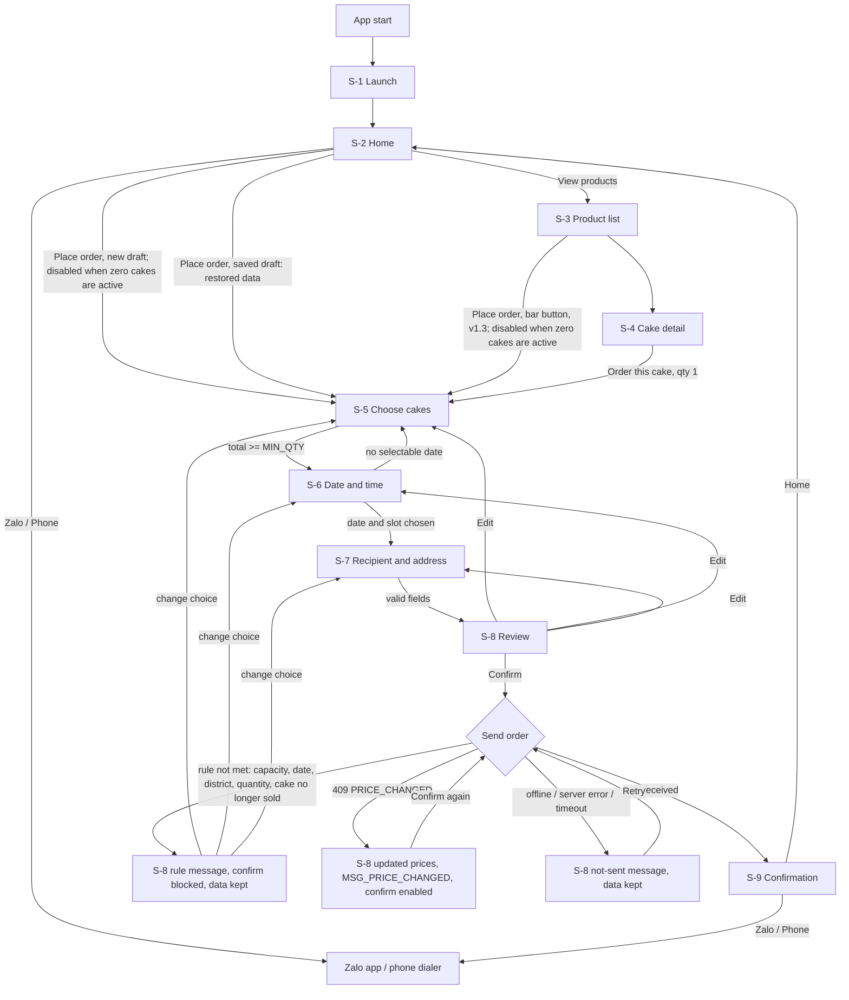

# Place Order UI, part 1: Overview, Research, Flow, Inventory (sections 1 to 4)

[v1.4 | 2026-10-27] Part of the split UI specification; index: [place-order-ui.md](../place-order-ui.md). Content unchanged from v1.3; section numbers are the original ones.

## 1. Overview

Scope: the Customer app on iOS and Android, from launch to the confirmation screen. The Admin app (staff and owner) is out of scope (PRD non-goals). One specification covers both platforms; differences are in section 6. Visual direction: iOS uses Liquid Glass, Android uses Material 3 Expressive. Component and token names come from `design-system.md`.

Global rules that apply to every screen:

- All text is Vietnamese and referenced by key (FR-14). Text lives in section 8.
- Money is shown as whole dong (BR-5). Format and rules are in the design system (principle 4).
- No payment information, payment method, payment hint or payment word appears anywhere (FR-19, AC-27). Reviewers shall check every key in section 8.
- Launch data (shop name, greeting, contacts, prices, districts, slots) is shown exactly as received. No "sample", "demo" or "test" marker is shown (AC-29).
- Dates and times are shown in Vietnam time (UTC+7), whatever the device time zone (A-1).
- No screen offers tracking, status or cancellation (non-goals).

[v1.3 | 2026-10-26] Visual source of truth: the owner's design board in `docs/design/reference/` (24 screens, iOS 390 x 844 and Android 412 x 892; pictures of the slice 1 screens in `renders/`). Layout, sizes, colours and type come from the board through `design-system.md` v1.2; where this document and the board differed, this version follows the board unless the PRD or an ADR forbids what the board shows (section 5.11 lists those cases as open questions). The board is a design, not data: bracketed text such as `[Tên tiệm]`, `[Lời chào ngắn gọn]`, `[Giá]`, `[Số Zalo]`, and the label "Ảnh bánh" on picture frames are placeholders. The apps show shop data exactly as received (for example the shop name is shown as sent; the board's literal prefix "Bánh tét " is not added by the app) and real cake pictures.

Placeholders in text: `{n}`, `{min}`, `{max}`, `{days}`, `{amount}`, `{date}`, `{name}`, `{code}`, `{start}`, `{end}`, `{number}` [v1.3 | 2026-10-26] (a shop contact number as received). Values for `{min}` (MIN_QTY), `{days}` (LEAD_DAYS) and `{max}` (MAX_DAYS_AHEAD) come from configuration, never typed into copy.

## 2. Research summary

| Claim | Source (URL) | Read on | Confidence |
| ----- | ------------ | ------- | ---------- |
| iOS 26 Liquid Glass in SwiftUI: `glassEffect(_:in:)` with `GlassEffectContainer` for grouped glass shapes; iOS 26 and later | https://developer.apple.com/documentation/swiftui/glasseffectcontainer.md | 2026-10-25 | High |
| Glass button styles (`.glass`, `.glassProminent`), `.interactive()`, `glassEffectID` morphing; glass belongs on the navigation and action layer, not on content | https://levelup.gitconnected.com/swiftui-liquid-glass-from-basic-to-a-little-advance-cdef4e4c5b90 ; https://medium.com/@veersr9/ios-26-liquid-glass-in-swiftui-a-practical-reference-demo-app-liquidglassreference-69b8d46dc055 | 2026-10-25 | Medium (secondary) |
| Fallback before Liquid Glass: SwiftUI `Material` backgrounds | Apple SwiftUI `Material` documentation | 2026-10-25 | Unverified (not read) |
| Material 3 Expressive in Compose: `ButtonGroup`, `FloatingToolbar`, `FlexibleBottomAppBar`, `LoadingIndicator`, `MaterialExpressiveTheme`, large flexible top app bar; some APIs experimental in 1.4.0 alpha builds | https://proandroiddev.com/material-3-expressive-design-a-new-era-9ea77959a262 ; https://proandroiddev.com/material-3-expressive-design-a-new-era-part-2-6a93483c98b0 | 2026-10-25 | Medium (third-party) |
| Official Material 3 Expressive guidance (stable status, motion scheme) | https://m3.material.io/blog/building-with-m3-expressive | 2026-10-25 | Unverified (page unreadable) |

[v1.1 | 2026-10-25] Fixed by the owner: minimum iOS 17 and Android 8.0 (API 26). Real glass or blur exists only on iOS 26 and later and Android 12 (API 31) and later (ADR-0012, Accepted). Both fallbacks are specified in section 6. Zalo and phone link behaviour: ADR-0015.

Decisions that follow: glass is used for cards and the floating bar only; all long text sits on cards with contrast kept at 4.5:1; every glass surface has the `material.fallback` rendering. The system date pickers are not used for the date step because capacity-based unavailability must be shown per date (unverified that native pickers cannot do this; the custom `DateGrid` is the specified behaviour either way).

## 3. User Flow

Entry points: app start (S-1); S-4 starts the flow with that cake at quantity 1 (FR-4); S-2 starts the flow with no cake chosen, or, [v1.1 | 2026-10-25] when a saved draft exists (kept up to 24 hours, also after the system ended the app; ADR-0011), with the restored draft data, with no prompt. Entry from S-4 always starts a new draft with that cake at quantity 1 and replaces any saved draft. Exit points: S-9 to S-2; leaving the flow from step 1 with the back control returns to the previous screen and discards flow data. Flow data is kept for the whole time the customer moves between steps (FR-15).

Step count after "Place order": 4 steps (cakes, date and time, recipient, review) plus the confirmation, within G-1 (at most 6).

## 4. Screen Inventory

| ID | Name | App | Purpose | FRs covered |
| -- | ---- | --- | ------- | ----------- |
| S-1 | Launch | Customer | Logo-only screen on start | FR-1, FR-14 |
| S-2 | Home | Customer | Shop name, greeting, contact, entry to products and order | FR-2, FR-14, FR-19 |
| S-3 | Product list | Customer | Every active cake (1 to 4) with picture, name, description, price; Error only at zero [v1.2 | 2026-10-26] | FR-3, FR-14 |
| S-4 | Cake detail | Customer | One cake and the button that starts an order | FR-3, FR-4, FR-14 |
| S-5 | Order step 1: Choose cakes | Customer | Quantity per active cake (1 to 4 rows) [v1.2 | 2026-10-26] | FR-5, FR-4, FR-10, FR-14, FR-15 |
| S-6 | Order step 2: Date and time | Customer | Receiving date and time slot | FR-6, FR-7, FR-10, FR-14, FR-15 |
| S-7 | Order step 3: Recipient and address | Customer | Name, phone, address, district, note | FR-8, FR-13, FR-18, FR-14, FR-15 |
| S-8 | Order step 4: Review | Customer | Full order review, privacy sentence, confirm, rule and send errors | FR-9, FR-10, FR-16, FR-17, FR-18, FR-15, FR-14 |
| S-9 | Confirmation | Customer | Order code, received message, contact buttons | FR-11, FR-12, FR-14, FR-19 |

Error and offline states have no screens of their own. They are states of the screens above and use the shared patterns in section 5.10.
