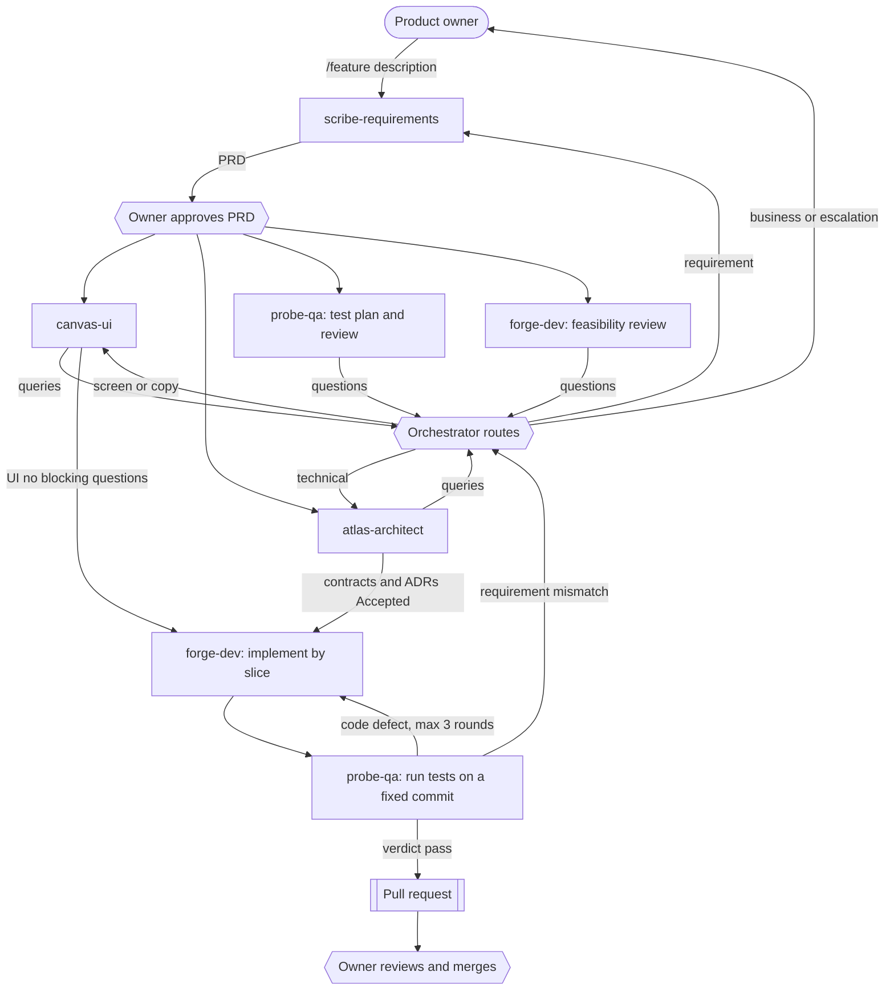

# Agent Development Process

The product owner supplies **business intent** (what the product should do). Five subagents turn it into documents, code and tests. Technical decisions are made by the agents, researched and recorded; the owner is asked only in the cases listed under "Escalation".

## Agents

| Stage | Agent | Reads | Writes | Standard |
| ----- | ----- | ----- | ------ | -------- |
| 1 | `scribe-requirements` | `pipeline/<slug>/00-request.md`, existing docs | `product/<feature>.md` | `01-requirements.md` |
| 2 | `canvas-ui` | PRD | `design/<feature>-ui.md`, `design/design-system.md` | `02-ui.md`, `12-design-system.md` |
| 3 | `atlas-architect` | PRD, UI | `system/*.md`, `decisions/adr-*.md` | `03` to `09` |
| 4 | `forge-dev` | PRD, UI, system docs | code, tests, `engineering/dev-guide.md`, updated system docs | `10-dev-guide.md` |
| 5 | `probe-qa` | PRD, UI, system docs, code | `test/<feature>-tests.md` | `11-test.md` |

All documents follow `standards/00-common.md`. Folder layout: `docs/product`, `docs/design`, `docs/system`, `docs/decisions`, `docs/engineering`, `docs/test`, `docs/pipeline`.

## Flow

## Concurrent start

Development and QA do not wait for design and architecture to finish. Right after the owner approves the PRD, four agents start at once, each in its own worktree:

| Agent | Early mode (documents still draft) | Output |
| ----- | ---------------------------------- | ------ |
| `canvas-ui` | Writes the UI specification | `docs/design/` |
| `atlas-architect` | Designs architecture, data, API, ADRs | `docs/system/`, `docs/decisions/` |
| `probe-qa` | Writes the test plan from the PRD acceptance criteria, UI states and API drafts, and reviews all documents for contradictions and untestable items | `docs/test/`, plus questions |
| `forge-dev` | Reviews feasibility, proposes the slice plan and migration steps; writes no code yet | Report with questions |

Questions return to the orchestrator, which sends each to the agent that owns the answer (see Question routing). That agent **updates its document in place** (version bump, labelled lines, change log). The orchestrator then tells every consumer to resync: it merges the new `feature/<slug>` tip into the consumer's stage branch (`git -C <worktree> merge feature/<slug>`) and points the consumer at the labelled lines.

Implementation starts only when the "Ready gate" conditions hold: PRD `Approved`; UI without blocking questions; data model, API and workflows complete; every ADR for the technology involved `Accepted`. Then `forge-dev` builds slice by slice (parallel instances per component allowed) while `probe-qa` turns its plan into executable tests and runs them against a fixed commit. A defect report names the commit it was found on; the fix is merged, then `probe-qa` retests on the new commit.

### Question routing

| Question is about | Goes to | Result |
| ----------------- | ------- | ------ |
| What the product should do, business rules, acceptance criteria | `scribe-requirements` (and the owner for business choices) | PRD updated |
| Screens, states, copy, accessibility | `canvas-ui` | UI document updated |
| Data, API, workflows, security, technology | `atlas-architect` | System documents or ADR updated |
| Money, security or customer data, hard to reverse, visible business behavior | Owner (one batch) | Answer recorded by the owning agent |

A question that bounces between agents more than twice goes to the owner.

## Orchestration

The main Claude Code session orchestrates (skill `.claude/skills/feature`). Subagents start with an empty context and cannot ask the owner questions, so:

- State lives in files. Each stage reads named input files and writes named output files.
- Subagents return a short report. Questions and queries for other agents are returned to the orchestrator, which routes them.
- `docs/pipeline/<slug>/00-request.md` holds the owner's request; `run.md` holds the current stage, round counter, approvals and pending questions.

## Gates

Only two gates need the owner: **PRD approval** and the **final pull request**. Between them agents proceed on their own. The "Ready gate" in each standard controls when **implementation** may start; it does not stop agents from reviewing and planning early.

## Escalation to the owner

Agents decide and record technical matters (with research and sources). They stop and ask the owner, in one batch, when a decision:

1. costs money (paid services, accounts, hosting),
2. affects security or customer data,
3. is hard to reverse (language, framework, stored-data structure with users),
4. leads to different visible business behavior depending on the option.

Business questions always go to the owner. Technical questions are answered by the responsible agent or by research.

## Loops

- `probe-qa` finds a code defect: back to `forge-dev`. Maximum three rounds (a round is report, fix, retest); after that the orchestrator asks the owner.
- `forge-dev` or `probe-qa` finds a question, gap or contradiction in a document: it is routed to the owning agent, which updates the document; consumers resync. No round limit, except the bounce rule under Question routing.
- `probe-qa` finds behavior that contradicts or is missing from the requirements: the orchestrator asks `scribe-requirements` to clarify. Business questions go on to the owner.

## Worktrees (isolation)

Every subagent works in its **own git worktree** on its **own branch**, so two agents never write to the same checkout and cannot conflict.

| Item | Rule |
| ---- | ---- |
| Integration branch | `feature/<slug>`: the feature's trunk; only the orchestrator merges into it |
| Stage branch | `stage/<slug>/<n>-<agent>` (for example `stage/place-order/1-scribe`), created from the **current tip** of `feature/<slug>` |
| Worktree path | `.claude/worktrees/<slug>/<n>-<agent>` (git-ignored) |
| Create | `git worktree add -b stage/<slug>/<n>-<agent> .claude/worktrees/<slug>/<n>-<agent> feature/<slug>` |
| Work | The agent receives the absolute worktree path and uses only paths inside it |
| Commit | The orchestrator commits in the worktree (`git -C <path> ...`); agents never run git |
| Merge | After checking the output, the orchestrator merges the stage branch into `feature/<slug>` with `--no-ff`, then removes the worktree and deletes the stage branch |
| Failed stage | Keep the worktree and branch for inspection; do not merge |

Why not the built-in `isolation: worktree` option: it starts from the default branch, not from the feature branch, so the agent would not see the previous stage's documents. The orchestrator therefore creates the worktree explicitly after committing the previous stage.

### Write ownership (prevents merge conflicts)

| Agent | May write only |
| ----- | -------------- |
| `scribe-requirements` | `docs/product/` |
| `canvas-ui` | `docs/design/` |
| `atlas-architect` | `docs/system/`, `docs/decisions/` |
| `forge-dev` | Code in the component folders named in `docs/system/architecture.md`, `docs/engineering/` |
| `probe-qa` | `docs/test/`, test folders |
| orchestrator | `docs/pipeline/`, merges |

After each stage the orchestrator lists the changed files in the stage worktree and rejects the stage if any lies outside the agent's allowed paths, or if the main checkout changed.

### Technical guard (hook)

Each agent file declares a `PreToolUse` hook (`.claude/hooks/worktree_guard.py <agent>`) that runs only while that agent runs:

- A write (`Write`, `Edit`, `MultiEdit`, `NotebookEdit`) is denied unless the target lies inside a worktree **registered** for that agent and inside the agent's own paths; `.git`, `.claude/` and `CLAUDE.md` are always denied; `forge-dev` may write docs only under `docs/engineering/`.
- Registry: `.claude/worktrees/.guard/<agent>.roots`, one absolute worktree path per line. The orchestrator adds the line when it creates the worktree and removes it when it deletes the worktree. No registry means every write is denied (fail closed).
- Agents with `Bash` (`atlas-architect`, `forge-dev`, `probe-qa`) are also denied any git command except read-only ones (`status`, `diff`, `log`, `show`, ...).
- Limits: shell redirects and scripts are not path-checked, so the post-stage scope check stays. Project-level agent hooks run only after the folder's workspace trust is accepted. Parallel instances of the same agent share one registry file and can reach each other's worktrees.
- Worktrees are mandatory for every stage, and always for stage 4 (development), stage 5 (QA) and any parallel run.

### Parallelism

- **Different features** run in parallel: each has its own `feature/<slug>` branch and worktrees.
- **Stages inside a feature** run in sequence, because each needs the previous document.
- **Stage 4 may fan out** after the API and data contracts are `Accepted`: one `forge-dev` per component (`4-forge-backend`, `4-forge-ios`, `4-forge-android`), each in its own worktree and writing only its own component folder. Instances do not edit shared documents; they report needed document changes, which one final `forge-dev` pass applies. Merge the backend first, then the clients.
- **Fix rounds** use new worktrees (`5-probe-r1`, `4-forge-fix-r1`, ...) taken from the current tip.
- Each worktree has its own build products: expect a cold build per worktree, and take simulator lanes through `ddagent` (maximum four).

## Git and pull request

- One commit per completed stage, made by the orchestrator in the stage worktree (message begins with the agent name).
- After every completed step the orchestrator scans the unpushed commits for sensitive data and **pushes `feature/<slug>`** to GitHub. Stage branches stay local.
- The pipeline ends by pushing `feature/<slug>` (stage branches stay local) and opening a pull request. Agents never merge.
- The repository is public: no sensitive data in files, commits or pull request text.
