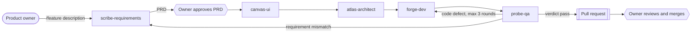

# Agent Development Process

The product owner supplies **business intent** (what the product should do). Five subagents turn it into documents, code and tests. Technical decisions are made by the agents, researched and recorded; the owner is asked only in the cases listed under "Escalation".

## Agents

| Stage | Agent | Reads | Writes | Standard |
| ----- | ----- | ----- | ------ | -------- |
| 1 | `scribe-requirements` | `pipeline/<slug>/00-request.md`, existing docs | `product/<feature>.md` | `01-requirements.md` |
| 2 | `canvas-ui` | PRD | `design/<feature>-ui.md`, `design/design-system.md` | `02-ui.md`, `12-design-system.md` |
| 3 | `atlas-architect` | PRD, UI | `system/*.md`, `decisions/adr-*.md` | `03` to `09` |
| 4 | `forge-dev` | PRD, UI, system docs | code, tests, `engineering/dev-guide.md`, updated system docs | `10-dev-guide.md` |
| 5 | `probe-qa` | PRD, UI, system docs, code | `test/<feature>-tests.md` | `11-test.md` |

All documents follow `standards/00-common.md`. Folder layout: `docs/product`, `docs/design`, `docs/system`, `docs/decisions`, `docs/engineering`, `docs/test`, `docs/pipeline`.

## Flow

## Orchestration

The main Claude Code session orchestrates (skill `.claude/skills/feature`). Subagents start with an empty context and cannot ask the owner questions, so:

- State lives in files. Each stage reads named input files and writes named output files.
- Subagents return a short report. Questions and queries for other agents are returned to the orchestrator, which routes them.
- `docs/pipeline/<slug>/00-request.md` holds the owner's request; `run.md` holds the current stage, round counter, approvals and pending questions.

## Gates

Only two gates need the owner: **PRD approval** and the **final pull request**. Between them agents proceed on their own. A stage starts only when the previous document meets its "Ready gate" in its standard.

## Escalation to the owner

Agents decide and record technical matters (with research and sources). They stop and ask the owner, in one batch, when a decision:

1. costs money (paid services, accounts, hosting),
2. affects security or customer data,
3. is hard to reverse (language, framework, stored-data structure with users),
4. leads to different visible business behavior depending on the option.

Business questions always go to the owner. Technical questions are answered by the responsible agent or by research.

## Loops

- `probe-qa` finds a code defect: back to `forge-dev`. Maximum three rounds; after that the orchestrator asks the owner.
- `probe-qa` finds behavior that contradicts or is missing from the requirements: the orchestrator asks `scribe-requirements` to clarify. Business questions go on to the owner.

## Git and pull request

- Branch `feature/<slug>`, one commit per completed stage (message begins with the agent name).
- The pipeline ends by pushing the branch and opening a pull request. Agents never merge.
- The repository is public: no sensitive data in files, commits or pull request text.
