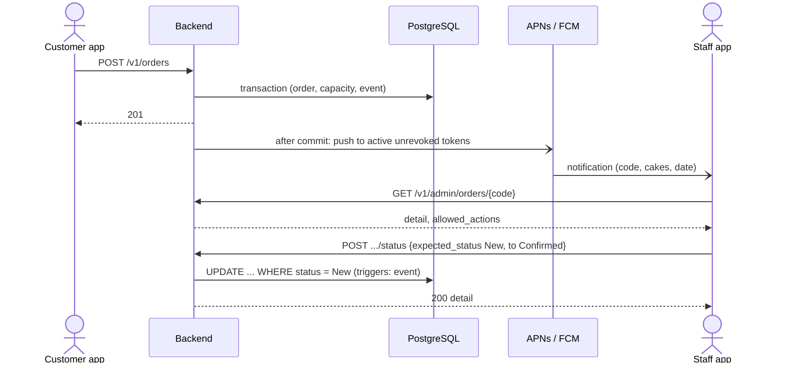

# Admin Order Handling

| Field        | Value |
| ------------ | ----- |
| Version      | 1.1 [v1.1 | 2026-10-31] |
| Last updated | 2026-10-31 |
| Status       | Draft |
| Owner        | atlas-architect |
| Based on     | product/admin-orders.md v1.6 (27 FR, 14 BR) [v1.1 | 2026-10-31] |
| Related      | order-lifecycle.md (state machine, owned there); session-lifecycle.md; api/06; data-model/05; ADR-0024, ADR-0028 to ADR-0030 |

## 1. Purpose & Scope

How staff and owner see new orders, move them through New, Confirmed, Completed or Cancelled, and how a settings change reaches customers. The state machine itself is `order-lifecycle.md` section 6; this file adds the actors, the staff-side flows, conflicts and notifications.

## 2. Actors

| Actor | Role |
| ----- | ---- |
| Staff, owner | Read orders, change status (owner also settings) |
| Customer | Places the order; contacted outside the app |
| System | Backend, database triggers, push dispatcher |

## 3. Main Flow: new order to completed

1. The order is stored (place-order flow, FR-25). The push task starts after the commit and never delays or fails the order response (FR-25, ADR-0024).
2. A device that allowed notifications shows the alert; a tap opens the detail by order code (FR-26); the list is the source of truth if no push arrives (BR-9).
3. Staff confirm, complete or cancel; each action is one request with `expected_status` (FR-16 to FR-18, ADR-0028).
4. Cancel needs a reason chosen from four (FR-18, BR-8); capacity is returned in the same transaction (BR-2).

## 4. Alternate & Error Flows

| Case | Handling | Trace |
| ---- | -------- | ----- |
| Two people act on the same order | First wins; the second gets 409 `ORDER_STATE_CHANGED` with the current detail; stored order unchanged | FR-19 |
| Same person repeats the tap or the response was lost | 200 with `Idempotent-Replay: true` | FR-19, ADR-0028 |
| Invalid pair or final state | 422 `STATUS_TRANSITION_INVALID`; also blocked by the database guard | BR-2 |
| Cancel without reason | 422 `CANCEL_REASON_REQUIRED`; no write | FR-18 |
| Finished order placed more than 90 days ago | 404 `ORDER_NOT_FOUND`, also on a push tap. Open (New, Confirmed) orders of any age are found and can be changed | BR-9 |
| Session ended while acting | 401 `SESSION_REVOKED`; the app clears customer data and shows sign-in; a push tap resumes after sign-in | FR-2, FR-26 |
| Push fails or is denied | Order still in the list; nothing else shown (no hint, no settings) | FR-25, BR-9 |
| "Sign out all other phones" or account deactivated | Sessions revoked and tokens deleted in one transaction; no more pushes | FR-4, FR-5, FR-25 |
| Database asleep or down | 503 `SERVICE_UNAVAILABLE`; app shows retry; nothing partial is written (single transaction) | FR-12 |
| Owner lowers the daily limit below booked cakes | Allowed; nothing cancelled; date reads as full | BR-11 |
| Cake removed that is in open orders | Orders stay valid and show stored name and price | BR-12 |

## 5. State machine and transitions

The states and the four allowed transitions are defined once in `order-lifecycle.md` section 6 (enforced by the trigger `customer_order_status_guard`). Actor and guard in this feature:

| From | To | Endpoint | Actor | Guard | Side effects |
| ---- | -- | -------- | ----- | ----- | ------------ |
| New | Confirmed | `POST /v1/admin/orders/{code}/status` | Staff, owner | `expected_status = New`, inside the window (BR-9) | Event with actor name |
| Confirmed | Completed | same | Staff, owner | `expected_status = Confirmed`; any time after confirmation (BR-2) | Event; capacity unchanged |
| New, Confirmed | Cancelled | same | Staff, owner | Reason required | `cancel_reason` set; event with reason; `day_load` reduced; the phone's count changes (ADR-0030) |

## 6. Business Rules Applied

| Rule | Enforced by |
| ---- | ----------- |
| BR-1 rights | `RequireRole` per route group, role re-check in services; order routes allow both roles |
| BR-2 transitions and capacity | Service pair table, then database trigger; trigger on `Cancelled` returns capacity |
| BR-3 record | Trigger inserts the event; the table is append-only |
| BR-7 customer data | Not in push, logs or analytics; cleared on sign-out; review accounts see demo rows only |
| BR-8 reasons | CHECK list (four values); per-phone count rule |
| BR-9 list order and window | Keyset sort and `OrderWindow` predicate of ADR-0029 v1.3 on every read and on status change: open orders always, finished orders 90 days |

## 7. Concurrency & Idempotency

Status changes use one conditional `UPDATE` (ADR-0028); the database serialises two writers on the row and the second sees the new status, matches zero rows and receives 409. A cancel and a new customer order for the same date change `day_load` atomically (order-lifecycle.md section 7). Settings writes take a row lock on `shop_setting` so two requests cannot both pass the cake cap or the last-active checks. The list uses keyset paging, so inserts do not duplicate rows.

## 8. Events & Audit

| Moment | Record |
| ------ | ------ |
| Status change | `order_event` (type, from, to, actor type, actor id, actor name, reason) written by trigger; append-only |
| Settings change | `settings_change` rows per field (actor, old, new) |
| Sign-in, sign-out, sign out other phones, reuse | `security_event` (deactivation is in `settings_change`) |
| Push sent or failed | One log line per order with counts only (no tokens, no data) |

## 9. Place Order change summary

Cancelled orders stop counting toward 5 per phone per 24 hours unless `fake_spam` (FR-27). Files and rules: ADR-0030 table. The catalog gains up to 12 cakes and uploaded image URLs (api/02). Lead days and minimum cakes are read from `shop_setting` by the existing rules (order-lifecycle.md section 5), so no rule code changes beyond the new CHECK limits.

## 10. Open Questions / Change log

| ID | Question | Why it matters | Blocking | Class | Status | Answer |
| -- | -------- | -------------- | -------- | ----- | ------ | ------ |
| AO-Q1 | Is the notification text (loc keys) acceptable on both stores' lock screens | Privacy of the order code on a locked phone | No | business | Open (PRD FR-26 allows the code) | |

| Version | Date | Change |
| ------- | ---- | ------ |
| 1.0 | 2026-10-31 | First version. |
| 1.1 | 2026-10-31 | PRD v1.6: four cancel reasons, one window rule (open orders always), no push hint, sign out other phones; ids renumbered; acceptance-criteria references dropped. |
