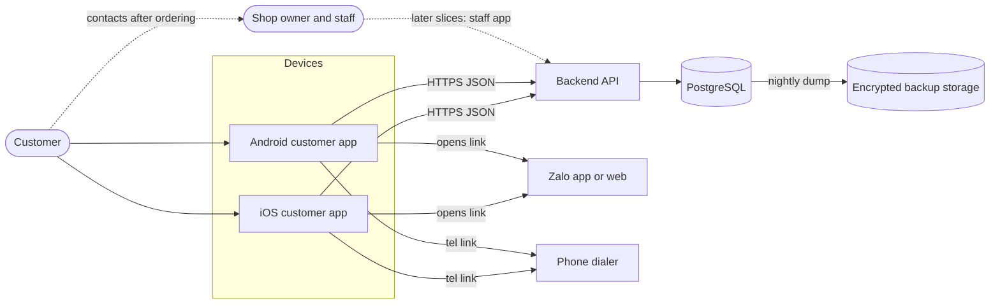
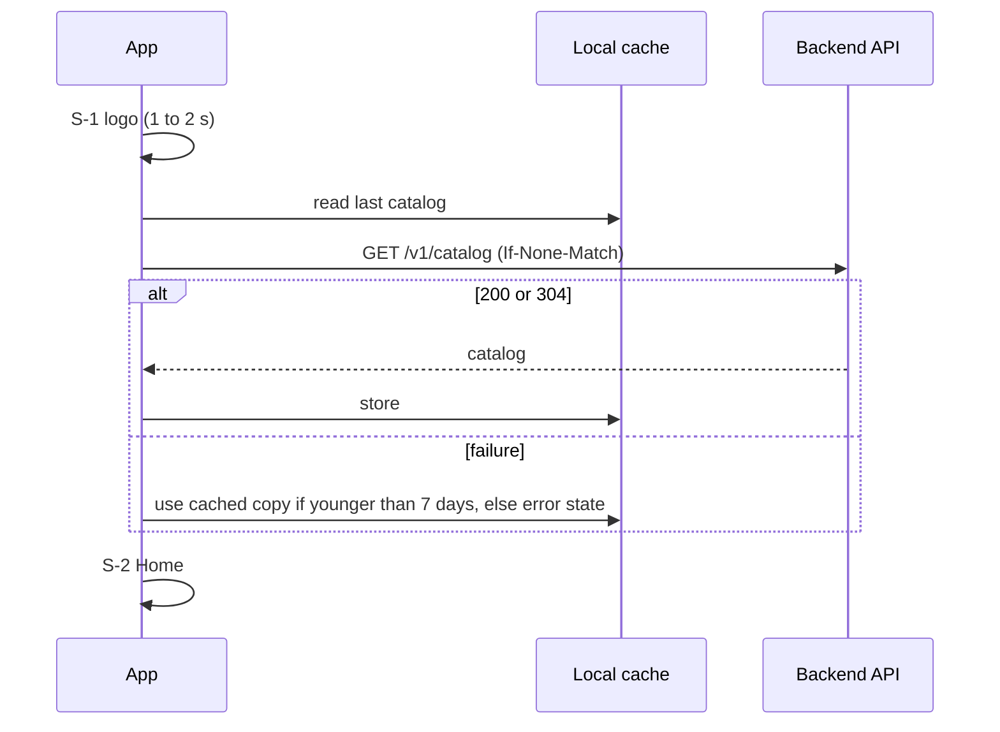
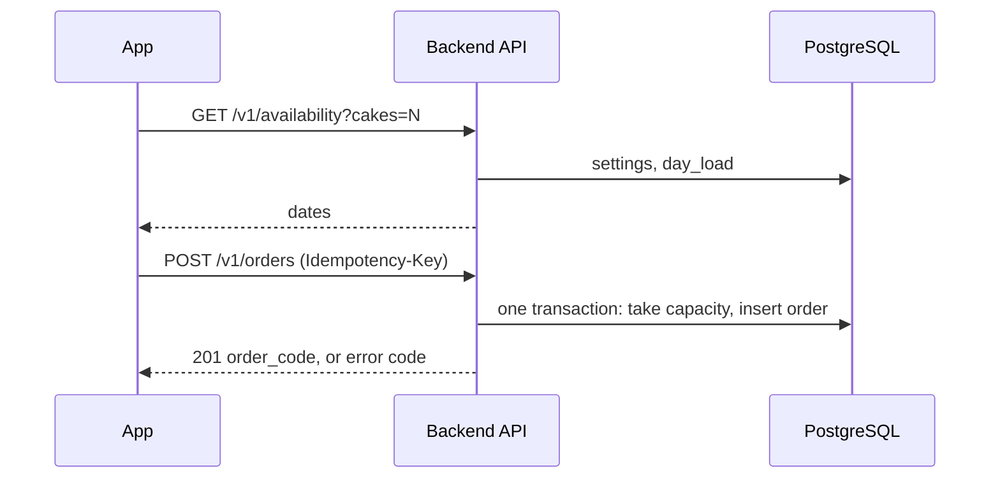

# System Architecture

| Field        | Value |
| ------------ | ----- |
| Version      | 1.3 |
| Last updated | 2026-10-26 |
| Status       | Draft |
| Owner        | atlas-architect |
| Based on     | product/place-order.md v1.2; design/place-order-ui.md v1.0; design/design-system.md v1.0 |
| Related      | data-model.md; api.md; order-lifecycle.md; auth.md; deployment.md; docs/decisions/ |

All owner decisions are recorded: Swift with Vapor (ADR-0001), PostgreSQL (ADR-0002), free trial hosting (ADR-0003, Accepted for the trial; returns to Proposed if a card or cost appears), repository layout (ADR-0004), iOS 17 and Android API 26 (ADR-0005), reject and re-review on price change (ADR-0010). [v1.1 | 2026-10-25]

## 1. Purpose & Scope

This document maps the system for the first slice: a customer browses four cakes and places an order from an iOS or Android app, and a backend stores the order. It covers components, flows, storage, integrations and quality targets. It does not cover staff and owner features, push notifications or payment (later slices); their extension points are named in section 10.

## 2. System Context

The shop has no screen in this slice; it learns of orders from the database (operator query) until the staff slice exists. The dotted arrows are outside this slice.

## 3. Components

| Name | Responsibility | Technology | Repo path | Talks to |
| ---- | -------------- | ---------- | --------- | -------- |
| iOS customer app | Nine screens S-1 to S-9, order flow, local cache and draft (FR-1 to FR-19) | Swift, SwiftUI, iOS 17+ (ADR-0005); bundle id `app.banh.customer` (ADR-0016); Liquid Glass on iOS 26+, material blur on iOS 17 to 25 [v1.2 | 2026-10-26] | `ios/BanhApp/` (tests `ios/BanhAppTests/`, `ios/BanhAppUITests/`; ADR-0004) | Backend API, Zalo, dialer |
| Android customer app | Same screens and flow | Kotlin 2.4, Jetpack Compose (BOM 2026.09.00, Material3 1.4), AGP 9.4 with built-in Kotlin, Gradle 9.6, JDK 17, API 26+ (ADR-0005, ADR-0007); blur on Android 12+, opaque cards below; application ID `app.banh.customer` (ADR-0016) [v1.2 | 2026-10-26] | `android/app/` | Backend API, Zalo, dialer |
| Backend API | Serves catalog and availability, validates and creates orders, enforces rules and rate limits | Swift 6, Vapor 4, Fluent with PostgreSQL driver and raw SQL for the order transaction (ADR-0001) [v1.1 | 2026-10-25] | `backend/Sources/App/` (tests `backend/Tests/AppTests/`, package `backend/Package.swift`, `backend/Dockerfile`) | PostgreSQL |
| Database | Stores configuration, orders, daily counters, audit events; enforces constraints and triggers | PostgreSQL 16+ (ADR-0002, Accepted) | Migrations `backend/db/migrations/`, seed `backend/db/seed/` | Backend API, backup job |
| Static assets | Product images, logo, privacy page | Files served by the backend | `backend/assets/` | Apps (via API host) |
| Contract fixtures | Shared sample requests, responses and validation cases used by all test suites | JSON files | `contracts/fixtures/` | Backend tests, iOS tests, Android tests |
| Contracts package [v1.1 | 2026-10-25] | Codable request, response and error-code types shared by backend and iOS (optional for iOS; fixtures stay the contract) | SwiftPM library `BanhContracts`, Foundation only | `contracts/swift/` | Backend, iOS app |
| Backend image [v1.1 | 2026-10-25] | The built container, produced in CI (never on the host) | Multi-stage Dockerfile, `linux/amd64`, public image on GHCR | `backend/Dockerfile`, `.github/workflows/backend.yml` | CI, host |
| Backup job | Nightly encrypted dump to separate storage | GitHub Actions scheduled workflow, `pg_dump`, `age`, private GitHub repository as storage [v1.1 | 2026-10-25] | `.github/workflows/db-backup.yml` | Database, backup storage |
| CI pipeline | Builds and tests the three components | GitHub Actions: `backend.yml` (Linux, PostgreSQL service, image, staging deploy), `ios.yml` (macOS runner, Xcode 27 needed), `android.yml` (Ubuntu, JDK 17) [v1.2 \| 2026-10-26] | `.github/workflows/` | Repository |

Developer tooling (`ddagent`, installed from its own repository) is not part of the system.

Component repo paths use the monorepo layout of ADR-0004 (Accepted) [v1.1 | 2026-10-25]. The existing Xcode project moves into `ios/` (orchestrator task; CLAUDE.md and `.claude/rules/swift.md` paths follow).

## 4. Key Flows

Order placement, including the capacity race, is in order-lifecycle.md section 3. Short forms:

App start and catalog (FR-1, FR-2, FR-3):

Place order (FR-9 to FR-17):

Contact (FR-2, FR-12): the app opens `https://zalo.me/<contact>` or `tel:<number>` through the operating system; no data goes to the backend.

## 5. Data & Storage Overview

| Data | Where | Notes |
| ---- | ----- | ----- |
| Shop, settings, products, districts, slots | PostgreSQL tables (seeded now, owner-edited later) | ADR-0013 |
| Orders, items, daily counters, audit events | PostgreSQL | data-model.md |
| Catalog cache | App-private storage on the device | Up to 7 days (ADR-0011) |
| Order draft | App-private storage on the device, 24 hours, excluded from backups | Personal data (ADR-0011) |
| Product images | Backend static files; HTTP cache on the device | Fake placeholders in the repository |
| Backups | Separate encrypted object storage | deployment.md section 6 |

Full structure: data-model.md.

## 6. External Integrations

| Service | Purpose | Auth mechanism | Failure behaviour |
| ------- | ------- | -------------- | ----------------- |
| Zalo (app, or web page via link) | Customer contacts the shop (FR-2, FR-12) | None (public link) | If the link cannot be opened: toast `ERR_OPEN_ZALO`; the phone button still works. If Zalo is not installed, the link opens the web page (unverified, ADR-0015) |
| Phone dialer (`tel:`) | Customer calls the shop | None | If it cannot open: toast `ERR_OPEN_PHONE` |
| Managed PostgreSQL host (Neon free plan, ADR-0003) | Stores data | Connection string in `DATABASE_URL` | API returns 503 `SERVICE_UNAVAILABLE`; apps keep entered data and offer retry (FR-17); the free database suspends after 5 idle minutes and the first query can take a few seconds (deployment.md section 7) [v1.1 | 2026-10-25] |
| App hosting (Render free web service, ADR-0003) | Runs the API image | Platform account | Sleeps after 15 idle minutes, about 1 minute to wake: apps wake it at launch, use the cached catalog meanwhile and retry orders with the same key; outage: apps show load or send errors; customers can contact the shop by phone or Zalo [v1.1 | 2026-10-25] |
| Backup storage (private GitHub repository) | Holds encrypted dumps | Deploy key in CI secrets [v1.1 | 2026-10-25] | Backup run fails: alert to the operator; no effect on customers |
| GitHub Actions | CI and backup schedule | Repository secrets | Delayed builds or backups; alert when a nightly run fails |
| Apple App Store, Google Play | Distribution | Developer accounts (owner) | Store review delay does not affect installed apps |

Every arrow in section 2 appears in sections 3 or 6.

## 7. Cross-cutting Concerns

- Security and customer data: HTTPS only; no accounts; server computes all money; rate limits; personal data only in the order table and the device draft; no personal data in logs (auth.md, data-model.md section 7).
- Observability: structured JSON logs with a request id, `/healthz`, uptime check and alerts (deployment.md section 7).
- Error handling: machine-readable error codes mapped to Vietnamese message keys by the apps (api.md section 5). Entered data is never lost on error (FR-17).
- Configuration: all shop parameters in database tables (ADR-0013); runtime settings in environment variables (deployment.md section 3).
- Localization: Vietnamese only; strings in resource files keyed as in the UI document; server sends keys, not text (FR-14).
- Time: Vietnam time (UTC+7) for all business dates; the server date is authoritative (A-1).
- Accessibility and look: native components, `material.fallback` rules (ADR-0012, design-system.md).
- Privacy: privacy page `/privacy`; the apps state what is collected before confirmation (PRD section 8); store privacy forms in deployment.md section 4.

## 8. Quality Attributes

| Attribute | Target | Basis |
| --------- | ------ | ----- |
| Order submission result | At most 10 s from tap to confirmation or error (client timeout 10 s) | PRD section 8 |
| `POST /v1/orders` server time | p95 at most 1 s with a warm server and database; after a database resume at most 5 s; after a server sleep up to about 60 s on the free trial host (not met; the apps cope by retrying with the same key, ADR-0003) [v1.1 | 2026-10-25] | Estimate; resume time from Neon docs, server wake from Render docs |
| `GET /v1/catalog`, `GET /v1/availability` server time | p95 at most 500 ms | Estimate |
| Availability of the API | 99.5% per month on the paid path (about 3.6 hours of downtime); the free trial has no target [v1.1 | 2026-10-25] | Single instance, estimate |
| Expected load | Up to 100 orders per day, up to 2,000 app opens per day, peak 5 requests per second | Small shop assumption, unverified; design margin ten times |
| Correctness | 0 orders accepted beyond the daily limit, under 50 parallel requests in test | G-2, AC-22 |
| Data durability | Backup every 24 hours (recovery point 24 h); restore within 4 hours (recovery time) | deployment.md section 6 |
| Cost | USD 0 during the trial; about USD 7 to 27 per month on the paid always-on path (estimate) [v1.1 | 2026-10-25] | ADR-0003 |
| Accessibility | WCAG 2.2 AA contrast 4.5:1; dynamic type | PRD section 8 |

## 9. Constraints & Assumptions

- Public repository: placeholders and fake data only (00-common.md).
- One shop at launch (`shop_id` ready for more).
- Payment is outside the app; the API has no payment data (FR-19).
- Order handling by the shop is outside this slice; staff read orders via the database or later via the staff slice.
- Assumed: shop timezone UTC+7 with no daylight saving time (A-1).
- Assumed: the free Neon and Render terms stay as researched on 2026-10-25 (ADR-0003, unverified over time). No spend during the new-project phase (owner). [v1.1 | 2026-10-25]

## 10. Extension Points for Later Slices

| Later feature | Prepared by |
| ------------- | ----------- |
| Staff and owner login | Reserved `/v1/staff` prefix; `order_event.actor_type/actor_id`; auth.md placeholder |
| Order list and statuses New, Confirmed, Completed, Cancelled | `customer_order.status`, transition trigger, indexes by shop and status |
| Owner configuration of products, prices, districts, fees, limit, slots, shop info | Tables in data-model.md read at request time; `is_active`, `sort_order`; the same read path |
| Payment | `customer_order.payment_status` placeholder, not exposed |
| Push notifications | Not prepared beyond staff identity; needs a new ADR |
| More shops | `shop_id` on every table |

## 11. Slice Plan [v1.1 | 2026-10-25]

Order of end-to-end slices. A slice is done when its acceptance criteria pass on both apps and the backend, with contract fixtures in `contracts/fixtures/` agreeing across the three test suites. Each slice is a pull request (or a short series) that touches every component listed; the contract is fixed in api.md and data-model.md before the slice starts. Nothing in a later slice is needed to test an earlier one.

| # | Slice | Components touched | Contract needed | FR / AC covered | Done when |
| - | ----- | ------------------ | --------------- | --------------- | --------- |
| 0 | Walking skeleton | Repo move to `ios/`, `android/`, `backend/`, `contracts/`; backend package with `/healthz`; Dockerfile; CI (build, test, image to GHCR, deploy hook); Neon project and Render service; migration `0001_init.sql` and sample seed; iOS and Android empty shells at the new minimum OS | `GET /healthz` (api.md 4.4); data-model.md migrations (section 8); deployment.md | Enabler (ADR-0004, ADR-0005) | The image runs on the host, `/healthz` answers, migrations apply, CI is green for all three components |
| 1 | Read-only catalogue and shop info | Backend: `GET /v1/catalog` with ETag, `/assets/*`, `/privacy`; tables `shop`, `shop_setting`, `product`, `district`, `delivery_slot`; iOS and Android: S-1 launch, S-2 home with Zalo and phone buttons, S-3 product list, S-4 detail (order button present, flow opens an empty S-5 stub), catalogue cache and offline copy | `GET /v1/catalog` (api.md 4.1), shared schemas (api.md 3), fixtures `catalog-*.json`; error codes `RATE_LIMITED`, `SERVICE_UNAVAILABLE` | FR-1, FR-2, FR-3, FR-4 (entry), FR-14, FR-19; AC-1 to AC-5, AC-21, AC-27, AC-29 | Both apps show the four sample cakes from the backend, work offline from cache (up to 7 days), and the contact buttons open Zalo and the dialer |
| 2 | Availability and order building | Backend: `GET /v1/availability`, rules for lead time, horizon, remaining capacity (`day_load`), Vietnam date; apps: S-5 cakes, S-6 date and time, S-7 recipient and address, S-8 review (confirm disabled or stubbed), draft persistence, client-side validation and total | `GET /v1/availability` (api.md 4.2); fixtures for dates and capacity; validation rules of ADR-0009 shared as fixtures | FR-5 to FR-10, FR-13, FR-15, FR-18; AC-6 to AC-14, AC-18, AC-24, AC-26 | A customer can walk S-5 to S-8 with correct selectable dates and a correct total; going back keeps data |
| 3 | Order creation | Backend: `POST /v1/orders`, one transaction (counter `UPDATE`, order, items, event), idempotency, price check, rate limits (IP and phone), order code, error catalogue; apps: S-8 confirm, sending state, all error states, same-key retry, price-changed re-review, timeout handling | `POST /v1/orders` (api.md 4.3), error catalogue (api.md 5); order-lifecycle.md sections 3 to 6; fixtures for success, replay, each error | FR-9 to FR-11 (server side), FR-13, FR-16, FR-17; AC-9, AC-13, AC-15, AC-16, AC-19, AC-20, AC-22, AC-23 | 50 parallel requests never oversell (AC-22); replay returns the stored order; every error code reaches the right UI state with data kept |
| 4 | Confirmation and launch readiness | Apps: S-9 confirmation with code and contact buttons, return to S-2, clearing the draft; backend: ordering switch, alerts, log policy checks, privacy page text; operations: nightly encrypted backup, restore test, uptime monitor, store listings, privacy forms, real shop data replacing sample rows | api.md 4.5; deployment.md sections 4, 6, 7; launch checklist | FR-11 (screen), FR-12, FR-14, FR-19; AC-15, AC-17, AC-25, AC-27 | Launch checklist complete; end-to-end test on staging with a real device on each platform |

Parallel work inside a slice: backend and the two apps start together from the contract and fixtures; the apps may use fixtures as a stub server until the backend endpoint lands. Slices 1 and 2 may overlap on the apps once slice 0 is done, but slice 3 waits for slice 2 on the backend (availability and capacity reads feed the order check). Testers write each slice's test cases from its acceptance criteria and the fixtures before development ends.

## 12. Decision Index

| ADR | Decision | Status |
| --- | -------- | ------ |
| [ADR-0001](../decisions/adr-0001-backend-language-framework.md) | Backend: Swift with Vapor (owner) | Accepted |
| [ADR-0002](../decisions/adr-0002-database.md) | PostgreSQL (owner) | Accepted |
| [ADR-0003](../decisions/adr-0003-hosting.md) | Free trial hosting: Render free container plus Neon free Postgres; paid path recorded | Accepted for the trial |
| [ADR-0004](../decisions/adr-0004-repository-layout.md) | Monorepo with `ios/`, `android/`, `backend/`, `contracts/` | Accepted |
| [ADR-0005](../decisions/adr-0005-minimum-os-versions.md) | iOS 17 and Android API 26 | Accepted |
| [ADR-0006](../decisions/adr-0006-native-vs-single-codebase.md) | Two native apps | Accepted |
| [ADR-0007](../decisions/adr-0007-mobile-architecture.md) | Mobile architecture | Accepted |
| [ADR-0008](../decisions/adr-0008-daily-limit-concurrency-idempotency.md) | Daily-limit counter and idempotency key | Accepted |
| [ADR-0009](../decisions/adr-0009-order-code-and-input-validation.md) | Order code, phone, lengths, quantity bound | Accepted |
| [ADR-0010](../decisions/adr-0010-price-change-at-confirmation.md) | Reject and re-review on price change | Accepted |
| [ADR-0011](../decisions/adr-0011-offline-caching-and-draft.md) | Catalog cache and persisted draft | Accepted |
| [ADR-0012](../decisions/adr-0012-blur-glass-fallback.md) | Native glass/blur, solid fallback, no paid library | Accepted |
| [ADR-0013](../decisions/adr-0013-configuration-source-and-sample-data.md) | Configuration in tables, sample flag | Accepted |
| [ADR-0014](../decisions/adr-0014-abuse-protection.md) | Rate limits, no SMS | Accepted |
| [ADR-0015](../decisions/adr-0015-zalo-and-phone-contact.md) | Zalo web link and `tel:` | Accepted |
| [ADR-0016](../decisions/adr-0016-application-identifiers.md) | Android application ID and iOS bundle id `app.banh.customer` | Accepted for development; frozen at first store upload |

Mapping of the open technical questions: Q-T1 to ADR-0008; Q-T2 to ADR-0013; Q-T3 and TQ-1 to ADR-0005; Q-T4 to deployment.md section 4; Q-T5 to ADR-0003; Q-T6 and TQ-5, TQ-6 to ADR-0009; TQ-2 to ADR-0015; TQ-3 and TQ-7 to ADR-0011; TQ-4 to ADR-0010; TQ-8 to ADR-0012.

## 13. Risks & Open Questions / Change log

| ID | Risk or question | Impact | Mitigation |
| -- | ---------------- | ------ | ---------- |
| R-1 | Free plan terms change; server sleep (about 1 minute) and database suspend slow the first request after idle | Slower or timed-out first order, possible forced cost | Apps wake the server at launch, same-key retry, alerts; paid upgrade path (ADR-0003) |
| R-2 | Zalo web link behaviour without the app is unverified | Contact flow | Device test before release; phone button remains |
| R-3 | Store accounts and review (owner fees, new personal Google Play accounts may need closed testing before production, unverified) | Release date | Start accounts early (deployment.md section 9) |
| R-4 | Retention period for personal data not stated (BR-12); Vietnamese personal data law may apply (unverified) | Compliance, privacy page text | Owner states the period; legal review recommended |
| R-5 | Ordering rules duplicated in two apps | Drift | Server authority, shared fixtures |
| R-6 | Server-side Swift: small ecosystem, slow release builds, Linux differences, Vapor 5 migration ahead | Delivery speed, hiring, later slices (SMS, push) | Build in CI with caching, test on Linux per pull request, pin versions, yearly upgrade review (ADR-0001) |
| R-8 | The API host name is compiled into the apps | A host change after release needs an app update | Custom domain before store release (launch cost, owner) |
| R-9 | Free-tier hosting is not for real customers' orders (no backups on the host, sleep) | Lost or missed orders | Trial only; nightly encrypted dump; move to the paid path before launch (ADR-0003) |
| R-7 | Material3 Expressive APIs may be experimental in the stable library | API churn | Opt-in, pinned version, wrapper components (ADR-0007) |

| ID | Question | Why it matters | Blocking | Class | Status | Answer |
| -- | -------- | -------------- | -------- | ----- | ------ | ------ |
| AR-Q1 | Owner decisions on ADR-0001 to 0005 and 0010 | Developers start after the decisions | No longer | technical and business | Closed 2026-10-25: all decided; ADR-0003 stays conditional on no card or cost appearing | Owner |

| Version | Date | Change |
| ------- | ---- | ------ |
| 1.0 | 2026-10-25 | First version. |
| 1.1 | 2026-10-25 | Owner decisions applied: Swift and Vapor, PostgreSQL, free trial hosting, layout, minimum OS, price change. Components, integrations, quality targets, risks updated. Slice plan added (section 11). |
| 1.2 | 2026-10-26 | After slice 0: Android toolchain and CI, application identifiers (ADR-0016), code structure target and refactors before slice 1 (section 14). |
| 1.3 | 2026-10-26 | After the backend refactor round: section 14 matches the built layout (`WallClock`, `DatabasePoolSizing`, `PostgresProbe` in `Repositories/`), error flow, collision retry owner, test target rules, remaining refactors. |

## 14. Backend Code Structure Target [v1.3 | 2026-10-26]

Review after the refactor round of slice 0 (`backend/Sources/App`, evidence read on 2026-10-26). Strengths worth keeping: configuration parsed from a dictionary and never from the global environment; secrets never echoed in errors; one place that turns any thrown error into the contract envelope; the database behind a protocol so tests need no PostgreSQL; one forward-only migration runner with a tested SQL splitter; contract fixtures decoded in tests; real-database tests that roll back. Layout as built, and the rule for each folder in slices 1 to 4:

| Folder under `Sources/App` | Holds (built) | Rule |
| -------------------------- | ------------- | ---- |
| `Config/` | `AppConfig` (variable names and defaults), `DatabasePoolSizing` (event loops times connections per loop stays within `DATABASE_POOL_MAX`) | Every variable of deployment.md section 3 gets a typed field when its slice reads it |
| `Http/` | `APIError`, `APIErrorCode` (one table: code, HTTP status, top-level `message_key`; api.md section 5), `APIErrorMiddleware`, `RequestIDMiddleware`, `AccessLogMiddleware` | The only place that turns an error into the response envelope. Order: request id, access log, error mapper innermost. Rate-limit middleware (ADR-0014) joins here |
| `Routes/` | `HealthRoutes`; later `CatalogRoutes`, `AvailabilityRoutes`, `OrderRoutes` | Parse, call a service, encode; no SQL, no rules |
| `Services/` | `HealthService`, `ShopCalendar`, `BusinessDate`; later `AvailabilityService`, `OrderPlacementService`, `OrderRules` | Pure Swift; time, randomness and storage come in as protocols |
| `Repositories/` | `PostgresProbe`; later the protocols `CatalogRepository`, `DayLoadRepository`, `OrderRepository` with their PostgreSQL implementations (exact SQL of ADR-0008) | Only SQL lives here. Every method wraps connection and pool failures as `APIError(.serviceUnavailable)` (api.md section 5) |
| `Support/` | `WallClock` (protocol, `SystemWallClock`, `FixedWallClock`; named so because `Clock` is a Swift standard library protocol), `OrderCodeGenerator`, `DatabaseProbe`, `withDeadline` | No Vapor types |
| `Migrations/` | Runner and SQL splitter | Unchanged |

Composition root: `configure` builds one `AppServices` value (clock, probe, order code generator; repositories join in the slices that introduce them), stores it on the `Application`; tests replace the whole value or single members.

Error flow: services and repositories throw `APIError`; the middleware maps it. Anything else is mapped by status when it is a Vapor `AbortError`, otherwise `INTERNAL_ERROR`, logging only the type name. The mapper never parses driver errors, so a database outage is `SERVICE_UNAVAILABLE` only when a repository throws it explicitly (api.md section 5).

Order code collisions: the generator only draws a code; the order service of slice 3 retries up to 5 draws when the unique index rejects the insert (ADR-0009).

Tests: `AppTests` is one target. Database tests (`Tests/AppTests/Database`, base class `DatabaseTestCase`) run inside that same target and only when `DATABASE_MIGRATION_URL` is set; otherwise they skip, so `swift test` works without a database. They apply the real migrations and run each test in a transaction that is rolled back. The URL must point at a throwaway database only (the CI service container or a local container), never staging or production.

Fitness for slices 1 to 3: the layering fits. Remaining refactors (dev queries in the architect report): repositories need a per-request or per-transaction database handle, so `AppServices` should hold factories, not connected repositories; the access log still lacks platform, app version and error code; the default body limit must be set to 8 KB; `Retry-After` is not yet written by the mapper; `withDeadline` leaves its timer task running after success.
