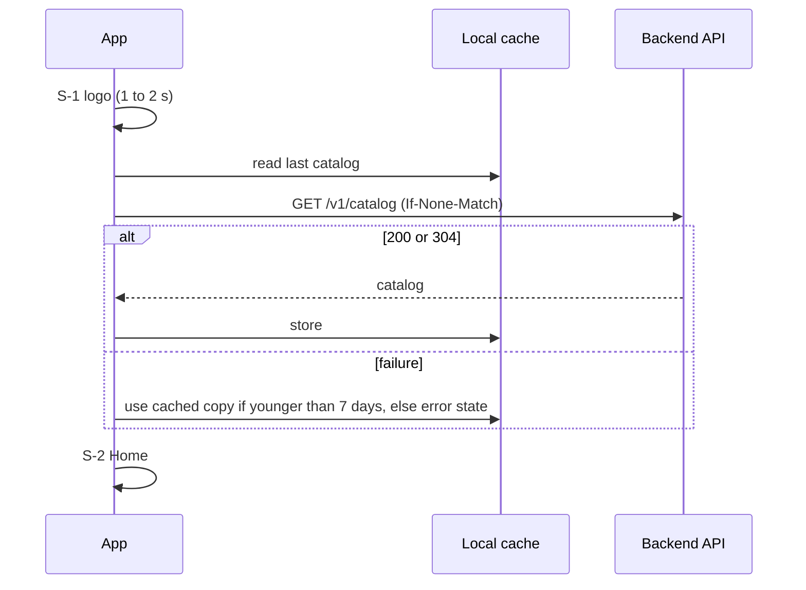
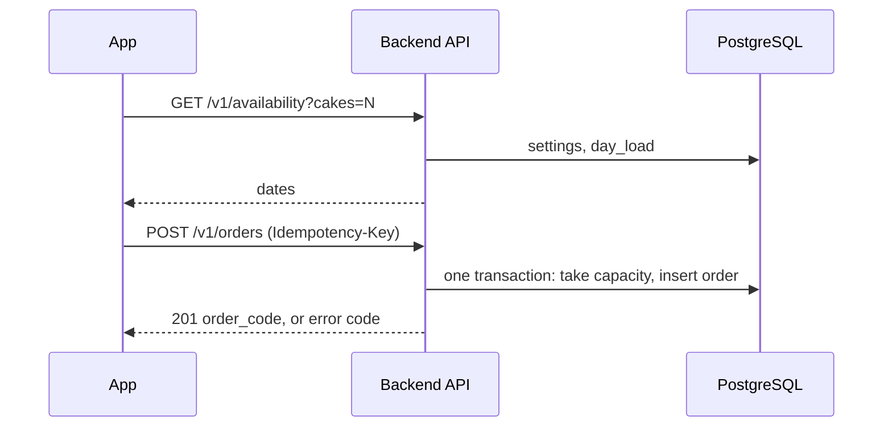

# System Architecture

| Field        | Value |
| ------------ | ----- |
| Version      | 1.0 |
| Last updated | 2026-10-25 |
| Status       | Draft |
| Owner        | atlas-architect |
| Based on     | product/place-order.md v1.2; design/place-order-ui.md v1.0; design/design-system.md v1.0 |
| Related      | data-model.md; api.md; order-lifecycle.md; auth.md; deployment.md; docs/decisions/ |

Items that depend on a pending owner choice are marked "pending owner choice" and are written against the architect's recommended option: backend language (ADR-0001), database (ADR-0002), hosting (ADR-0003), repository layout (ADR-0004), minimum OS versions (ADR-0005), price-change rule (ADR-0010).

## 1. Purpose & Scope

This document maps the system for the first slice: a customer browses four cakes and places an order from an iOS or Android app, and a backend stores the order. It covers components, flows, storage, integrations and quality targets. It does not cover staff and owner features, push notifications or payment (later slices); their extension points are named in section 10.

## 2. System Context

The shop has no screen in this slice; it learns of orders from the database (operator query) until the staff slice exists. The dotted arrows are outside this slice.

## 3. Components

| Name | Responsibility | Technology | Repo path | Talks to |
| ---- | -------------- | ---------- | --------- | -------- |
| iOS customer app | Nine screens S-1 to S-9, order flow, local cache and draft (FR-1 to FR-19) | Swift, SwiftUI, iOS 17+ (pending owner choice); Liquid Glass on iOS 26+ | `ios/BanhApp/` (tests `ios/BanhAppTests/`, `ios/BanhAppUITests/`; layout pending owner choice, ADR-0004) | Backend API, Zalo, dialer |
| Android customer app | Same screens and flow | Kotlin, Jetpack Compose, Material3 Expressive, API 26+ (pending owner choice) | `android/app/` | Backend API, Zalo, dialer |
| Backend API | Serves catalog and availability, validates and creates orders, enforces rules and rate limits | TypeScript, Node.js, Fastify, zod, `pg` (ADR-0001, pending owner choice) | `backend/src/` | PostgreSQL |
| Database | Stores configuration, orders, daily counters, audit events; enforces constraints and triggers | PostgreSQL 16+ (ADR-0002, pending owner choice) | Migrations `backend/db/migrations/`, seed `backend/db/seed/` | Backend API, backup job |
| Static assets | Product images, logo, privacy page | Files served by the backend | `backend/assets/` | Apps (via API host) |
| Contract fixtures | Shared sample requests, responses and validation cases used by all test suites | JSON files | `contracts/fixtures/` | Backend tests, iOS tests, Android tests |
| Backup job | Nightly encrypted dump to separate storage | GitHub Actions scheduled workflow, `pg_dump`, `age` | `.github/workflows/db-backup.yml` | Database, backup storage |
| CI pipeline | Builds and tests the three components | GitHub Actions | `.github/workflows/` | Repository |

Developer tooling `tools/ddagent/` is not part of the system.

Component repo paths use the recommended monorepo layout (ADR-0004). Until the owner decides, the existing Xcode project stays at the repository root.

## 4. Key Flows

Order placement, including the capacity race, is in order-lifecycle.md section 3. Short forms:

App start and catalog (FR-1, FR-2, FR-3):

Place order (FR-9 to FR-17):

Contact (FR-2, FR-12): the app opens `https://zalo.me/<contact>` or `tel:<number>` through the operating system; no data goes to the backend.

## 5. Data & Storage Overview

| Data | Where | Notes |
| ---- | ----- | ----- |
| Shop, settings, products, districts, slots | PostgreSQL tables (seeded now, owner-edited later) | ADR-0013 |
| Orders, items, daily counters, audit events | PostgreSQL | data-model.md |
| Catalog cache | App-private storage on the device | Up to 7 days (ADR-0011) |
| Order draft | App-private storage on the device, 24 hours, excluded from backups | Personal data (ADR-0011) |
| Product images | Backend static files; HTTP cache on the device | Fake placeholders in the repository |
| Backups | Separate encrypted object storage | deployment.md section 6 |

Full structure: data-model.md.

## 6. External Integrations

| Service | Purpose | Auth mechanism | Failure behaviour |
| ------- | ------- | -------------- | ----------------- |
| Zalo (app, or web page via link) | Customer contacts the shop (FR-2, FR-12) | None (public link) | If the link cannot be opened: toast `ERR_OPEN_ZALO`; the phone button still works. If Zalo is not installed, the link opens the web page (unverified, ADR-0015) |
| Phone dialer (`tel:`) | Customer calls the shop | None | If it cannot open: toast `ERR_OPEN_PHONE` |
| Managed PostgreSQL host | Stores data | Connection string in `DATABASE_URL` | API returns 503 `SERVICE_UNAVAILABLE`; apps keep entered data and offer retry (FR-17); free plans may pause idle compute, the first request after idle can be slower (deployment.md section 7) |
| App hosting (container platform) | Runs the API | Platform account | Outage: apps show load or send errors; cached catalog still shows; customers can contact the shop by phone or Zalo |
| Backup storage | Holds encrypted dumps | Access key pair in CI secrets | Backup run fails: alert to the operator; no effect on customers |
| GitHub Actions | CI and backup schedule | Repository secrets | Delayed builds or backups; alert when a nightly run fails |
| Apple App Store, Google Play | Distribution | Developer accounts (owner) | Store review delay does not affect installed apps |

Every arrow in section 2 appears in sections 3 or 6.

## 7. Cross-cutting Concerns

- Security and customer data: HTTPS only; no accounts; server computes all money; rate limits; personal data only in the order table and the device draft; no personal data in logs (auth.md, data-model.md section 7).
- Observability: structured JSON logs with a request id, `/healthz`, uptime check and alerts (deployment.md section 7).
- Error handling: machine-readable error codes mapped to Vietnamese message keys by the apps (api.md section 5). Entered data is never lost on error (FR-17).
- Configuration: all shop parameters in database tables (ADR-0013); runtime settings in environment variables (deployment.md section 3).
- Localization: Vietnamese only; strings in resource files keyed as in the UI document; server sends keys, not text (FR-14).
- Time: Vietnam time (UTC+7) for all business dates; the server date is authoritative (A-1).
- Accessibility and look: native components, `material.fallback` rules (ADR-0012, design-system.md).
- Privacy: privacy page `/privacy`; the apps state what is collected before confirmation (PRD section 8); store privacy forms in deployment.md section 4.

## 8. Quality Attributes

| Attribute | Target | Basis |
| --------- | ------ | ----- |
| Order submission result | At most 10 s from tap to confirmation or error (client timeout 10 s) | PRD section 8 |
| `POST /v1/orders` server time | p95 at most 1 s with a warm database; at most 5 s after a database cold start | Estimate; cold start duration unverified |
| `GET /v1/catalog`, `GET /v1/availability` server time | p95 at most 500 ms | Estimate |
| Availability of the API | 99.5% per month (about 3.6 hours of downtime) | Single instance, estimate |
| Expected load | Up to 100 orders per day, up to 2,000 app opens per day, peak 5 requests per second | Small shop assumption, unverified; design margin ten times |
| Correctness | 0 orders accepted beyond the daily limit, under 50 parallel requests in test | G-2, AC-22 |
| Data durability | Backup every 24 hours (recovery point 24 h); restore within 4 hours (recovery time) | deployment.md section 6 |
| Cost | About USD 7 per month hosting (estimate) | ADR-0003 |
| Accessibility | WCAG 2.2 AA contrast 4.5:1; dynamic type | PRD section 8 |

## 9. Constraints & Assumptions

- Public repository: placeholders and fake data only (00-common.md).
- One shop at launch (`shop_id` ready for more).
- Payment is outside the app; the API has no payment data (FR-19).
- Order handling by the shop is outside this slice; staff read orders via the database or later via the staff slice.
- Assumed: shop timezone UTC+7 with no daylight saving time (A-1).
- Assumed: Neon-like free database terms and Render-like prices stay as researched (ADR-0003, unverified over time).

## 10. Extension Points for Later Slices

| Later feature | Prepared by |
| ------------- | ----------- |
| Staff and owner login | Reserved `/v1/staff` prefix; `order_event.actor_type/actor_id`; auth.md placeholder |
| Order list and statuses New, Confirmed, Completed, Cancelled | `customer_order.status`, transition trigger, indexes by shop and status |
| Owner configuration of products, prices, districts, fees, limit, slots, shop info | Tables in data-model.md read at request time; `is_active`, `sort_order`; the same read path |
| Payment | `customer_order.payment_status` placeholder, not exposed |
| Push notifications | Not prepared beyond staff identity; needs a new ADR |
| More shops | `shop_id` on every table |

## 11. Decision Index

| ADR | Decision | Status |
| --- | -------- | ------ |
| [ADR-0001](../decisions/adr-0001-backend-language-framework.md) | Backend: TypeScript, Node.js, Fastify | Proposed |
| [ADR-0002](../decisions/adr-0002-database.md) | PostgreSQL | Proposed |
| [ADR-0003](../decisions/adr-0003-hosting.md) | Container PaaS plus managed Postgres, about USD 7 per month | Proposed |
| [ADR-0004](../decisions/adr-0004-repository-layout.md) | Monorepo with `ios/`, `android/`, `backend/`, `contracts/` | Proposed |
| [ADR-0005](../decisions/adr-0005-minimum-os-versions.md) | iOS 17 and Android API 26 | Proposed |
| [ADR-0006](../decisions/adr-0006-native-vs-single-codebase.md) | Two native apps | Accepted |
| [ADR-0007](../decisions/adr-0007-mobile-architecture.md) | Mobile architecture | Accepted |
| [ADR-0008](../decisions/adr-0008-daily-limit-concurrency-idempotency.md) | Daily-limit counter and idempotency key | Accepted |
| [ADR-0009](../decisions/adr-0009-order-code-and-input-validation.md) | Order code, phone, lengths, quantity bound | Accepted |
| [ADR-0010](../decisions/adr-0010-price-change-at-confirmation.md) | Reject and re-review on price change | Proposed |
| [ADR-0011](../decisions/adr-0011-offline-caching-and-draft.md) | Catalog cache and persisted draft | Accepted |
| [ADR-0012](../decisions/adr-0012-blur-glass-fallback.md) | Native glass/blur, solid fallback, no paid library | Accepted |
| [ADR-0013](../decisions/adr-0013-configuration-source-and-sample-data.md) | Configuration in tables, sample flag | Accepted |
| [ADR-0014](../decisions/adr-0014-abuse-protection.md) | Rate limits, no SMS | Accepted |
| [ADR-0015](../decisions/adr-0015-zalo-and-phone-contact.md) | Zalo web link and `tel:` | Accepted |

Mapping of the open technical questions: Q-T1 to ADR-0008; Q-T2 to ADR-0013; Q-T3 and TQ-1 to ADR-0005; Q-T4 to deployment.md section 4; Q-T5 to ADR-0003; Q-T6 and TQ-5, TQ-6 to ADR-0009; TQ-2 to ADR-0015; TQ-3 and TQ-7 to ADR-0011; TQ-4 to ADR-0010; TQ-8 to ADR-0012.

## 12. Risks & Open Questions / Change log

| ID | Risk or question | Impact | Mitigation |
| -- | ---------------- | ------ | ---------- |
| R-1 | Free database plan terms change or cold start is slow | Cost or slower first order | Alert; upgrade path to a paid plan (ADR-0003) |
| R-2 | Zalo web link behaviour without the app is unverified | Contact flow | Device test before release; phone button remains |
| R-3 | Store accounts and review (owner fees, new personal Google Play accounts may need closed testing before production, unverified) | Release date | Start accounts early (deployment.md section 9) |
| R-4 | Retention period for personal data not stated (BR-12); Vietnamese personal data law may apply (unverified) | Compliance, privacy page text | Owner states the period; legal review recommended |
| R-5 | Ordering rules duplicated in two apps | Drift | Server authority, shared fixtures |
| R-6 | Pending owner choices (six ADRs) | Paths and technology may change | Documents are written against the recommended options |
| R-7 | Material3 Expressive APIs may be experimental in the stable library | API churn | Opt-in, pinned version, wrapper components (ADR-0007) |

| ID | Question | Why it matters | Blocking | Class | Status | Answer |
| -- | -------- | -------------- | -------- | ----- | ------ | ------ |
| AR-Q1 | Owner decisions on ADR-0001 to 0005 and 0010 | Developers start after the decisions (the Ready gate requires Accepted ADRs for new technology) | Yes for forge-dev start | technical and business | Open (owner) | |

| Version | Date | Change |
| ------- | ---- | ------ |
| 1.0 | 2026-10-25 | First version. |
