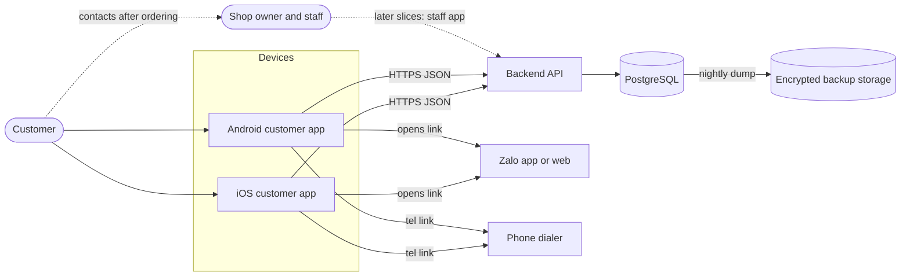

# System Architecture: Purpose, context, components

Part of [architecture.md](../architecture.md) (index, version, change log), sections 1 to 3. Moved from architecture.md v1.7 with the wording unchanged unless a line carries a newer label [v1.8 | 2026-10-27].

All owner decisions are recorded: Swift with Vapor (ADR-0001), PostgreSQL (ADR-0002), free trial hosting (ADR-0003, Accepted for the trial; returns to Proposed if a card or cost appears), repository layout (ADR-0004), iOS 17 and Android API 26 (ADR-0005), reject and re-review on price change (ADR-0010). [v1.1 | 2026-10-25]

## 1. Purpose & Scope

This document maps the system for the first slice: a customer browses the active cakes (one to four) and places an order [v1.5 | 2026-10-26] from an iOS or Android app, and a backend stores the order. It covers components, flows, storage, integrations and quality targets. It does not cover staff and owner features, push notifications or payment (later slices); their extension points are named in section 10.

Update [v1.10 | 2026-10-31]: staff and owner features, push notifications and the admin apps are now in scope; see [07-admin-orders.md](07-admin-orders.md). The statements below about "no staff features" describe the first slice.

## 2. System Context

The shop has no screen in this slice; it learns of orders from the database (operator query) until the staff slice exists. The dotted arrows are outside this slice.

## 3. Components

| Name | Responsibility | Technology | Repo path | Talks to |
| ---- | -------------- | ---------- | --------- | -------- |
| iOS customer app | Nine screens S-1 to S-9, order flow, local cache and draft (FR-1 to FR-19) | Swift, SwiftUI, iOS 17+ (ADR-0005); bundle id `app.banh.customer` (ADR-0016); Liquid Glass on iOS 26+, material blur on iOS 17 to 25 [v1.2 | 2026-10-26] | `ios/BanhApp/` (tests `ios/BanhAppTests/`, `ios/BanhAppUITests/`; ADR-0004) | Backend API, Zalo, dialer |
| Android customer app | Same screens and flow | Kotlin 2.4, Jetpack Compose (BOM 2026.09.00, Material3 1.4), AGP 9.4 with built-in Kotlin, Gradle 9.6, JDK 17, API 26+ (ADR-0005, ADR-0007); blur on Android 12+, opaque cards below; application ID `app.banh.customer` (ADR-0016) [v1.2 | 2026-10-26] | `android/app/` | Backend API, Zalo, dialer |
| Backend API | Serves catalog and availability, validates and creates orders, enforces rules and rate limits | Swift 6, Vapor 4, Fluent with PostgreSQL driver and raw SQL for the order transaction (ADR-0001) [v1.1 | 2026-10-25] | `backend/Sources/App/` (tests `backend/Tests/AppTests/`, package `backend/Package.swift`, `backend/Dockerfile`) | PostgreSQL |
| Database | Stores configuration, orders, daily counters, audit events; enforces constraints and triggers | PostgreSQL 16+ (ADR-0002, Accepted) | Migrations `backend/db/migrations/`, seed `backend/db/seed/` | Backend API, backup job |
| Static assets | Product images, logo, privacy page | Files served by the backend; images in `backend/assets/images/` served at `/assets/images/*` with a content version in the URL and a one-year cache (ADR-0017) [v1.5 \| 2026-10-26] | `backend/assets/` | Apps (via API host) |
| Contract fixtures | Shared sample requests, responses and validation cases used by all test suites | JSON files | `contracts/fixtures/` | Backend tests, iOS tests, Android tests |
| Contracts package [v1.1 | 2026-10-25] | Codable request, response and error-code types shared by backend and iOS (optional for iOS; fixtures stay the contract) | SwiftPM library `BanhContracts`, Foundation only | `contracts/swift/` | Backend, iOS app |
| Backend image [v1.1 | 2026-10-25] | The built container, produced in CI (never on the host) | Multi-stage Dockerfile, `linux/amd64`, public image on GHCR | `backend/Dockerfile`, `.github/workflows/backend.yml` | CI, host |
| Backup job | Nightly encrypted dump to separate storage | GitHub Actions scheduled workflow, `pg_dump`, `age`, private GitHub repository as storage [v1.1 | 2026-10-25] | `.github/workflows/db-backup.yml` | Database, backup storage |
| CI pipeline | Builds and tests the three components | GitHub Actions: `backend.yml` (Linux, PostgreSQL service, image, staging deploy), `ios.yml` (hosted `macos-26`, Xcode 26.x, project format 77), `android.yml` (Ubuntu, JDK 17) [v1.2 \| 2026-10-26] | `.github/workflows/` | Repository |

Developer tooling (`ddagent`, installed from its own repository) is not part of the system.

Component repo paths use the monorepo layout of ADR-0004 (Accepted) [v1.1 | 2026-10-25]. The existing Xcode project moves into `ios/` (orchestrator task; CLAUDE.md and `.claude/rules/swift.md` paths follow).
