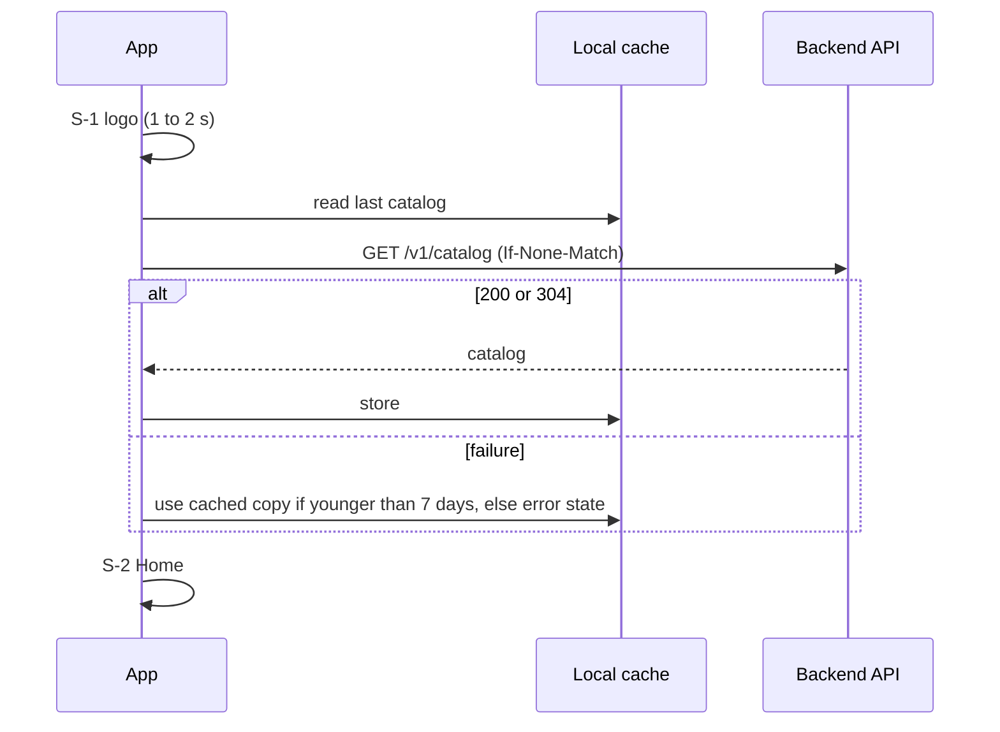
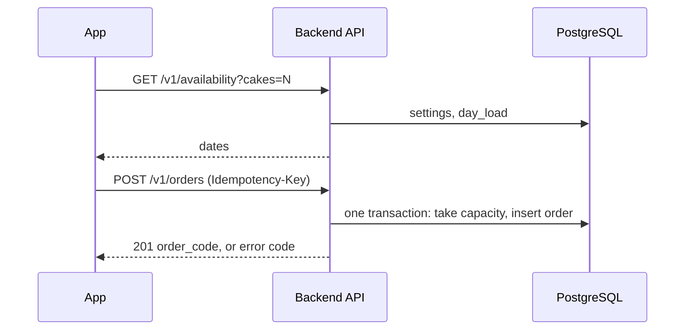

# System Architecture: Key flows, data and storage, integrations

Part of [architecture.md](../architecture.md) (index, version, change log), sections 4 to 6. Moved from architecture.md v1.7 with the wording unchanged unless a line carries a newer label [v1.8 | 2026-10-27].

## 4. Key Flows

Order placement, including the capacity race, is in order-lifecycle.md section 3. Short forms:

App start and catalog (FR-1, FR-2, FR-3):

Place order (FR-9 to FR-17):

Contact (FR-2, FR-12): the app opens `https://zalo.me/<contact>` or `tel:<number>` through the operating system; no data goes to the backend.

## 5. Data & Storage Overview

| Data | Where | Notes |
| ---- | ----- | ----- |
| Shop, settings, products, districts, slots | PostgreSQL tables (seeded now, owner-edited later) | ADR-0013 |
| Orders, items, daily counters, audit events | PostgreSQL | data-model.md |
| Catalog cache | App-private storage on the device | Up to 7 days (ADR-0011) |
| Order draft | App-private storage on the device, 24 hours, excluded from backups | Personal data (ADR-0011) |
| Product images | Backend static files; HTTP cache on the device (versioned URL, ADR-0017) | Fake placeholders in the repository [v1.5 \| 2026-10-26] |
| Backups | Separate encrypted object storage | deployment.md section 6 |

Full structure: data-model.md.

## 6. External Integrations

| Service | Purpose | Auth mechanism | Failure behaviour |
| ------- | ------- | -------------- | ----------------- |
| Zalo (app, or web page via link) | Customer contacts the shop (FR-2, FR-12) | None (public link) | If the link cannot be opened: toast `ERR_OPEN_ZALO`; the phone button still works. If Zalo is not installed, the link opens the web page (unverified, ADR-0015) |
| Phone dialer (`tel:`) | Customer calls the shop | None | If it cannot open: toast `ERR_OPEN_PHONE` |
| Managed PostgreSQL host (Neon free plan, ADR-0003) | Stores data | Connection string in `DATABASE_URL` | API returns 503 `SERVICE_UNAVAILABLE`; apps keep entered data and offer retry (FR-17); the free database suspends after 5 idle minutes and the first query can take a few seconds (deployment.md section 7) [v1.1 | 2026-10-25] |
| App hosting (Render free web service, ADR-0003) | Runs the API image | Platform account | Sleeps after 15 idle minutes, about 1 minute to wake: apps wake it at launch, use the cached catalog meanwhile and retry orders with the same key; outage: apps show load or send errors; customers can contact the shop by phone or Zalo [v1.1 | 2026-10-25] |
| Backup storage (private GitHub repository) | Holds encrypted dumps | Deploy key in CI secrets [v1.1 | 2026-10-25] | Backup run fails: alert to the operator; no effect on customers |
| GitHub Actions | CI and backup schedule | Repository secrets | Delayed builds or backups; alert when a nightly run fails |
| Apple App Store, Google Play | Distribution | Developer accounts (owner) | Store review delay does not affect installed apps |

Every arrow in section 2 appears in sections 3 or 6.
