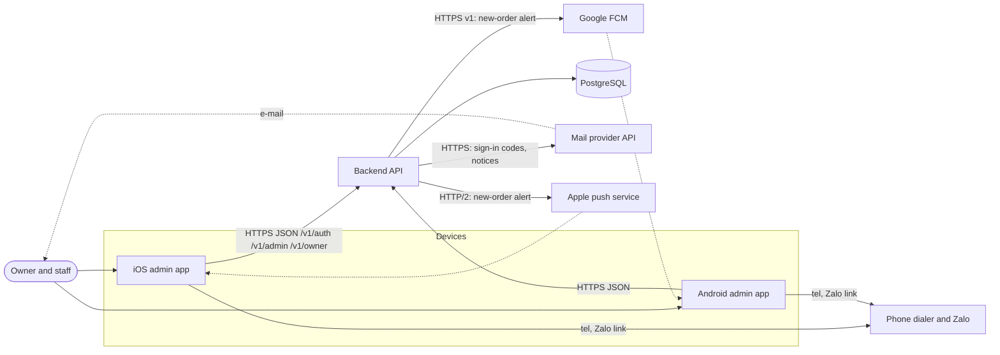

# System Architecture: Admin apps (admin-orders)

Part of [architecture.md](../architecture.md) (index, version, change log), sections 16 to 22. New in v1.10 [v1.10 | 2026-10-31]. It extends sections 1 to 15; where a line there says "no staff features", this file replaces it.

## 16. Purpose & Scope

Adds the separate admin apps for owner and staff (iOS and Android, same repository, same backend; PRD D-1, D-2): sign-in by e-mail code, order list and status changes, push notification of new orders, owner settings (cakes with images, districts, slots, ordering rules, shop information, staff, devices, backup address). Not covered: payment, order editing, customer notifications, web admin.

## 17. System Context (addition)



## 18. Components (additions)

| Name | Responsibility | Technology | Repo path | Talks to |
| ---- | -------------- | ---------- | --------- | -------- |
| iOS admin app | Sign-in, order list and detail, status actions, owner settings, devices, push registration (FR-1 to FR-44) | Swift, SwiftUI, iOS 17+, MVVM-C; bundle id `app.banh.admin` (ADR-0026); separate project `ios/BanhAdmin.xcodeproj`, format 77, scheme `BanhAdmin` | `ios/BanhAdmin/` (tests `ios/BanhAdminTests/`, `ios/BanhAdminUITests/`) | Backend API, APNs (receives), dialer, Zalo |
| Android admin app | Same screens | Kotlin, Compose, MVI, minSdk 26; application id `app.banh.admin` | `android/admin/` | Backend API, FCM (receives), dialer, Zalo |
| iOS shared packages | Design tokens and components; money and date formatting, `Load`, HTTP client with error envelope, repository protocols | Local SwiftPM packages `BanhDesign`, `BanhCore` (ADR-0021) | `ios/Packages/` | Both iOS apps |
| Android shared modules | Same, as Gradle modules with convention plugins | `:core:design`, `:core:common`, `:core:network`, `:core:model`, `build-logic/` (ADR-0021) | `android/core/`, `android/build-logic/` | `:app`, `:admin` |
| Backend admin code | Sign-in and sessions, order queries and status changes, settings, cakes and images, staff, devices, push and mail dispatch | Same Swift target; feature folders `Routes/Admin/`, `Services/Admin/{Auth,Orders,Settings,Mail,Push}/`, `Repositories/Admin/`; outbound clients in `Http/Outbound/` (no new top-level folder, ADR-0018) | `backend/Sources/App/` | PostgreSQL, mail provider, APNs, FCM |
| Maintenance task | Daily purge of expired codes, sessions, security events | In-process scheduled task (`Services/Admin/Auth/Maintenance`) | `backend/Sources/App/` | PostgreSQL |
| Operator commands | `bootstrap-owner`, `review-account on/off` | Vapor commands in `CommandName.swift` | `backend/Sources/App/` | PostgreSQL |
| Admin contract fixtures | Requests, responses and error cases shared by backend and both admin apps | JSON | `contracts/fixtures/admin/` | All admin test suites |
| Admin CI | Builds and tests the admin apps; package paths also trigger the customer workflows | `admin-ios.yml`, `admin-android.yml` | `.github/workflows/` | Repository |

## 19. Key Flows

Sign-in and refresh: auth.md section 2. New order to push to confirm: admin-order-handling.md section 3. Cake add with image:

```mermaid
sequenceDiagram
    participant App as Admin app (owner)
    participant API as Backend
    participant DB as PostgreSQL
    App->>App: resize to 1600 px JPEG
    App->>API: POST /v1/owner/cakes (multipart, Bearer)
    API->>API: role, 5 MB cap, signature and size checks
    API->>DB: one transaction: lock shop_setting, count, insert product + product_image, settings_change
    API-->>App: 201 cake
    Note over API: customer catalog ETag changes; customer apps refresh
```

## 20. External Integrations (additions)

| Service | Purpose | Auth mechanism | Failure behaviour |
| ------- | ------- | -------------- | ----------------- |
| Mail provider (HTTPS API, ADR-0023) | Sign-in codes, recovery codes, notices | API key `MAIL_API_KEY` | Send happens after the response, one retry after 5 s; failure logged without the address; the person asks for a new code; daily cap protects the quota; sign-in is unavailable while the provider is down (staff already signed in keep working) |
| Apple push service (APNs, ADR-0024) | New-order alerts to iOS | Provider token from a `.p8` key | Retries 1, 5, 20 s; invalid token deleted; the order and the list are unaffected; no outbox (BR-14) |
| Google FCM v1 (ADR-0024) | New-order alerts to Android | Service-account OAuth2 token | Same |
| Apple App Store, Google Play | Admin distribution (ADR-0026) | Developer accounts (owner) | Review delay does not affect installed apps |
| Customer-side integrations | Unchanged | | |

Every arrow in section 17 appears in sections 18 or 20.

## 21. Cross-cutting and Quality (additions)

| Topic | Rule or target |
| ----- | -------------- |
| Security | auth.md; no e-mail address, token, code or customer data in logs; tokens hashed; server-side role checks |
| Privacy | Staff see customer name, phone, address for orders of the last 90 days only (ADR-0029); data cleared from the device at sign-out; privacy page gains a staff section; push holds no personal data |
| Localization | Vietnamese in the apps; push text is a resource key in each app; e-mail bodies are server templates in Vietnamese (an exception to "server sends keys", because no app renders them) |
| Time | Shop dates in UTC+7; instants UTC |
| Order list first page | p95 at most 500 ms warm; first rows visible in 3 s on mobile (PRD) |
| Status change | p95 at most 1 s warm; result visible in 5 s (PRD) |
| New-order notification | At least 95 percent delivered within 60 s on a warm host (G-1; estimate, measured by a log counter) |
| Sign-in mail | Within 60 s in normal conditions (PRD); needs a running host (free plan cold start is about 60 s, ADR-0003 v1.4) |
| Revocation | 0 s at the server (checked on every request); bound 5 minutes (access token lifetime) |
| Load | At most 31 people, 100 orders a day, about 5 requests per second at peak; one instance |
| Cost | Mail free tier; push free; domain USD 10 to 15 a year; store fees already needed; paid hosting needed for real use (ADR-0003 v1.4) |

## 22. Decisions, risks, open questions

Decision index: ADR-0021 to ADR-0031 (architecture/05). Risks:

| ID | Risk | Mitigation |
| -- | ---- | ---------- |
| R-AO-1 | Free host sleeps: slow first sign-in mail and in-memory limits reset | Paid always-on before real use (ADR-0003 v1.4); phone-independent DB-based limits |
| R-AO-2 | Code-request flooding blocks sign-in for a day (global mail cap) or locks one address | Per-address and per-client limits first; alert on cap use; operator can raise the cap |
| R-AO-3 | Push lost when the process dies after commit | List is truth; counter to decide on an outbox (ADR-0024) |
| R-AO-4 | No absolute session cap: a stolen device used weekly stays signed in until revoked | Owner decision Q-15; device list and revoke; consider a 90-day cap later |
| R-AO-5 | Store review needs access to a code-only app | ADR-0027 (owner decides) |
| R-AO-6 | Compose compiler plugin in library modules unverified; two Xcode projects drift | Spike first (ADR-0021); shared packages are the only shared code |
| R-AO-7 | `availability.cakes` upper bound grows with 12 products (99 times 12 = 1188) | Bound is computed from active products; no contract change |
| R-AO-8 | Customer apps designed for four cakes and fixed rules text | Place Order UI update (query to canvas-ui and forge-dev) |

## 23. Slice plan (admin)

Contract first; backend and both apps start together from `contracts/fixtures/admin/`. Package extraction (ADR-0021) is slice A0.

| # | Slice | Contract | FR covered | Done when |
| - | ----- | -------- | ---------- | --------- |
| A0 | Package extraction, admin project skeletons, CI, migration `0002`, `bootstrap-owner`, mail and push protocols with recording fakes | data-model/04, api/05 | Enabler | Customer apps unchanged and green; empty admin apps build |
| A1 | Sign-in, refresh, sign-out, devices, roles | api/05, api/06 10.6, 10.7 | FR-1 to FR-7, FR-36, FR-37 | AC-1 to AC-14, AC-53 to AC-56 pass |
| A2 | Order list, detail, status change, cancel reasons, per-phone rule | api/06 10.9 to 10.11, migration `0003` | FR-8 to FR-20, FR-41, FR-44 | AC-15 to AC-31, AC-67 to AC-72 |
| A3 | Push registration and dispatch | api/06 10.8, 10.12 | FR-31 to FR-35 | AC-48 to AC-52 on two real devices |
| A4 | Owner settings, districts, slots, ordering rules, staff, backup e-mail and recovery | api/07 | FR-21 to FR-30, FR-40, FR-42, FR-43 | AC-32 to AC-47, AC-57 to AC-59, AC-64 to AC-66 |
| A5 | Cakes add, hide, remove with images; customer app for up to 12 cakes | api/07 10.17, ADR-0025 | FR-22, FR-38, FR-39 | AC-33, AC-34, AC-60 to AC-63 |
| A6 | Launch: store records, review account, privacy page staff section, paid hosting, domain and mail DNS | ADR-0023, ADR-0026, ADR-0027, deployment/04 | NFR | Checklist in deployment/04 complete |
