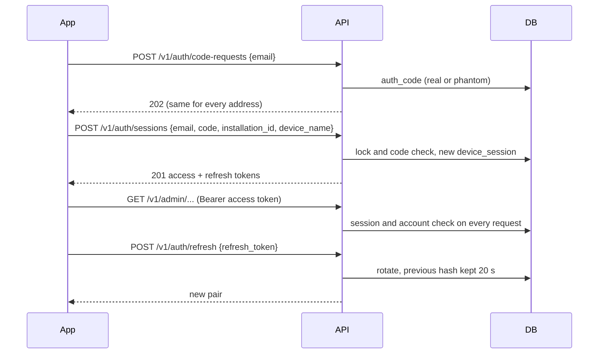

# Authentication and Authorization

| Field        | Value |
| ------------ | ----- |
| Version      | 2.0 [v2.0 | 2026-10-31] |
| Last updated | 2026-10-31 |
| Status       | Draft |
| Owner        | atlas-architect |
| Based on     | product/place-order.md v1.2 (BR-7); product/admin-orders.md v1.2 [v2.0 | 2026-10-31] |
| Related      | ADR-0014, ADR-0019, ADR-0022, ADR-0023, ADR-0027; session-lifecycle.md; api/05; data-model/04; auth/abuse-secrets-threats.md |

Scope [v2.0 | 2026-10-31]: the anonymous customer slice and the admin apps (owner and staff). Sign-in is by e-mail address and a one-time code sent by e-mail. The earlier text about staff sign-in by phone number and SMS is removed (PRD Q-3: no SMS, no message cost). Sections 5 to 7 are in [auth/abuse-secrets-threats.md](auth/abuse-secrets-threats.md).

## 1. Actors & Roles

| Actor | Identity | Notes |
| ----- | -------- | ----- |
| Anonymous customer | None; an order holds name, phone, address (PO BR-7) | Unchanged |
| Staff | E-mail address added by the owner, up to 30 active (BR-8) | Orders only (BR-1) |
| Owner | One account, created by the operator command `bootstrap-owner` (A-2) | Staff rights plus settings, staff, backup address, all devices |
| Review account | Staff-role account of kind `review` while ADR-0027 is enabled | Sees demo orders only |
| System | Backup job, migration runner, maintenance task, push and mail senders | Uses database credentials or provider keys; not an API caller |

## 2. Authentication

Customer: none; no token, no API key in the app. Protection is rate limits and server validation (section 4 of the abuse file).

Admin sign-in (FR-1 to FR-4, FR-36; ADR-0022): e-mail address plus a 6-digit code valid 10 minutes, used once. Credentials after sign-in: an access token (300 s) and a refresh token (7 days, restarted on each refresh). Both are random 256-bit secrets prefixed with the device session id; only SHA-256 hashes are stored. Codes are stored as HMAC-SHA256 with the secret `AUTH_CODE_PEPPER`.

Owner recovery (FR-42, FR-43, BR-17): `recovery-requests` sends one code to the owner address and a different one to the confirmed backup address; `recovery-sessions` needs both. Details and the open question SL-Q1: session-lifecycle.md.

| Item | Value |
| ---- | ----- |
| Code | 6 digits, 10 minutes, one use, newer code voids older |
| Access token | 300 s, opaque, checked against the session row on every request (revocation is immediate; the PRD bound of 5 minutes holds even without that check) |
| Refresh token | 7 days sliding, rotated on each use; previous token tolerated 20 s (lost response); later reuse revokes the session |
| Sign-out | Revokes this session and deletes its push token |
| Revocation | Owner revokes a device; deactivating an account revokes all its sessions in one transaction; renewal fails at once, data access ends on the next request |
| Device identity | Session id; app-generated `installation_id` and model name only (no hardware id) |
| Storage on device | iOS Keychain (after first unlock, this device only); Android Keystore-wrapped key over app-private storage; cleared at sign-out (BR-15) |
| Existence | Responses, timing and state do not show whether an address is registered (phantom `auth_code` rows, mail after the response) |

## 3. Authorization

Enforced on the server: `AdminAuthMiddleware` loads session and account, then `RequireRole` per route group (`/v1/admin` owner or staff, `/v1/owner` owner), and services re-check the account where a rule depends on it (own devices only for staff).

| Endpoint group | Anonymous | Staff | Owner | Review |
| -------------- | --------- | ----- | ----- | ------ |
| `GET /v1/catalog`, `/v1/availability`, `POST /v1/orders`, `/healthz`, `/privacy`, `/assets/*` | Allowed (orders rate limited) | Allowed | Allowed | Allowed |
| `/v1/auth/*` | Allowed (rate limited) | Allowed | Allowed | Allowed |
| `GET /v1/admin/me`, `DELETE /v1/admin/session` | 401 | Allowed | Allowed | Allowed |
| `/v1/admin/orders*` | 401 | Allowed | Allowed | Demo rows only |
| `/v1/admin/devices*` | 401 | Own devices | All devices | Own |
| `PUT, DELETE /v1/admin/push-token` | 401 | Allowed | Allowed | Accepted, never used |
| `/v1/owner/*` (settings, cakes, districts, slots, staff, backup e-mail) | 401 | 403 | Allowed | 403 |

Staff cannot edit orders, delete orders or see payment data (BR-1): no such endpoint exists. The database role of the backend has no schema rights and no DELETE on `account`, `order_event`, `security_event`, `settings_change`; migrations use a separate role.

## 8. Open Questions / Change log

| ID | Question | Why it matters | Blocking | Class | Status | Answer |
| -- | -------- | -------------- | -------- | ----- | ------ | ------ |
| AU-Q1 | Is the per-phone limit of 5 orders per 24 hours acceptable to the shop? | Visible limit on repeat customers | No | business | Default applied; owner may change | |
| AU-Q2 | Confirm ADR-0022 (security design) and ADR-0027 (store review account) | Security and customer data | No for design start; yes before store submission | technical (owner confirms) | Open | Recommendation in the ADRs |
| AU-Q3 | One code or two for the owner's ordinary sign-in (SL-Q1) | Business behaviour | No | business | Open | Recommendation in session-lifecycle.md |

| Version | Date | Change |
| ------- | ---- | ------ |
| 1.0 | 2026-10-25 | First version (customer slice; staff login placeholder). |
| 1.1 | 2026-10-25 | Backup storage secret replaced by a deploy key; deploy hook secrets; public image note. |
| 1.2 | 2026-10-26 | Image visibility clarified (D-12). |
| 1.3 | 2026-10-26 | Read limit wording: one shared budget per address (api.md section 1, ADR-0017). |
| 1.4 | 2026-10-27 | ADR-0014 amendment and ADR-0019: per-phone limit not built, limiter caveats, client address trust. |
| 1.5 | 2026-10-29 | Slice 3 resync: per-phone limit built (any status, check-then-insert, `Retry-After` 3600, Q-O3 pending); per-IP limit counts replays. |
| 2.0 | 2026-10-31 | Rewritten for admin-orders: e-mail code sign-in (SMS text removed), access and rotating refresh tokens, recovery, roles and permission matrix, review account; abuse, secrets and threats moved to auth/abuse-secrets-threats.md; per-phone limit ignores cancelled orders except `fake_spam`. Removed in v2.0: the staff phone and SMS placeholder and the `/v1/staff` reservation. |
