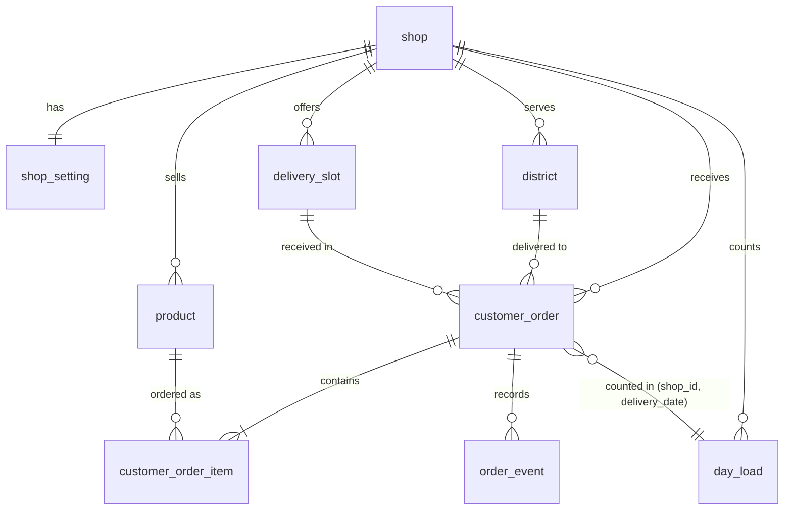

# Data Model

| Field        | Value |
| ------------ | ----- |
| Version      | 1.3 |
| Last updated | 2026-10-26 |
| Status       | Draft |
| Owner        | atlas-architect |
| Based on     | product/place-order.md v1.2; design/place-order-ui.md v1.0 |
| Related      | architecture.md; api.md; order-lifecycle.md; ADR-0002, ADR-0008, ADR-0009, ADR-0013, ADR-0017 |

## 1. Overview

Storage: PostgreSQL 16 or newer (ADR-0002, Accepted); the schema uses only standard features available from version 14. The Swift backend reads it through Fluent and PostgresNIO; the schema is defined by the SQL migrations, not by Fluent models [v1.1 | 2026-10-25]. Conventions:

- Table and column names: `snake_case`; table names singular; primary keys named `id` (UUID, generated by the application with UUIDv7 or by `gen_random_uuid()`).
- Every table that belongs to a shop has `shop_id` (UUID, foreign key to `shop`). The launch has one shop; the column lets later slices serve more than one without migration.
- Money: `integer` in whole Vietnamese dong (VND). Times: `timestamptz` stored in UTC. Calendar dates and slot times are in the shop timezone (`shop.timezone`, default `Asia/Ho_Chi_Minh`, A-1) and stored as `date` and `time`.
- Enumerations are `text` columns with CHECK constraints (not native enums) so values can be added by migration without locking.
- `created_at` and `updated_at` are `timestamptz NOT NULL DEFAULT now()` on every table unless stated.
- Tables are named after what they hold. The order table is `customer_order` because `order` is a reserved word.

## 2. Entity Relationship Diagram

## 3. Entities

### 3.1 shop (FR-2, FR-14; BR-10)

Purpose: the shop and its public information. One row at launch.

| Column | Type | Null | Default | Constraints | Notes |
| ------ | ---- | ---- | ------- | ----------- | ----- |
| id | uuid | no | generated | PK | |
| name | text | no | | length 1 to 100 | Shown on S-2 (FR-2) |
| greeting | text | no | | length 1 to 300 | Shown on S-2 |
| phone_contact | text | no | | E.164 pattern `^\+[1-9][0-9]{7,14}$` | Dial number (FR-2, FR-12); shown only through `tel:` |
| zalo_contact | text | no | | length 3 to 100 | Zalo number (digits, international form without `+`) or account id (ADR-0015) |
| timezone | text | no | `Asia/Ho_Chi_Minh` | | IANA name; A-1 |
| is_sample | boolean | no | false | | True for fake seed data (AC-29); never exposed by the API |
| created_at, updated_at | timestamptz | no | now() | | |

### 3.2 shop_setting (BR-1 to BR-4, BR-8, BR-10, ADR-0009)

Purpose: the ordering parameters of a shop, typed and constrained. One row per shop.

| Column | Type | Null | Default | Constraints | Notes |
| ------ | ---- | ---- | ------- | ----------- | ----- |
| shop_id | uuid | no | | PK, FK shop | |
| daily_limit | integer | no | | `> 0` | DAILY_LIMIT, shared across all products (BR-1). Value from the shop; sample value in the seed |
| lead_days | integer | no | 2 | `>= 0` | LEAD_DAYS (BR-2) |
| min_qty | integer | no | 2 | `>= 1` | MIN_QTY (BR-4) |
| max_days_ahead | integer | no | 30 | `>= lead_days` | MAX_DAYS_AHEAD (BR-8) |
| max_qty_per_cake | integer | no | 99 | between 1 and 99 | Input-safety bound (ADR-0009), not a business rule |
| is_sample | boolean | no | false | | |
| created_at, updated_at | timestamptz | no | now() | | |

### 3.3 product (FR-3, FR-4, FR-5, BR-5)

Purpose: a cake the shop sells. The set is four at launch (PRD non-goal: no more products); the table has no limit of four, and the API lists every active row, so one to four is normal when the owner deactivates a cake (owner decision 2026-10-26) [v1.3 | 2026-10-26].

| Column | Type | Null | Default | Constraints | Notes |
| ------ | ---- | ---- | ------- | ----------- | ----- |
| id | uuid | no | generated | PK | Used in API as `product_id` |
| shop_id | uuid | no | | FK shop | |
| slug | text | no | | unique with `shop_id`; `^[a-z0-9-]{1,40}$` | Stable machine name, for example `banana`, `mung-bean-pork-fat`, `mung-bean-vegetarian`, `mung-bean-egg-yolk-pork-fat` |
| name | text | no | | length 1 to 100 | Vietnamese display name |
| description | text | no | | length 1 to 300 | Short description |
| price_vnd | integer | no | | `>= 0` | Current price (BR-5). Changing it never changes past orders (BR-6) |
| image_path | text | no | | | Relative path of the file under `backend/assets/`, for example `images/banana.png`: no leading slash, no `..`. The API field is `image_url` (api.md 4.6 builds it from this column) [v1.3 \| 2026-10-26] |
| sort_order | integer | no | 0 | | Display order |
| is_active | boolean | no | true | | Inactive products are not returned and cannot be ordered |
| is_sample | boolean | no | false | | |
| created_at, updated_at | timestamptz | no | now() | | |

### 3.4 district (FR-8, BR-3)

Purpose: a served district and its flat delivery fee. A district not in this table (or inactive) cannot be chosen.

| Column | Type | Null | Default | Constraints | Notes |
| ------ | ---- | ---- | ------- | ----------- | ----- |
| id | uuid | no | generated | PK | |
| shop_id | uuid | no | | FK shop | |
| name | text | no | | unique with `shop_id`; length 1 to 100 | |
| delivery_fee_vnd | integer | no | | `>= 0` | Flat fee (BR-3). A fee of 0 is allowed as data but the PRD defines no free-delivery case, so launch data has no 0 fee |
| sort_order | integer | no | 0 | | |
| is_active | boolean | no | true | | |
| is_sample | boolean | no | false | | |
| created_at, updated_at | timestamptz | no | now() | | |

### 3.5 delivery_slot (FR-7, BR-11)

Purpose: one entry of the fixed list of delivery time slots, the same for every date. Slots have no capacity.

| Column | Type | Null | Default | Constraints | Notes |
| ------ | ---- | ---- | ------- | ----------- | ----- |
| id | uuid | no | generated | PK | |
| shop_id | uuid | no | | FK shop | |
| start_time | time | no | | | Local shop time |
| end_time | time | no | | `> start_time` | |
| sort_order | integer | no | 0 | | |
| is_active | boolean | no | true | | |
| is_sample | boolean | no | false | | |
| created_at, updated_at | timestamptz | no | now() | | |

Unique `(shop_id, start_time, end_time)`.

### 3.6 day_load (BR-1, BR-9, AC-22, AC-28)

Purpose: the number of cakes accepted per receiving date; the single point where the daily limit is enforced (ADR-0008).

| Column | Type | Null | Default | Constraints | Notes |
| ------ | ---- | ---- | ------- | ----------- | ----- |
| shop_id | uuid | no | | PK part, FK shop | |
| delivery_date | date | no | | PK part | Shop-local calendar date |
| cakes_accepted | integer | no | 0 | `>= 0` | Cakes in orders whose status is not `Cancelled` |
| capacity_limit | integer | no | | `> 0` | Daily limit applied when the row was last raised; CHECK `cakes_accepted <= capacity_limit` |
| updated_at | timestamptz | no | now() | | |

Rows are created on demand. Remaining amount shown to availability logic = `shop_setting.daily_limit - cakes_accepted` (0 or less means full; the current setting is used, not `capacity_limit`).

### 3.7 customer_order (FR-8, FR-11, FR-16, FR-18, BR-5 to BR-7, BR-12)

Purpose: one order. Prices and names that affect the order are snapshotted (standard 04 rule 3).

| Column | Type | Null | Default | Constraints | Notes |
| ------ | ---- | ---- | ------- | ----------- | ----- |
| id | uuid | no | generated | PK | Internal only; never shown to the customer |
| shop_id | uuid | no | | FK shop | |
| order_code | text | no | | unique; `^BT-[2-9A-HJKMNP-Z]{6}$` | Customer-facing code (ADR-0009, AC-16) |
| status | text | no | `New` | CHECK in `New`, `Confirmed`, `Completed`, `Cancelled` | Section 5; transitions guarded by trigger |
| payment_status | text | no | `unpaid` | CHECK in `unpaid`, `paid` | Placeholder for the later payment feature. Not exposed by any API in this slice (FR-19) |
| delivery_date | date | no | | | Shop-local date. Lead and horizon rules are checked at write time against the order date; not a table constraint because they depend on configuration (BR-2, BR-8) |
| slot_id | uuid | no | | FK delivery_slot | |
| slot_start_time, slot_end_time | time | no | | | Snapshot of the slot |
| district_id | uuid | no | | FK district | |
| district_name | text | no | | | Snapshot |
| delivery_fee_vnd | integer | no | | `>= 0` | Snapshot of the district fee (BR-3) |
| items_subtotal_vnd | integer | no | | `>= 0` | Sum of line totals |
| total_vnd | integer | no | | `>= 0`; CHECK `total_vnd = items_subtotal_vnd + delivery_fee_vnd` | BR-5 |
| total_cakes | integer | no | | `>= 1` | Sum of item quantities; the value added to `day_load` |
| customer_name | text | no | | length 1 to 100 (or purged) | Personal data (BR-7) |
| customer_phone | text | no | | E.164 `^\+84[35789][0-9]{8}$` (or purged) | Personal data; stored normalised (ADR-0009) |
| customer_address | text | no | | length 1 to 250 (or purged) | Personal data; district stored separately |
| note | text | yes | null | length 0 to 200 | Personal data possible (FR-18) |
| idempotency_key | uuid | no | | unique with `shop_id` | FR-16 (ADR-0008) |
| request_hash | text | no | | length 64 | SHA-256 hex of the normalised request body |
| client_platform | text | no | | CHECK in `ios`, `android` | Operational |
| app_version | text | no | | length 1 to 20 | Operational |
| status_changed_at | timestamptz | no | now() | | |
| pii_purged_at | timestamptz | yes | null | | Set when name, phone, address, note were erased (BR-12); the purge job is outside this slice |
| created_at, updated_at | timestamptz | no | now() | | `created_at` is the order date in UTC; the order date in shop time is derived with `shop.timezone` (A-8) |

Rule: the length and pattern checks on the three personal columns are written as `(pii_purged_at IS NOT NULL OR <check>)`, so a purge can blank them.

### 3.8 customer_order_item (FR-5, BR-5, BR-6, AC-6)

Purpose: one product line of an order, with the price at confirmation.

| Column | Type | Null | Default | Constraints | Notes |
| ------ | ---- | ---- | ------- | ----------- | ----- |
| order_id | uuid | no | | PK part, FK customer_order (ON DELETE RESTRICT) | |
| product_id | uuid | no | | PK part, FK product | One line per product |
| product_name | text | no | | | Snapshot |
| unit_price_vnd | integer | no | | `>= 0` | Price at confirmation (BR-6, AC-23) |
| quantity | integer | no | | between 1 and 99 | Zero-quantity lines are not stored (AC-6) |
| line_total_vnd | integer | no | | CHECK `line_total_vnd = unit_price_vnd * quantity` | |

### 3.9 order_event (order-lifecycle.md section 9)

Purpose: append-only audit trail of an order's life.

| Column | Type | Null | Default | Constraints | Notes |
| ------ | ---- | ---- | ------- | ----------- | ----- |
| id | bigint | no | identity | PK | |
| order_id | uuid | no | | FK customer_order | |
| event_type | text | no | | CHECK in `created`, `status_changed` | More types come with later slices |
| from_status | text | yes | null | | Null for `created` |
| to_status | text | no | | | |
| actor_type | text | no | | CHECK in `customer`, `staff`, `owner`, `system` | `customer` for the `created` event (written by the application). Status-change events are written by trigger with `system` unless the transaction sets `app.actor_type` [v1.2 \| 2026-10-26] |
| actor_id | uuid | yes | null | | Null for `customer` and `system`; staff id in the later slice, taken from `app.actor_id` [v1.2 \| 2026-10-26] |
| created_at | timestamptz | no | now() | | |

The table rejects UPDATE and DELETE by trigger (append-only).

Who writes it [v1.2 | 2026-10-26]: the `created` row is inserted by the order transaction. Every later row is inserted by the trigger `customer_order_release_capacity` on any status change (not only cancellation), so no code path can skip the audit. The trigger reads the actor from the transaction settings `app.actor_type` and `app.actor_id` (set with `set_config(name, value, true)` in the same transaction, before the status update); when absent or empty the actor is `system` with a null id. An `app.actor_type` outside the CHECK list fails the update. `customer_order.updated_at` is not maintained by a trigger: the application sets it in the same statement.

## 4. Enumerations

| Set | Value | Meaning |
| --- | ----- | ------- |
| customer_order.status | `New` | Received from the customer; the shop has not acted. Initial state |
| | `Confirmed` | The shop accepted the order (later slice) |
| | `Completed` | Delivered (later slice). Final |
| | `Cancelled` | Cancelled by the shop (later slice). Final. Releases the date's capacity (BR-9) |
| customer_order.payment_status | `unpaid` | Initial and only value used now |
| | `paid` | Reserved for the payment feature |
| order_event.actor_type | `customer`, `staff`, `owner`, `system` | Who caused the event |
| customer_order.client_platform | `ios`, `android` | Source app |

## 5. Indexes & Constraints

| Object | Definition | Reason |
| ------ | ---------- | ------ |
| PK `day_load (shop_id, delivery_date)` | | One counter per date; row lock serialises competing orders (AC-22) |
| CHECK on `day_load` | `cakes_accepted >= 0 AND cakes_accepted <= capacity_limit` | Limit can never be exceeded even by faulty code (BR-1) |
| UNIQUE `customer_order (order_code)` | | Unique code (AC-16) |
| UNIQUE `customer_order (shop_id, idempotency_key)` | | One order per confirmation attempt (FR-16, AC-19) |
| INDEX `customer_order (shop_id, delivery_date, status)` | | Later: shop lists the orders of a day; reconciliation with `day_load` |
| INDEX `customer_order (customer_phone, created_at)` | | Per-phone rate limit lookup (ADR-0014) |
| INDEX `customer_order (shop_id, status, created_at)` | | Later: new-order list for staff |
| UNIQUE `product (shop_id, slug)`, `district (shop_id, name)`, `delivery_slot (shop_id, start_time, end_time)` | | No duplicates in configuration |
| FKs | `customer_order.slot_id`, `district_id`, `customer_order_item.product_id`, all `shop_id` | Integrity; `ON DELETE RESTRICT`: configuration rows used by an order cannot be deleted (use `is_active = false`) |
| Trigger `customer_order_status_guard` (BEFORE UPDATE OF status) | Allows only the transitions in order-lifecycle.md section 6; rejects any other change including changes of a final state; sets `status_changed_at` | The server rejects invalid transitions even for direct SQL |
| Trigger `customer_order_release_capacity` (AFTER UPDATE OF status) | On every status change inserts an `order_event` (`status_changed`, from, to, actor from `app.actor_type` / `app.actor_id`, default `system`); when the new status is `Cancelled` it also runs `UPDATE day_load SET cakes_accepted = cakes_accepted - OLD.total_cakes` for the order's date. An update that leaves the status unchanged does nothing [v1.2 \| 2026-10-26] | BR-9, AC-28, audit (order-lifecycle.md section 8) |
| Trigger `customer_order_immutable` (BEFORE UPDATE) | Rejects changes to any column except `status`, `payment_status`, `status_changed_at`, `updated_at`, `pii_purged_at` and the personal columns when `pii_purged_at` is being set | Snapshots must not change (BR-6) |
| Trigger on `order_event` | Rejects UPDATE and DELETE | Append-only audit |

Migration review 2026-10-26: `backend/db/migrations/0001_init.sql` matches sections 3 to 5 column by column, constraint by constraint and index by index; the only gap was the wording of the trigger row above, so the document changed and the migration did not. Trigger firing order on `customer_order` is alphabetical (`customer_order_immutable`, `customer_order_status_guard` before the update; `customer_order_release_capacity` after). [v1.2 | 2026-10-26]

Rules enforced only in application code (they depend on configuration): lead time (BR-2), horizon (BR-8), minimum quantity (BR-4), served district (BR-3, also the foreign key and `is_active`), per-cake maximum, price acknowledgement (ADR-0010).

## 6. Data Rules

- Money: whole VND integers; no decimals, no rounding (BR-5). Totals are computed only by the server; all arithmetic is also checked by CHECK constraints.
- Time: instants in UTC (`timestamptz`); the order date (A-8) and all rule dates are computed in `shop.timezone`. A delivery date is a calendar date without time zone.
- Identifiers: UUID primary keys; the customer sees only `order_code`. Order codes are not sequential (ADR-0009).
- Deletion: no hard delete of orders in this slice. Configuration rows are deactivated, not deleted. Cancellation is a status change, not a delete.
- Retention (BR-12): the period is not decided by the owner. Until then personal data is kept; the design supports erasing name, phone, address and note by setting `pii_purged_at` (a purge job and a period will be added when the owner states it).
- Normalisation: text is trimmed and Unicode NFC normalised before storage; phone stored in E.164 (ADR-0009).
- Sample data: rows with `is_sample = true` are seed data; the apps do not see the flag (AC-29). Seed text that can reach a screen carries no sample marker ("mẫu", "sample", "test", "demo", "fake"). Seed `phone_contact` is a fake number that passes the ADR-0009 pattern: `+84` then `[35789]` then 8 digits, in the fake range `+84900000000` to `+84900000099`; `zalo_contact` is the same number without `+`. No official reserved fictional range exists that I found (unverified), so these are numbers unlikely to be assigned; they never go into a store listing. [v1.3 | 2026-10-26]
- `settings.note_max_length` in the API is a code constant (200, input-safety bound of ADR-0009) equal to the `customer_order.note` check; `shop_setting` has no column for it [v1.3 | 2026-10-26].

## 7. Sensitive Data

| Field | Classification | Who may read | Retention |
| ----- | -------------- | ------------ | --------- |
| customer_order.customer_name | personal | Backend service role; later: shop staff and owner | Until the retention period (BR-12, open); purge sets `pii_purged_at` |
| customer_order.customer_phone | personal | Same | Same |
| customer_order.customer_address | personal | Same | Same |
| customer_order.note | personal (may contain any text) | Same | Same |
| customer_order.idempotency_key, request_hash | operational (the hash covers personal fields; it is a one-way digest) | Backend | With the order |
| customer_order.client_platform, app_version | operational | Backend | With the order |
| order_event | operational | Backend; later staff | With the order |
| Device draft (not in the database; ADR-0011) | personal | Only the customer's device (app-private storage, excluded from backups) | Until the order is confirmed or 24 hours after the last change |
| Server logs | operational; must never contain name, phone, address, note | Operators | 30 days (deployment.md) |

Backups contain personal data: they are encrypted (deployment.md section 6). Real customer data never enters the repository, fixtures or test environments; fixtures use fake data.

## 8. Migrations

- SQL files in `backend/db/migrations`, named `NNNN_<slug>.sql`, applied in order by a Vapor `migrate` command that wraps each file in a Fluent migration (`SQLDatabase.raw`); Fluent records applied versions in its `_fluent_migrations` table (replaces the former `schema_migration` table) [v1.1 | 2026-10-25]. Production migrations run from CI with the migration role before the new image is deployed.
- Each file is forward-only and written so the previous release of the backend still works (expand, then contract in a later release). A down script is provided where simple (adding a column) and not provided where data would be lost.
- Initial migration `0001_init.sql` creates all tables, constraints, indexes and triggers above. Seed `backend/db/seed/sample.sql` is separate and runs only in local and staging (and in production once, for sample launch data, by the operator).
- Impact on existing data: none (new database).

## 9. Traceability

| Entity | FR / BR |
| ------ | ------- |
| shop | FR-2, FR-14 |
| shop_setting | BR-1, BR-2, BR-4, BR-8, BR-10 |
| product | FR-3, FR-4, FR-5, BR-5, BR-6 |
| district | FR-8, BR-3 |
| delivery_slot | FR-7, BR-11 |
| day_load | BR-1, BR-9 |
| customer_order, customer_order_item | FR-8, FR-9, FR-11, FR-16, FR-18, BR-5, BR-6, BR-7, BR-12 |
| order_event | order-lifecycle.md; supports later staff features |

## 10. Open Questions / Change log

| ID | Question | Why it matters | Blocking | Class | Status | Answer |
| -- | -------- | -------------- | -------- | ----- | ------ | ------ |
| DM-Q1 | Retention period of customer contact data (BR-12) | Purge job and privacy text | No | business | Open (owner, already in PRD 12.1) | |
| DM-Q2 | Database choice (ADR-0002) | Schema is written for PostgreSQL | No | technical | Closed: owner accepted PostgreSQL (2026-10-25) | Owner |

| Version | Date | Change |
| ------- | ---- | ------ |
| 1.0 | 2026-10-25 | First version. |
| 1.1 | 2026-10-25 | PostgreSQL accepted; Swift/Fluent migration mechanics. |
| 1.2 | 2026-10-26 | After slice 0: trigger writes an `order_event` on every status change with a session-settable actor; migration reviewed against the document; `updated_at` is set by the application. |
| 1.3 | 2026-10-26 | QA findings DOC-1, DOC-5, DOC-6, DOC-7: `image_path` rule, products not limited to four, seed wording and fake phone rule, `note_max_length` constant. |
