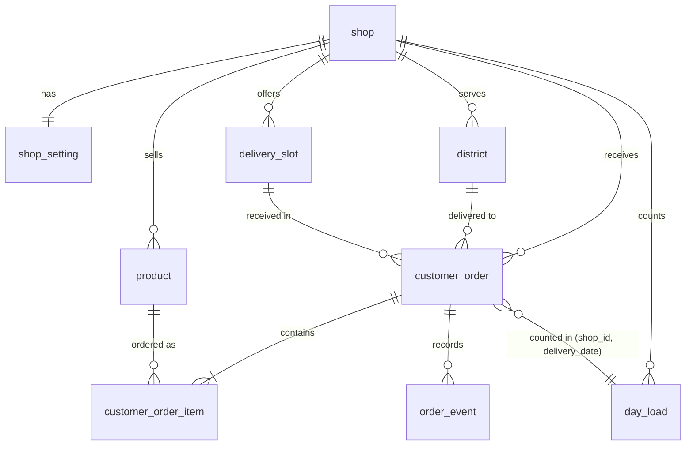

# Data Model: Overview, ER diagram, configuration entities

Part of [data-model.md](../data-model.md) (index, version, change log), sections 1, 2, 3.1 to 3.6. Moved from data-model.md v1.3 with the wording unchanged unless a line carries a newer label [v1.4 | 2026-10-27].

## 1. Overview

Storage: PostgreSQL 16 or newer (ADR-0002, Accepted); the schema uses only standard features available from version 14. The Swift backend reads it through Fluent and PostgresNIO; the schema is defined by the SQL migrations, not by Fluent models [v1.1 | 2026-10-25]. Conventions:

- Table and column names: `snake_case`; table names singular; primary keys named `id` (UUID, generated by the application with UUIDv7 or by `gen_random_uuid()`).
- Every table that belongs to a shop has `shop_id` (UUID, foreign key to `shop`). The launch has one shop; the column lets later slices serve more than one without migration.
- Money: `integer` in whole Vietnamese dong (VND). Times: `timestamptz` stored in UTC. Calendar dates and slot times are in the shop timezone (`shop.timezone`, default `Asia/Ho_Chi_Minh`, A-1) and stored as `date` and `time`.
- Enumerations are `text` columns with CHECK constraints (not native enums) so values can be added by migration without locking.
- `created_at` and `updated_at` are `timestamptz NOT NULL DEFAULT now()` on every table unless stated.
- Tables are named after what they hold. The order table is `customer_order` because `order` is a reserved word.

## 2. Entity Relationship Diagram

## 3. Entities

### 3.1 shop (FR-2, FR-14; BR-10)

Purpose: the shop and its public information. One row at launch.

| Column | Type | Null | Default | Constraints | Notes |
| ------ | ---- | ---- | ------- | ----------- | ----- |
| id | uuid | no | generated | PK | |
| name | text | no | | length 1 to 100 | Shown on S-2 (FR-2) |
| greeting | text | no | | length 1 to 300 | Shown on S-2 |
| phone_contact | text | no | | E.164 pattern `^\+[1-9][0-9]{7,14}$` | Dial number (FR-2, FR-12); shown only through `tel:` |
| zalo_contact | text | no | | length 3 to 100 | Zalo number (digits, international form without `+`) or account id (ADR-0015) |
| timezone | text | no | `Asia/Ho_Chi_Minh` | | IANA name; A-1 |
| is_sample | boolean | no | false | | True for fake seed data (AC-29); never exposed by the API |
| created_at, updated_at | timestamptz | no | now() | | |

### 3.2 shop_setting (BR-1 to BR-4, BR-8, BR-10, ADR-0009)

Purpose: the ordering parameters of a shop, typed and constrained. One row per shop.

| Column | Type | Null | Default | Constraints | Notes |
| ------ | ---- | ---- | ------- | ----------- | ----- |
| shop_id | uuid | no | | PK, FK shop | |
| daily_limit | integer | no | | `> 0` | DAILY_LIMIT, shared across all products (BR-1). Value from the shop; sample value in the seed |
| lead_days | integer | no | 2 | `>= 0` | LEAD_DAYS (BR-2) |
| min_qty | integer | no | 2 | `>= 1` | MIN_QTY (BR-4) |
| max_days_ahead | integer | no | 30 | `>= lead_days` | MAX_DAYS_AHEAD (BR-8) |
| max_qty_per_cake | integer | no | 99 | between 1 and 99 | Input-safety bound (ADR-0009), not a business rule |
| is_sample | boolean | no | false | | |
| created_at, updated_at | timestamptz | no | now() | | |

### 3.3 product (FR-3, FR-4, FR-5, BR-5)

Purpose: a cake the shop sells. The set is four at launch (PRD non-goal: no more products); the table has no limit of four, and the API lists every active row, so one to four is normal when the owner deactivates a cake (owner decision 2026-10-26) [v1.3 | 2026-10-26].

| Column | Type | Null | Default | Constraints | Notes |
| ------ | ---- | ---- | ------- | ----------- | ----- |
| id | uuid | no | generated | PK | Used in API as `product_id` |
| shop_id | uuid | no | | FK shop | |
| slug | text | no | | unique with `shop_id`; `^[a-z0-9-]{1,40}$` | Stable machine name, for example `banana`, `mung-bean-pork-fat`, `mung-bean-vegetarian`, `mung-bean-egg-yolk-pork-fat` |
| name | text | no | | length 1 to 100 | Vietnamese display name |
| description | text | no | | length 1 to 300 | Short description |
| price_vnd | integer | no | | `>= 0` | Current price (BR-5). Changing it never changes past orders (BR-6) |
| image_path | text | no | | | Relative path of the file under `backend/assets/`, for example `images/banana.png`: no leading slash, no `..`. The API field is `image_url` (api.md 4.6 builds it from this column) [v1.3 \| 2026-10-26] |
| sort_order | integer | no | 0 | | Display order |
| is_active | boolean | no | true | | Inactive products are not returned and cannot be ordered |
| is_sample | boolean | no | false | | |
| created_at, updated_at | timestamptz | no | now() | | |

### 3.4 district (FR-8, BR-3)

Purpose: a served district and its flat delivery fee. A district not in this table (or inactive) cannot be chosen.

| Column | Type | Null | Default | Constraints | Notes |
| ------ | ---- | ---- | ------- | ----------- | ----- |
| id | uuid | no | generated | PK | |
| shop_id | uuid | no | | FK shop | |
| name | text | no | | unique with `shop_id`; length 1 to 100 | |
| delivery_fee_vnd | integer | no | | `>= 0` | Flat fee (BR-3). A fee of 0 is allowed as data but the PRD defines no free-delivery case, so launch data has no 0 fee |
| sort_order | integer | no | 0 | | |
| is_active | boolean | no | true | | |
| is_sample | boolean | no | false | | |
| created_at, updated_at | timestamptz | no | now() | | |

### 3.5 delivery_slot (FR-7, BR-11)

Purpose: one entry of the fixed list of delivery time slots, the same for every date. Slots have no capacity.

| Column | Type | Null | Default | Constraints | Notes |
| ------ | ---- | ---- | ------- | ----------- | ----- |
| id | uuid | no | generated | PK | |
| shop_id | uuid | no | | FK shop | |
| start_time | time | no | | | Local shop time |
| end_time | time | no | | `> start_time` | |
| sort_order | integer | no | 0 | | |
| is_active | boolean | no | true | | |
| is_sample | boolean | no | false | | |
| created_at, updated_at | timestamptz | no | now() | | |

Unique `(shop_id, start_time, end_time)`.

### 3.6 day_load (BR-1, BR-9, AC-22, AC-28)

Purpose: the number of cakes accepted per receiving date; the single point where the daily limit is enforced (ADR-0008).

| Column | Type | Null | Default | Constraints | Notes |
| ------ | ---- | ---- | ------- | ----------- | ----- |
| shop_id | uuid | no | | PK part, FK shop | |
| delivery_date | date | no | | PK part | Shop-local calendar date |
| cakes_accepted | integer | no | 0 | `>= 0` | Cakes in orders whose status is not `Cancelled` |
| capacity_limit | integer | no | | `> 0` | Daily limit applied when the row was last raised; CHECK `cakes_accepted <= capacity_limit` |
| updated_at | timestamptz | no | now() | | |

Rows are created on demand. Remaining amount shown to availability logic = `shop_setting.daily_limit - cakes_accepted` (0 or less means full; the current setting is used, not `capacity_limit`). When the owner changes the limit no row is rewritten; see data-model/05 "day_load and the daily limit" [v1.6 | 2026-10-31].
