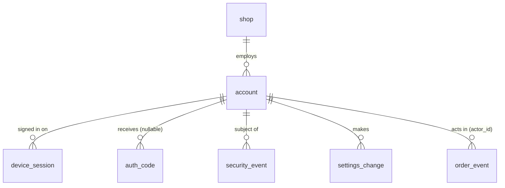

# Data Model: Admin accounts, sessions, codes, security events

Part of [data-model.md](../data-model.md) (index, version, change log), sections 3.10 to 3.16. New in v1.6 [v1.6 | 2026-10-31]. Simplified in v1.8: two tables fewer (`auth_email_state`, `push_token`), see sections 3.12 to 3.14 [v1.8 | 2026-10-31]. Simplified again in v1.9 for PRD v1.6: backup e-mail, recovery codes, device list and per-device revoke removed (columns listed in section 3.17); FR and BR ids are those of PRD v1.6 [v1.9 | 2026-10-31]. Migration `backend/db/migrations/0002_admin_auth.sql`. Conventions of section 1 apply (snake_case, UUID keys, UTC `timestamptz`, `created_at`/`updated_at`). Decisions: ADR-0022, ADR-0024, ADR-0027.

## 2.1 ER diagram (additions)

## 3.10 account (FR-1, FR-3, FR-5; BR-1, BR-4, BR-6) [v1.9 | 2026-10-31]

Purpose: one owner and up to 30 active staff. Never deleted (earlier history keeps the name).

| Column | Type | Null | Default | Constraints | Notes |
| ------ | ---- | ---- | ------- | ----------- | ----- |
| id | uuid | no | generated | PK | |
| shop_id | uuid | no | | FK shop | |
| role | text | no | | CHECK `owner` or `staff` | |
| kind | text | no | `normal` | CHECK `normal` or `review` | `review` only for ADR-0027 |
| email | text | no | | length 3 to 254; stored trimmed, NFC, lower case; UNIQUE `(shop_id, email)` | Personal data; sign-in address (BR-4 compares case-insensitively because of the stored form) |
| display_name | text | no | | length 1 to 100 | Shown in history and lists |
| is_active | boolean | no | true | CHECK `role <> 'owner' OR is_active` | The owner cannot be deactivated (BR-6) |
| deactivated_at | timestamptz | yes | null | | |
| created_at, updated_at | timestamptz | no | now() | | |

Constraints and triggers: partial UNIQUE `(shop_id) WHERE role = 'owner'` (exactly one owner); trigger `account_staff_limit` (takes `FOR UPDATE` on the `shop_setting` row, then counts) refuses a 31st active staff account (BR-6). The unique index on `email` is the only address guard; `account_email_guard` is not built [v1.9 | 2026-10-31]. No DELETE grant to the application role.

## 3.11 device_session (FR-2, FR-4, FR-5, FR-6, FR-7; BR-5, BR-13) [v1.9 | 2026-10-31]

Purpose: one signed-in device and its credential family. One row per signed-in phone; no screen lists the rows.

| Column | Type | Null | Default | Constraints | Notes |
| ------ | ---- | ---- | ------- | ----------- | ----- |
| id | uuid | no | generated | PK | Embedded in both token strings |
| account_id | uuid | no | | FK account | |
| installation_id | uuid | no | | | App-generated; a new sign-in with the same value revokes the older session of that installation |
| platform | text | no | | CHECK `ios` or `android` | |
| device_name | text | no | | length 1 to 60 | Model text; no user-chosen name; used only in the new-device notice (BR-13) |
| push_token | text | yes | null | UNIQUE; length 1 to 512 | The device's push token (FR-25); a token seen on another session is moved here. Null when permission is denied, after sign-out, revoke or deactivation, or when the provider reports it invalid (ADR-0024) [v1.8 | 2026-10-31] |
| push_apns_environment | text | yes | null | CHECK `production` or `sandbox`; required when `push_token` is set and `platform = 'ios'` | [v1.8 | 2026-10-31] |
| sign_in_method | text | no | | CHECK `code`, `review` | `recovery` removed [v1.9 | 2026-10-31] |
| access_token_hash | bytea | no | | length 32 | SHA-256 of the access token |
| access_expires_at | timestamptz | no | | | Created + 300 s |
| refresh_token_hash | bytea | no | | length 32 | Current refresh credential |
| previous_refresh_hash | bytea | yes | null | length 32 | The one before; used for the 20 s grace and for reuse detection |
| refresh_rotated_at | timestamptz | yes | null | | Time of the last rotation |
| refresh_expires_at | timestamptz | no | | | Restarted to now + 7 days on each refresh (BR-5) |
| last_used_at | timestamptz | no | now() | | Written at most once per 5 minutes |
| revoked_at | timestamptz | yes | null | | Set once |
| revoked_reason | text | yes | null | CHECK `signed_out`, `signed_out_others`, `account_deactivated`, `reuse_detected`, `replaced`, `expired_cleanup` (`revoked_by_owner` replaced by `signed_out_others` [v1.9 | 2026-10-31]) | CHECK `(revoked_at IS NULL) = (revoked_reason IS NULL)` |
| created_at | timestamptz | no | now() | | |

Indexes: `(account_id) WHERE revoked_at IS NULL` (deactivation, sign out other phones); `(installation_id)`; `(revoked_at)` for cleanup. A session is valid when `revoked_at IS NULL`, the account is active, and the matching expiry is in the future.

## 3.12 auth_code (FR-1, FR-6; BR-4) [v1.9 | 2026-10-31]

Purpose: one-time codes. Also written for unregistered addresses (`account_id` null, `code_hmac` random, `mail_sent_at` null) so behaviour is identical (ADR-0022).

| Column | Type | Null | Default | Constraints | Notes |
| ------ | ---- | ---- | ------- | ----------- | ----- |
| id | uuid | no | generated | PK | |
| email | text | no | | stored form of 3.10 | Address the code is for; personal data; purged 24 h after expiry |
| account_id | uuid | yes | null | FK account | Null for unknown addresses |
| code_hmac | bytea | no | | length 32 | HMAC-SHA256 with `AUTH_CODE_PEPPER` over the address and the code |
| created_at | timestamptz | no | now() | | |
| expires_at | timestamptz | no | | | Created + 10 minutes |
| consumed_at | timestamptz | yes | null | | Set on use or when a newer code replaces it |
| mail_sent_at | timestamptz | yes | null | | Counts toward the daily mail cap |
| wrong_count | smallint | no | 0 | CHECK 0 to 5 | Wrong entries against this code. At 5 the code is void: usable means `consumed_at IS NULL AND wrong_count < 5 AND now() < expires_at`. |

Indexes: `(email, created_at DESC)` (resend wait, hourly count, latest code); `(created_at)` (daily cap, cleanup).

Counters are derived, not stored in a second table [v1.8 | 2026-10-31] (BR-4, Q-20): the 30 s wait and the 3 an hour limit count rows of the same `email`; there is no lock on the address. A wrong entry runs `SELECT ... FOR UPDATE` on the latest usable code, compares the HMAC and, if wrong, adds 1 to `wrong_count`; with no usable code nothing is counted (an attacker needs a fresh code to guess again, so at most 3 codes x 5 tries = 15 wrong entries per address an hour). Unknown addresses use phantom rows with the same columns, so behaviour is identical.

## 3.13 (removed) [v1.8 | 2026-10-31]

`auth_email_state` is gone: with no time lock, the only counter is `auth_code.wrong_count` (section 3.12). Number kept so references stay valid.

## 3.14 (merged into 3.11) [v1.8 | 2026-10-31]

`push_token` is two columns of `device_session` (one token per device was always the rule). Sending reads `device_session` rows with `push_token IS NOT NULL`, `revoked_at IS NULL`, an active account and `kind <> 'review'`. Sign-out, sign out other phones and deactivation set the column to null in the same statement that sets `revoked_at`. FR-25; ADR-0024.

## 3.15 security_event (audit of access, not of orders)

Append-only (trigger rejects UPDATE and DELETE). Columns: `id` bigint identity PK; `at` timestamptz; `event_type` CHECK in `sign_in`, `sign_in_review`, `sign_out`, `sign_out_others`, `refresh_reuse_detected` (`sign_in_recovery`, `device_revoked`, `backup_email_changed` and the column `actor_account_id` removed [v1.9 | 2026-10-31]); `account_id` uuid null; `device_session_id` uuid null (the calling session for `sign_out_others`); `platform` text null. No e-mail address, no code. Account added, deactivated and reactivated are recorded in `settings_change` (entity `account`, section 3.16), not here [v1.8 | 2026-10-31]; code voiding is a log line only. Retention 180 days (purged by the maintenance task).

## 3.16 settings_change (FR-20 to FR-24; BR-3)

Append-only. Columns: `id` bigint identity PK; `batch_id` uuid (one save of one form); `shop_id`; `actor_account_id` FK account; `actor_name` text (snapshot); `entity_type` CHECK `shop`, `ordering`, `district`, `slot`, `cake`, `account`; `entity_id` uuid null; `field` text; `old_value` text null; `new_value` text null; `changed_at` timestamptz default now(). Money and numbers are stored as decimal text. Account rows record only `is_active`, never the address. Retention: kept with the shop (no personal data).

## Sensitive data added

| Field | Classification | Who may read | Retention |
| ----- | -------------- | ------------ | --------- |
| account.email, display_name | personal | Backend; owner sees all accounts, staff see their own | While the account exists (accounts are not deleted); operator erases on request |
| auth_code.email, code_hmac, wrong_count | personal / secret hash | Backend only | 24 h after expiry |
| device_session.*_hash, device_name | secret hash / operational | Backend only | Revoked or expired rows removed 30 days later |
| device_session.push_token | operational (identifies a device to Apple or Google) | Backend | Null at sign-out, sign-out of other phones, deactivation; row removed 30 days later |
| security_event | operational | Operator | 180 days |
| E-mail addresses | Never in logs, error bodies, URLs or analytics (NFR, BR-15); log lines carry the request id and a code only |

## 3.17 Removed in v1.9 [v1.9 | 2026-10-31]

| Removed | Feature (PRD deferred item) |
| ------- | --------------------------- |
| `account.backup_email`, `account.backup_email_confirmed_at`, trigger `account_email_guard` | Backup e-mail (P-1) |
| `auth_code.purpose`, `auth_code.challenge_id`, purposes `recovery_owner`, `recovery_backup`, `backup_confirm` | Two-code recovery (P-1) |
| `device_session.sign_in_method = recovery`, `revoked_reason = revoked_by_owner` (replaced by `signed_out_others`) | Recovery, per-device revoke (P-1, P-2) |
| `security_event` types `sign_in_recovery`, `device_revoked`, `backup_email_changed`; column `actor_account_id` | Same |
| Index use "device list" | Device list (P-2) |

Admin tables stay 5 (`account`, `device_session`, `auth_code`, `security_event`, `settings_change`).
