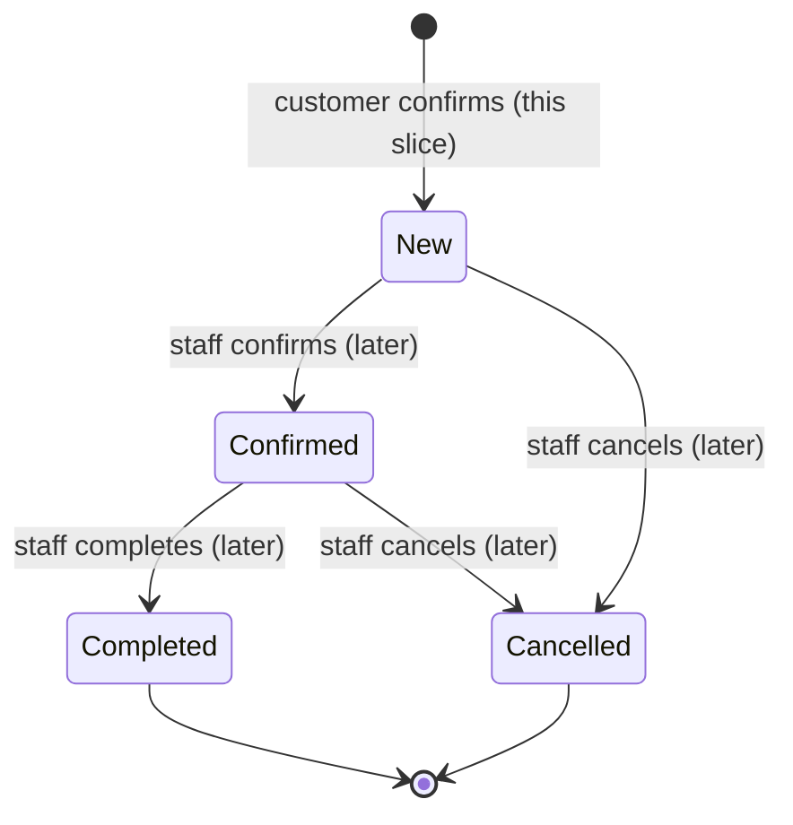

# Order Lifecycle

| Field        | Value |
| ------------ | ----- |
| Version      | 1.5 [v1.5 | 2026-10-31] |
| Last updated | 2026-10-31 |
| Status       | Draft |
| Owner        | atlas-architect |
| Based on     | product/place-order.md v1.2; design/place-order-ui.md v1.0; product/admin-orders.md v1.2 [v1.5 | 2026-10-31] |
| Related      | data-model.md; api.md; admin-order-handling.md; ADR-0008, ADR-0010, ADR-0028, ADR-0030 |

## 1. Purpose & Scope

How an order is created from the customer's confirmation, and the states an order moves through during its life. In this slice only creation is implemented (the order enters `New`). The other transitions are specified now so the data model and the database guard are right from the start; their endpoints belong to the later staff and owner slices. The staff and owner endpoints now exist: see admin-order-handling.md and api/06 [v1.5 | 2026-10-31].

## 2. Actors

| Actor | Role |
| ----- | ---- |
| Customer | Anonymous; starts creation from the app (FR-11) |
| Staff / owner | Later slice: confirm, complete, cancel |
| System | Backend and database: checks rules, counts capacity, assigns the code, writes the audit trail |

## 3. Main Flow: place an order

```mermaid
sequenceDiagram
    actor C as Customer app
    participant API as Backend API
    participant DB as PostgreSQL
    C->>API: GET /v1/catalog (cached copy shown first)
    C->>API: GET /v1/availability?cakes=N
    API->>DB: read settings and day_load
    API-->>C: dates with available / reason
    Note over C: Customer reviews the order; client generates Idempotency-Key
    C->>API: POST /v1/orders (Idempotency-Key, expected_total_vnd)
    API->>API: limits, validation, rules, price check
    API->>DB: BEGIN
    API->>DB: ensure day_load row; conditional UPDATE (cakes + n <= limit)
    alt capacity ok
        API->>DB: INSERT customer_order (New), items, order_event(created)
        API->>DB: COMMIT
        API-->>C: 201 order_code
    else date full
        API->>DB: ROLLBACK
        API-->>C: 409 DATE_CAPACITY
    end
```

Steps:

1. The app shows cached shop data and refreshes it (ADR-0011). FR-2, FR-3.
2. After the customer chose cakes, the app asks for availability for the number of cakes. FR-6, BR-1, BR-2, BR-8.
3. The customer chooses date, slot, enters recipient data and reviews. The app computes the displayed total from the catalog. FR-9, BR-5.
4. On Confirm the app sends the order with a fresh `Idempotency-Key` and the shown total. The screen becomes inert. FR-16.
5. The server checks limits, validates fields (FR-13), looks up the key, checks rules in the order of api.md 4.3, checks the price acknowledgement (ADR-0010).
6. The repository (`OrderRepository.insertOrder`) opens the transaction, not the service [v1.4 | 2026-10-29]; it takes capacity with the conditional update, inserts the order with status `New`, its items with price snapshots, and the `created` event, then commits. BR-1, BR-5, BR-6, BR-7.
7. The server returns the code; the app shows S-9 (FR-11). No status is shown (non-goal).

## 4. Alternate & Error Flows

| Case | Handling | Trace |
| ---- | -------- | ----- |
| Date full when confirming (another order took the room) | 409 `DATE_CAPACITY`; nothing stored; S-8 shows `ERR_DATE_CAPACITY`; the customer picks another date; data kept | AC-9, AC-22 |
| Total cakes below minimum | 422 `MIN_QTY`; S-8 blocks confirm and links to S-5 | BR-4, AC-13 |
| Midnight passes during the flow so the date is now too soon or too far | 422 `DATE_LEAD` / `DATE_HORIZON` (order date taken at confirmation, A-8) | BR-2, BR-8, FR-10 |
| District deactivated | 422 `DISTRICT_UNSERVED` | BR-3 |
| Price or fee changed | 409 `PRICE_CHANGED` with new values; the app updates the review; the customer confirms again (ADR-0010 Accepted) [v1.1 | 2026-10-25] | BR-5, BR-6, AC-23 |
| No connection | Request never leaves; `ERR_OFFLINE`; data kept; retry uses the same key | FR-17, AC-20 |
| Timeout or lost response (order may exist) | `ERR_TIMEOUT`; retry with the same key returns 200 replay with the same code; no second order | FR-16, AC-19 |
| Customer taps Confirm twice | The UI is inert after the first tap; if two requests still arrive, the unique key resolves it | FR-16 |
| Same key, edited order | 422 `IDEMPOTENCY_KEY_REUSED`; the app should have created a new key; it creates one and retries once | FR-16 |
| Database unavailable | 503 `SERVICE_UNAVAILABLE`; transaction never committed; retry with the same key | FR-17 |
| Order code collision | Roll the whole transaction back (counter included) and run a new one with a new code, up to 5 draws; then 500 and retry [v1.4 | 2026-10-29] | AC-16 |
| App killed after sending | The draft keeps the key; reopening and confirming again returns the stored order if it exists | ADR-0011 |
| Too many orders from one phone or IP | 429 `RATE_LIMITED` | ADR-0014 |

Local and server checks on S-8 [v1.3 | 2026-10-28]. The app blocks the Confirm button only for what it can know without the clock and capacity of the server: total cakes below the minimum (BR-4), a cake no longer in the catalogue (BR-13), missing date or slot, and a district not served (BR-3, from the cached catalogue). Lead time (BR-2), horizon (BR-8), capacity (BR-1) and price (BR-5, BR-6) are never decided locally, because the cached `server_date` and catalogue can be up to 7 days old (ADR-0011) and a local verdict would be wrong in both directions. They are answered by the server (`DATE_LEAD`, `DATE_HORIZON`, `DATE_CAPACITY`, `PRICE_CHANGED`) and shown as errors on S-8; the dates offered on S-6 come from a fresh availability call. Field format rules (ADR-0009) are checked locally and again by the server.

Idempotency key [v1.3 | 2026-10-28]: replaced on every change of the request body, kept for a pure retry (ADR-0008 v1.1). The "Fresh Idempotency-Key" in step 4 means a key belonging to the current content.

## 5. Business Rules Applied

| Rule | Enforced by |
| ---- | ----------- |
| BR-1 Daily limit, shared total | Conditional update on `day_load` plus CHECK; availability endpoint for display (ADR-0008) |
| BR-2 Lead time, calendar days, no cut-off | Server date in shop time; `delivery_date >= order_date + lead_days` |
| BR-3 Served districts, flat fee | Foreign key to active `district`; fee snapshot |
| BR-4 Minimum quantity | Server check against `shop_setting.min_qty` |
| BR-5 Total | Server computes; CHECK `total = subtotal + fee`; acknowledgement check |
| BR-6 Price kept | Snapshot columns; immutable trigger |
| BR-7 No account | Anonymous endpoint; order identified by code |
| BR-8 Horizon | Server date plus `max_days_ahead` |
| BR-9 Cancellation returns cakes | Trigger on status `Cancelled` (section 6) |
| BR-10, BR-11 Uniform rules, slots without capacity | One settings row; no capacity column on slots |
| BR-12 Retention | `pii_purged_at` placeholder (data-model.md) |

## 6. State Machine



Final states: `Completed`, `Cancelled`. Every non-final state (`New`, `Confirmed`) has an exit.

| From | To | Trigger | Actor | Guard | Side effects |
| ---- | -- | ------- | ----- | ----- | ------------ |
| (none) | New | `POST /v1/orders` accepted | Customer (via system) | All rules in api.md 4.3 pass; capacity taken | Row inserted with snapshots; `day_load` increased; `order_event` `created`. Implemented in this slice |
| New | Confirmed | Staff confirms | Staff, owner | Authenticated staff (later slice) | `order_event` `status_changed`; customer is contacted outside the app. Capacity unchanged |
| New | Cancelled | Staff cancels | Staff, owner | Authenticated (later) | `day_load.cakes_accepted` reduced by `total_cakes`; event written |
| Confirmed | Completed | Delivery done | Staff, owner | Authenticated (later) | Event written; capacity unchanged (the cakes were made) |
| Confirmed | Cancelled | Staff cancels | Staff, owner | Authenticated (later) | Capacity released as above; event written |

Admin-orders additions [v1.5 | 2026-10-31]: "Authenticated (later)" is now an active owner or staff session calling `POST /v1/admin/orders/{order_code}/status` with `expected_status` (stale view: 409, ADR-0028); a cancellation also requires a `cancel_reason` stored on the order and copied into the event (ADR-0030), and after it the order no longer counts toward the per-phone limit unless the reason is `fake_spam` (FR-44). Completed is allowed at any time after Confirmed (BR-2).

Any other pair is rejected by the database trigger `customer_order_status_guard` even for direct SQL, for example `Completed -> New`, `Cancelled -> Confirmed`, `New -> Completed`, and any change out of a final state. Each allowed change also writes its `order_event` through the trigger (rows above say "event written"; Confirmed and Completed do too) [v1.2 | 2026-10-26]. The status guard and the capacity release trigger are created in this slice (data-model.md section 5) so AC-28 can be tested at database level now.

## 7. Concurrency & Idempotency

- Two orders for the same date at the same time: the second blocks on the `day_load` row lock until the first commits, then re-evaluates the condition on the new value; exactly one succeeds when room exists for one (AC-22). Orders for different dates do not block each other.
- Cancel and create at the same time: the counter is changed atomically (`cakes_accepted - n`, `cakes_accepted + n`); both orders are correct in any order.
- Same key twice at once: the unique index lets one insert win; the other reads the winner and returns the same code.
- Retry after an unknown outcome: safe (replay). Retry after a rejection: the rejection left no state, so the order is evaluated again.
- Lock order: one `day_load` row per order and no other row locks, so no deadlock between orders.

## 8. Events & Audit

| Moment | Record |
| ------ | ------ |
| Order accepted | `order_event(created, to_status=New, actor_type=customer)` in the same transaction |
| Each later status change | `order_event(status_changed, from, to, actor_type, actor_id)` written by the trigger `customer_order_release_capacity` on every status change (confirm, complete and cancel alike), so it cannot be skipped. The actor is `system` unless the staff endpoint sets `app.actor_type` and `app.actor_id` in the same transaction (data-model.md 3.9) [v1.2 \| 2026-10-26] |
| Rejections | Not stored in the database; one structured log line without personal data: request id, code, platform, app version (deployment.md section 7) |

## 9. Traceability

Each flow step above traces to FR-9, FR-10, FR-11, FR-13, FR-16, FR-17, FR-18 and BR-1 to BR-9 as listed. Acceptance criteria exercised: AC-9, AC-13, AC-14, AC-15, AC-16, AC-19, AC-20, AC-22, AC-23, AC-28 (database level now, with cancellation later), AC-24.

## 10. Open Questions / Change log

| ID | Question | Why it matters | Blocking | Class | Status | Answer |
| -- | -------- | -------------- | -------- | ----- | ------ | ------ |
| OL-Q1 | Price-change behaviour (ADR-0010) | Alternate flow "Price or fee changed" | No | business | Closed: owner accepted reject and re-review (2026-10-25) | Owner |

| Version | Date | Change |
| ------- | ---- | ------ |
| 1.0 | 2026-10-25 | First version. |
| 1.1 | 2026-10-25 | ADR-0010 accepted; no flow change. |
| 1.2 | 2026-10-26 | Audit trigger wording aligned with the built migration (event on every status change). |
| 1.3 | 2026-10-28 | Slice 2 review: split of local and server checks on S-8; key rule pointer to ADR-0008 v1.1. No flow change. |
| 1.5 | 2026-10-31 | admin-orders: staff transitions are live (pointer to admin-order-handling.md); `expected_status`, cancel reason, per-phone count rule. No change to the state machine. |
| 1.4 | 2026-10-29 | Slice 3 resync: transaction opened inside `OrderRepository.insertOrder`; collision retry is a new transaction, not a savepoint; replay body byte-identical (sorted keys). No flow change. |
