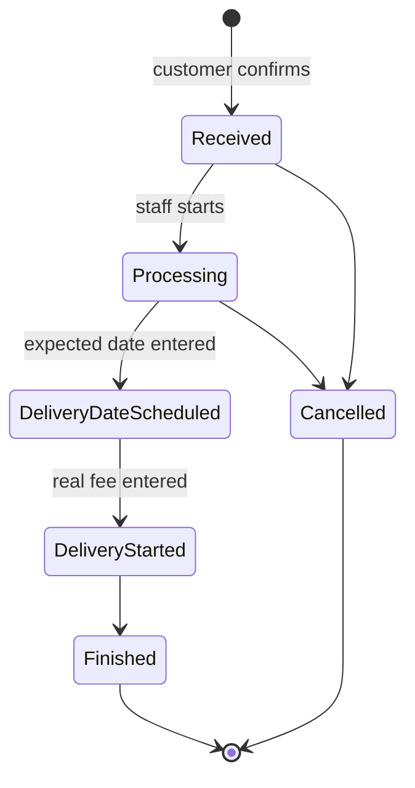

# Order Process: statuses, transitions, queries

| Field | Value |
| ----- | ----- |
| Version | 1.2 [v1.2 | 2026-11-02] |
| Status | Draft |
| Owner | atlas-architect |
| Based on | product/admin-orders.md v1.10 (BR-2, BR-9, BR-11, BR-15, FR-13, FR-16 to FR-19, FR-28, FR-29); ADR-0033 |
| Related | order-lifecycle.md (creation flow; its section 6 is superseded by this file), data-model/06, api/09, ADR-0028, ADR-0029, ADR-0033 |

## 1. State machine [v1.0 | 2026-11-02]



Final: `Finished`, `Cancelled`. A date move is not a transition: status stays `DeliveryDateScheduled`.

## 2. Transition table

| From | To | Input (required) | Guard | Side effects |
| ---- | -- | ---------------- | ----- | ------------ |
| (none) | Received | customer order | rules of api.md 4.3 | capacity taken, event `created` |
| Received | Processing | none | owner or staff; `expected_status` | event |
| Processing | DeliveryDateScheduled | `expected_delivery_date` from shop today to today + 7 [v1.2 | 2026-11-02] | as above | sets the date; one `order_expected_date_change` row (old date null); event |
| DeliveryDateScheduled | DeliveryStarted | `delivery_fee_final_vnd` integer 0 to 10 000 000 | as above | stores fee and `delivery_fee_set_at`; event |
| DeliveryStarted | Finished | none | as above | event; capacity unchanged |
| Received, Processing | Cancelled | `cancel_reason` (ADR-0030) | as above | releases `total_cakes` on the requested date; event |
| (date move) | same status | `expected_delivery_date` from shop today to today + 7 [v1.2 | 2026-11-02] | status is `DeliveryDateScheduled` and stored date equals `previous_expected_delivery_date` | updates the date; one change row (old, new) |

| (fee correction) | same status | `delivery_fee_vnd` 0 to 10 000 000, different from the stored fee [v1.2 | 2026-11-02] | status is `DeliveryStarted` and stored fee equals `previous_delivery_fee_vnd` | updates the fee and `delivery_fee_set_at`; one `order_fee_correction` row |

Every other pair is refused: 422 `STATUS_TRANSITION_INVALID`, no write (includes cancel from `DeliveryDateScheduled` onward, skipping a step, leaving a final state). The database trigger `customer_order_status_guard` holds the same pairs (recreated in migration 0008).

## 3. Rules

- Compare-and-set and replay: ADR-0033 section Decision 2; check order of ADR-0028 unchanged (session, window with replay exception, fields, pair, then the conditional UPDATE).
- Capacity: only the requested `delivery_date` counts; moving the expected date changes no `day_load` row (BR-15).
- Fee: required only at DeliveryDateScheduled to DeliveryStarted; refused at every other step (`FIELD_NOT_ALLOWED`). Amount to collect = `items_subtotal_vnd + delivery_fee_final_vnd`, shown only after the fee exists; the stored estimate (`delivery_fee_vnd`) is shown to the customer only.
- The expected date is changeable only in `DeliveryDateScheduled`; unlimited times; no daily limit, lead-day or slot check. Range [v1.2 | 2026-11-02]: shop today (Vietnam calendar, computed at request time by the server) to today + 7, both inclusive, checked on every entry and every move; a replay (ADR-0033 Decision 2) skips the range check. Errors: `EXPECTED_DATE_PAST`, `EXPECTED_DATE_TOO_FAR`.
- Fee correction [v1.2 | 2026-11-02]: only in `DeliveryStarted`, by owner or staff, unlimited times, compare key and replay in ADR-0033 Decision 10. Check order: session, role, body fields, `expected_status` must be `DeliveryStarted` (else 422 `FEE_CORRECTION_NOT_ALLOWED`, no write), range, new fee equals `previous` in the body (422 `FEE_UNCHANGED`, wins over 409 [v1.3 | 2026-11-02]), then the conditional UPDATE. After `Finished` the key fails: 409 `ORDER_STATE_CHANGED`; the trigger refuses any later change of the fee even by direct SQL. The record (account name, time, old, new) is never edited or deleted. No push, no customer message; `amount_to_collect_vnd` follows the latest fee.
- Customer is not messaged on a date move; no new push (ADR-0024 unchanged: push only for new orders).

## 4. Queries (shop date `:today`)

```sql
-- list date
COALESCE(expected_delivery_date, delivery_date) AS list_date
-- open set
status IN ('Received','Processing','DeliveryDateScheduled','DeliveryStarted')
-- badge and red mark
open AND COALESCE(expected_delivery_date, delivery_date) <= :today
-- window (ADR-0029, unchanged shape)
open OR (status IN ('Finished','Cancelled') AND created_at >= :today_start - 90 days)
-- sort
ORDER BY list_date, slot_start, created_at, id
```

Cursor note: the sort key now changes when a date moves, so a page can repeat or skip a row across pages; the apps refresh from page 1 after any status or date change (R-14 stays: list is the truth). Index: partial `customer_order_open_list_idx ON (shop_id, (COALESCE(expected_delivery_date, delivery_date)), slot_start_time, created_at, id) WHERE status IN (open four)` replaces the use of `customer_order_shop_date_status_idx` for the open view.

Filter values of `GET /v1/admin/orders?status=`: `todo` (the four open steps, default), each of the six names, `all` (api/09).

## 5. Answers for forge-dev [v1.1 | 2026-11-02]

- Estimate and `total_vnd`: `delivery_fee_vnd` and `total_vnd` are the stored estimate made at order time, unchanged, immutable; the real fee is `delivery_fee_final_vnd` (ADR-0033 Decision 4).
- Amount to collect: `items_subtotal_vnd + delivery_fee_final_vnd` once the fee exists. Old orders with no real fee: rows that migrate to `Finished` are backfilled with fee = estimate, so they show `items_subtotal_vnd + delivery_fee_vnd`. Old open orders (Processing and earlier) have no fee until staff enter it; the amount shows empty until then.
- Events: a status change writes one `order_event` (`status_changed`, new words). The fee entry is part of the DeliveryDateScheduled to DeliveryStarted event (fee stored on the order). The first date entry and every move write an `order_expected_date_change` row, not an `order_event` row. History = both merged by time; legacy words mapped on read (data-model/06 section 5).
- Skip: "Delivery date scheduled" cannot be skipped; Processing to DeliveryStarted is `STATUS_TRANSITION_INVALID`, so the date always exists before a fee.
- After delivery started: the date may not move (409 `ORDER_STATE_CHANGED`, the order is no longer DeliveryDateScheduled).
- Stale date move: compare key `(status, previous_expected_delivery_date)`; two staff moving at once, the second gets 409 with the current detail (ADR-0033 Decision 2).
- Push text: no new push per step (ADR-0024). Existing new-order text: `backend/Sources/App/Services/Admin/Push/PushSender.swift` (arguments order code, cakes, display date); sent from the order placement path. Nothing to change there.
- Old admin builds and cutover: ADR-0033 Old clients; no `APP_UPDATE_REQUIRED` is built.

## 6. Change log

| Version | Date | Change |
| ------- | ---- | ------ |
| 1.3 | 2026-11-02 | FEE_UNCHANGED before 409; shop today from the injectable server clock (api/09). |
| 1.2 | 2026-11-02 | Date range today to today + 7; fee correction rules (ADR-0033 Decisions 9 and 10). |
| 1.1 | 2026-11-02 | Section 5 answers; `order_event` history is kept, not remapped. |
| 1.0 | 2026-11-02 | First version (ADR-0033). |
