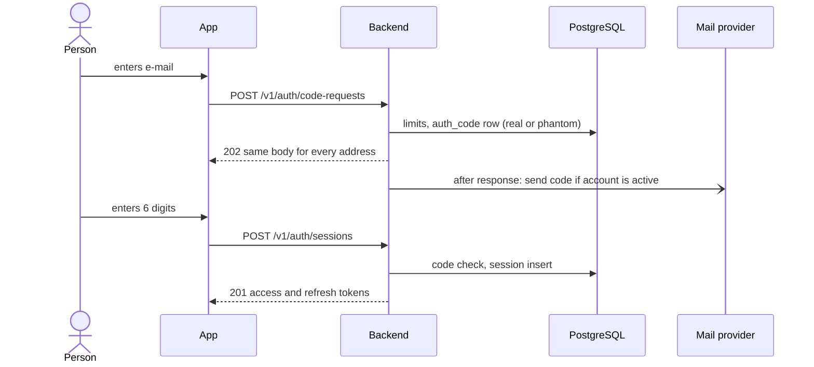
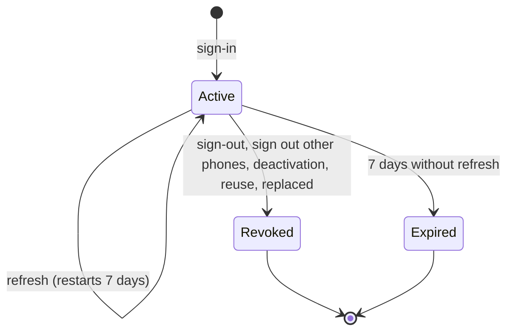

# Admin Sign-in and Session Lifecycle

| Field        | Value |
| ------------ | ----- |
| Version      | 1.3 [v1.3 | 2026-10-31] |
| Last updated | 2026-10-31 |
| Status       | Draft |
| Owner        | atlas-architect |
| Based on     | product/admin-orders.md v1.6 (FR-1 to FR-8, BR-1, BR-4 to BR-6, BR-13, BR-14) [v1.3 | 2026-10-31] |
| Related      | auth.md; api/05; data-model/04; ADR-0022, ADR-0023 |

## 1. Purpose & Scope

How a person signs in by e-mail code, how a device session lives, renews and ends, and how a person signs out all other phones. Values and storage: auth.md and data-model/04.

## 2. Actors

Staff, owner, system (mail sender, maintenance task), operator (creates the first owner).

## 3. Main Flow: sign in

Steps: (1) request, limits first, then the row; (2) the mail is sent after the response; (3) verification: latest usable code (unused, fewer than 5 wrong entries, unexpired), HMAC compare, a wrong entry adds 1 to the code's `wrong_count`; (4) success consumes the code, decides whether the device is new (below), replaces an older session of the same installation, creates the session, writes a security event [v1.2 | 2026-10-31]; (5) owner only, device new: the new-device notice is sent after the response (FR-7, BR-13): to the owner address only, with phone model, time and the advice to use "Sign out all other phones", no code or link; one retry after 5 s; a failure is logged and never affects the sign-in. "New" means no unrevoked, unexpired session of the owner account has this `installation_id` when the code is accepted (ADR-0022). Staff, renewals and review sign-ins send nothing. First owner: the operator runs `bootstrap-owner` (A-2).

## 4. Alternate & Error Flows

| Case | Handling | Trace |
| ---- | -------- | ----- |
| Unregistered or inactive address | Same 202 and same later errors; phantom row, no mail | FR-1, FR-6 |
| Resend before 30 s, fourth code in an hour, daily or per-address cap | 429 `CODE_RESEND_WAIT` or `CODE_REQUEST_LIMIT` with seconds | FR-1, BR-4 |
| Wrong code (fifth) | The 5th wrong entry voids the code: 422 `CODE_EXPIRED` ("request a new code"), also for its correct digits later; no time lock; a new code after 30 s starts a fresh count of 5 | BR-4 |
| Code older than 10 minutes or used | `CODE_EXPIRED` or `CODE_INVALID`; a new code makes older ones invalid | BR-4 |
| Mail provider failure | Logged without the address; the person requests a new code | FR-1 |
| Refresh response lost | Retry with the old refresh token within 20 s returns a new pair | FR-6, BR-5 |
| Old refresh token replayed later | Whole session revoked (`reuse_detected`), 401 `SESSION_REVOKED` | FR-6, BR-5 |
| Person taps "Sign out all other phones" | Every other session of the account revoked in one transaction, push tokens cleared; the calling phone stays; the other phones are refused on their next request | FR-4 |
| Owner deactivates a staff account | All sessions of that account revoked at once; renewal impossible | FR-5 |
| Mail service fails when sending the new-device notice | Sign-in succeeds; failure logged without addresses | FR-7 |
| Sign-out while offline | App clears data and shows sign-in at once; keeps a pending sign-out (refresh token only), unregisters the push token locally, repeats refresh then `DELETE /v1/admin/session` when online, for 7 days at most | FR-2 |

## 5. State Machine (device session)

| From | To | Trigger | Actor | Guard | Side effects |
| ---- | -- | ------- | ----- | ----- | ------------ |
| (none) | Active | Correct code | Person | Account active, code usable (not void) | Tokens issued, older session of the installation revoked, security event, push token not yet set |
| Active | Active | `POST /v1/auth/refresh` | Device | Current hash, or previous hash within 20 s | New hashes, `refresh_expires_at` = now + 7 days, previous hash kept |
| Active | Revoked | Sign-out | Person | Own device | Push token deleted |
| Active | Revoked | Sign out other phones | Person | Not the calling session; own account | Push tokens deleted; one event |
| Active | Revoked | Deactivation | Owner | Target is staff | All sessions of the account, tokens deleted, same transaction |
| Active | Revoked | Reuse | System | Old hash after the grace | Event `refresh_reuse_detected` |
| Active | Expired | Clock | System | `refresh_expires_at` passed | Cleanup after 30 days |

Final states: Revoked, Expired. A request is served only for Active sessions of active accounts with an unexpired access token.

## 6. Lost phone and lost mailbox (no recovery flow) [v1.3 | 2026-10-31]

A lost owner phone: the owner signs in with one code on a new phone and taps "Sign out all other phones". A lost owner mailbox: the operator recovers the owner account outside the app (PRD A-7); there is no backup address and no two-code flow in this version (P-1 deferred).

## 7. Business Rules Applied

BR-4 (code, limits, void after 5 wrong): auth/abuse-secrets-threats.md 4.2. BR-5 (7 days, renewal, reuse, 5 minutes): section 5 above. BR-6 (30 staff, owner protected): data-model/04 trigger. BR-13 (new-device notice): section 3, step 5. BR-14 (review account): ADR-0027.

## 8. Concurrency & Idempotency

Two refreshes at once with the same token: the row update is conditional on the presented hash; the loser repeats the lost-response path inside the grace window. Two sign-ins with the same code: the consume update is conditional (`consumed_at IS NULL`); one wins. Deactivation and sign-in racing: the session insert checks `is_active` in the same statement.

## 9. Events & Audit

`security_event` rows for sign-in, sign-out, sign out other phones, reuse (account changes are in `settings_change`); no address and no code stored.

## 10. Open Questions / Change log

| ID | Question | Why it matters | Blocking | Class | Status | Answer |
| -- | -------- | -------------- | -------- | ----- | ------ | ------ |
| SL-Q1 | May the owner sign in on any device with one code (as staff do), or only with two codes? | Business behaviour of the powerful account | No | business | Closed 2026-10-31: ALWAYS one code; two-code recovery stays a separate flow | Owner |
| SL-Q2 | Notice on an owner sign-in from a new device | Tripwire for a mailbox takeover | No | business | Closed 2026-10-31 (Q-24); backup-address copy dropped in v1.3 (D-3): owner address only | Owner |

| Version | Date | Change |
| ------- | ---- | ------ |
| 1.0 | 2026-10-31 | First version. |
| 1.1 | 2026-10-31 | SL-Q1 closed by the owner (one code), SL-Q2 opened, offline sign-out row, recovery separated from ordinary sign-in. |
| 1.2 | 2026-10-31 | Aligned with PRD v1.4: 5th wrong entry voids the code, no time lock, recovery counters separate, new-device notice (TQ-11, TQ-13); SL-Q2 closed. |
| 1.3 | 2026-10-31 | PRD v1.6: recovery flow, backup address and per-device revoke removed; "Sign out all other phones" added; notice to the owner address only; ids renumbered. |
