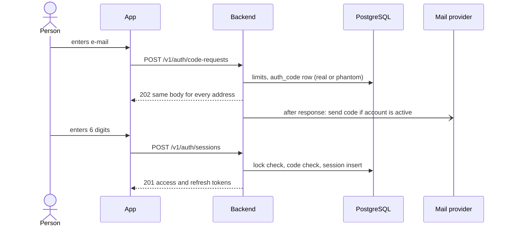
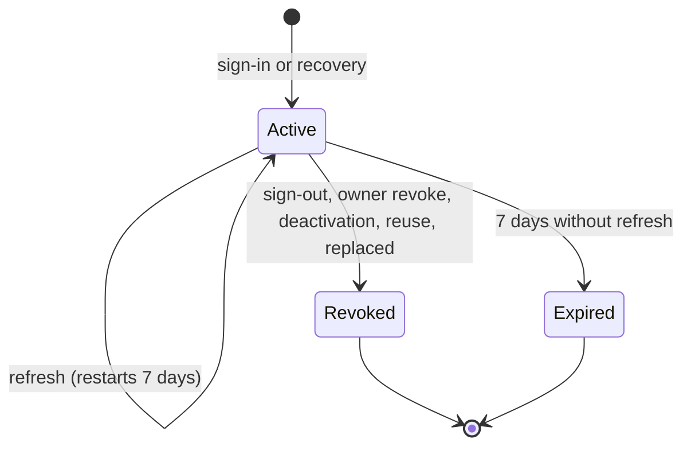

# Admin Sign-in and Session Lifecycle

| Field        | Value |
| ------------ | ----- |
| Version      | 1.1 [v1.1 | 2026-10-31] |
| Last updated | 2026-10-31 |
| Status       | Draft |
| Owner        | atlas-architect |
| Based on     | product/admin-orders.md v1.2 (FR-1 to FR-7, FR-36, FR-37, FR-42, FR-43, BR-5 to BR-8, BR-17) |
| Related      | auth.md; api/05; data-model/04; ADR-0022, ADR-0023 |

## 1. Purpose & Scope

How a person signs in by e-mail code, how a device session lives, renews and ends, and how the owner recovers. Values and storage: auth.md and data-model/04.

## 2. Actors

Staff, owner, system (mail sender, maintenance task), operator (creates the first owner).

## 3. Main Flow: sign in

Steps: (1) request, limits first, then the row; (2) the mail is sent after the response; (3) verification: lock, latest code, expiry, HMAC compare; (4) success consumes the code, replaces an older session of the same installation, creates the session, writes a security event. First owner: the operator runs `bootstrap-owner` (A-2).

## 4. Alternate & Error Flows

| Case | Handling | Trace |
| ---- | -------- | ----- |
| Unregistered or inactive address | Same 202 and same later errors; phantom row, no mail | FR-1, AC-2 |
| Resend before 30 s, fourth code in an hour, daily or per-address cap | 429 `CODE_RESEND_WAIT` or `CODE_REQUEST_LIMIT` with seconds | FR-3, FR-6, AC-6, AC-9 |
| Wrong code (fifth) | 422 `CODE_INVALID`; address locked 15 minutes; later attempts `CODE_LOCKED` even if correct | AC-8 |
| Code older than 10 minutes or used | `CODE_EXPIRED` or `CODE_INVALID`; a new code makes older ones invalid | AC-4, AC-5, AC-6 |
| Mail provider failure | Logged without the address; the person requests a new code | FR-1 |
| Refresh response lost | Retry with the old refresh token within 20 s returns a new pair | FR-36 |
| Old refresh token replayed later | Whole session revoked (`reuse_detected`), 401 `SESSION_REVOKED` | FR-36, AC-54 |
| Owner revokes a device or deactivates an account | Session rows revoked at once; the next request is refused; renewal impossible | FR-7, FR-37, AC-14, AC-55 |
| Owner without a backup address starts recovery | 202, nothing sent; no information given | FR-43, AC-59 |
| Sign-out while offline [v1.1 | 2026-10-31] | App clears data and shows sign-in at once; keeps a pending sign-out (refresh token only), unregisters the push token locally, repeats refresh then `DELETE /v1/admin/session` when online, for 7 days at most | FR-35, AC-11 |

## 5. State Machine (device session)

| From | To | Trigger | Actor | Guard | Side effects |
| ---- | -- | ------- | ----- | ----- | ------------ |
| (none) | Active | Correct code (or both recovery codes) | Person | Account active, address not locked | Tokens issued, older session of the installation revoked, security event, push token not yet set |
| Active | Active | `POST /v1/auth/refresh` | Device | Current hash, or previous hash within 20 s | New hashes, `refresh_expires_at` = now + 7 days, previous hash kept |
| Active | Revoked | Sign-out | Person | Own device | Push token deleted |
| Active | Revoked | Revoke | Owner (any), staff (own) | Device exists | Push token deleted; event |
| Active | Revoked | Deactivation | Owner | Target is staff | All sessions of the account, tokens deleted, same transaction |
| Active | Revoked | Reuse | System | Old hash after the grace | Event `refresh_reuse_detected` |
| Active | Expired | Clock | System | `refresh_expires_at` passed | Cleanup after 30 days |

Final states: Revoked, Expired. A request is served only for Active sessions of active accounts with an unexpired access token.

## 6. Recovery flow

Ordinary owner sign-in is not this flow: it is the flow of section 3 with one code to the owner address, with or without a backup address (owner decision 2026-10-31) [v1.1 | 2026-10-31]. Recovery is optional and separate; auth.md section 2 states what it protects and what it does not.

Owner enters the owner address on the recovery screen; the server creates two codes in one challenge when a confirmed backup address exists, sends one to each mailbox, and the owner types both. Success creates a session, notifies both addresses and offers the device list. Failure of either code is one wrong attempt for the address. Backup address registration and change use the same code table with purpose `backup_confirm` (FR-42).

## 7. Business Rules Applied

BR-5 (code, limits, lock): auth.md section 5. BR-6 (7 days, renewal, reuse): section 5 above. BR-7 (addresses): data-model/04 triggers. BR-8 (30 staff, owner protected, 5 minutes): triggers and per-request session check. BR-17 (recovery): section 6.

## 8. Concurrency & Idempotency

Two refreshes at once with the same token: the row update is conditional on the presented hash; the loser repeats the lost-response path inside the grace window. Two sign-ins with the same code: the consume update is conditional (`consumed_at IS NULL`); one wins. Deactivation and sign-in racing: the session insert checks `is_active` in the same statement.

## 9. Events & Audit

`security_event` rows for sign-in, recovery, sign-out, revoke, deactivation, reactivation, reuse, lockout, backup change; no address and no code stored.

## 10. Open Questions / Change log

| ID | Question | Why it matters | Blocking | Class | Status | Answer |
| -- | -------- | -------------- | -------- | ----- | ------ | ------ |
| SL-Q1 | May the owner sign in on any device with one code (as staff do), or only with two codes? | Business behaviour of the powerful account | No | business | Closed 2026-10-31: ALWAYS one code; two-code recovery stays a separate flow | Owner |
| SL-Q2 | Send a notice to the backup address (and the owner address) on every owner sign-in on a new device? Recommended: yes, one short mail, no code in it. Cost: one mail per owner sign-in, a small share of the daily cap | A real tripwire for a mailbox takeover, which the second recovery code does not give | No | business and security | Open, optional | Recommendation: yes |

| Version | Date | Change |
| ------- | ---- | ------ |
| 1.0 | 2026-10-31 | First version. |
| 1.1 | 2026-10-31 | SL-Q1 closed by the owner (one code), SL-Q2 opened, offline sign-out row, recovery separated from ordinary sign-in. |
